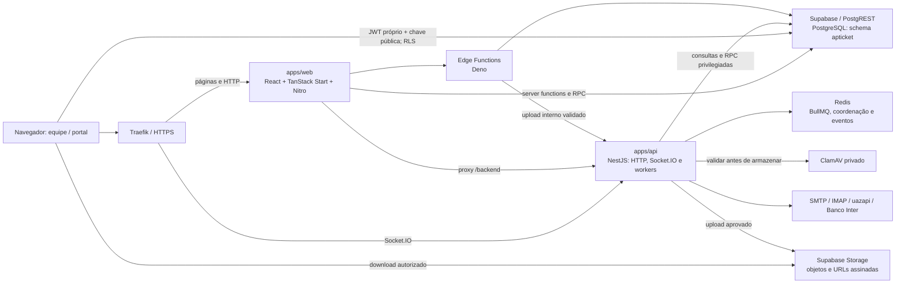

# APTicket — arquitetura, stack e padrões técnicos

**Referência:** 23/10/2026, America/Sao_Paulo.

**Código analisado:** commit `e14fcb8dc533e5a224ae129bc6e09957aa6ff472`.

**Público:** desenvolvimento, arquitetura, segurança, infraestrutura e sustentação.

Este documento descreve a implementação encontrada no repositório e as convenções para evoluí-la. Versões, limites e evidências são um retrato desta revisão; o lockfile e o código continuam sendo a fonte de verdade para versões posteriores. A inspeção da infraestrutura foi somente de leitura e não alterou serviços ou dados.

Quando uma prática é apresentada como orientação de evolução, isso não significa que já esteja aplicada de maneira uniforme a todo o legado. Os pontos conhecidos que exigem acompanhamento estão na seção 14.

## Índice

1. [Visão geral e decisões arquiteturais](#1-visão-geral-e-decisões-arquiteturais)
2. [Stack e versões](#2-stack-e-versões)
3. [Organização do monorepo](#3-organização-do-monorepo)
4. [Front-end e servidor web](#4-front-end-e-servidor-web)
5. [Back-end, integrações e processamento assíncrono](#5-back-end-integrações-e-processamento-assíncrono)
6. [Banco de dados e Supabase](#6-banco-de-dados-e-supabase)
7. [Identidade, sessões e autorização](#7-identidade-sessões-e-autorização)
8. [Políticas e controles de segurança](#8-políticas-e-controles-de-segurança)
9. [Anexos, Storage e ClamAV](#9-anexos-storage-e-clamav)
10. [Padrões de desenvolvimento](#10-padrões-de-desenvolvimento)
11. [Ambientes e configuração](#11-ambientes-e-configuração)
12. [Qualidade e testes](#12-qualidade-e-testes)
13. [Publicação, operação e recuperação](#13-publicação-operação-e-recuperação)
14. [Limites atuais e acompanhamento](#14-limites-atuais-e-acompanhamento)
15. [Como implementar uma nova funcionalidade](#15-como-implementar-uma-nova-funcionalidade)
16. [Fontes e documentação relacionada](#16-fontes-e-documentação-relacionada)

## 1. Visão geral e decisões arquiteturais

O APTicket é um sistema de Help Desk e PSA para MSPs, com tickets, canais de comunicação, portal do cliente, base de conhecimento, cadastros, contratos, financeiro e administração de acessos.

Sua arquitetura combina uma aplicação web full stack, uma API modular e o Supabase self-hosted. O banco, o serviço de autenticação da plataforma e parte da infraestrutura são compartilhados com outros sistemas. O schema de negócio do APTicket é `apticket`.

### 1.1 Componentes e fronteiras



O diagrama é lógico: não implica que todas as portas ou todos os componentes estejam publicados na Internet.

| Decisão                                 | Aplicação no projeto                                | Consequência técnica                                                                   |
| --------------------------------------- | --------------------------------------------------- | -------------------------------------------------------------------------------------- |
| Monorepo pnpm                           | Dois apps e pacotes compartilhados, com um lockfile | Mudanças de contrato podem ser revisadas e testadas no mesmo commit                    |
| Web full stack                          | TanStack Start também executa código servidor       | `apps/web` não pode ser publicado somente como arquivos estáticos                      |
| API modular NestJS                      | Módulos de domínio e workers na mesma aplicação     | Há duas unidades principais de deploy; cada módulo não é um microsserviço independente |
| Banco com regras próprias               | RLS, grants, constraints, triggers e funções SQL    | Parte da autorização e das transações reside no PostgreSQL                             |
| Sessão própria compatível com PostgREST | JWT emitido pelo APTicket                           | Perfis do sistema não dependem de uma linha correspondente em `auth.users`             |
| Filas e estado compartilhado            | BullMQ e Redis                                      | Repetição de tarefas, coordenação e comunicação entre instâncias                       |
| Controle central de anexos              | API + ClamAV + contrato de Storage                  | Produtores precisam publicar arquivos pelo fluxo aprovado                              |

### 1.2 Escolha do caminho de execução

| Necessidade                                                        | Caminho utilizado                                                          |
| ------------------------------------------------------------------ | -------------------------------------------------------------------------- |
| Leitura/CRUD já protegido por RLS                                  | Cliente Supabase no navegador ou função servidor com identidade do usuário |
| Operação web que exige segredo ou fluxo de autenticação            | Server function / módulo `*.server.ts` no web                              |
| Canal de comunicação, webhook, processamento contínuo ou WebSocket | API NestJS                                                                 |
| Transação de negócio, integridade e autorização no banco           | RPC/função SQL, constraints e triggers                                     |
| Operação financeira ou serviço na infraestrutura de funções        | Edge Function Deno, com validação específica                               |

O critério não é mover todo acesso ao banco para a API. A escolha deve preservar a fronteira de confiança, evitar duplicação de regras e manter as transações no componente adequado.

## 2. Stack e versões

As versões abaixo foram conferidas nas dependências instaladas do checkout. Os manifests podem usar intervalos semânticos; a instalação reproduzível é definida por `pnpm-lock.yaml`.

| Camada             | Tecnologia                                       | Versão/referência nesta revisão                 | Uso                                               |
| ------------------ | ------------------------------------------------ | ----------------------------------------------- | ------------------------------------------------- |
| Runtime            | Node.js                                          | Imagens Node 22; web/API observados em v22.23.4 | Servidor web, API e ferramentas                   |
| Workspaces         | pnpm                                             | 11.22.0, fixado em `packageManager`             | Instalação, scripts e dependências compartilhadas |
| Linguagem          | TypeScript                                       | 5.9.3 instalado nos dois apps                   | Código tipado                                     |
| Interface          | React / React DOM                                | React 19.2.8 instalado                          | Componentes e renderização                        |
| Web full stack     | TanStack Start                                   | 1.168.60                                        | Funções servidor e integração web                 |
| Rotas              | TanStack Router                                  | 1.170.41                                        | Rotas por arquivos, layouts e navegação           |
| Build web          | Vite                                             | 8.2.4                                           | Desenvolvimento e compilação                      |
| Runtime web        | Nitro                                            | 3.0.260603-beta                                 | Saída Node com `NITRO_PRESET=node-server`         |
| Configuração Vite  | `@lovable.dev/vite-tanstack-config`              | 2.8.5 no manifest                               | Integra plugins e convenções existentes           |
| Estado remoto      | TanStack Query                                   | 5.101.4                                         | Cache, consultas, mutations e invalidação         |
| Estilos            | Tailwind CSS                                     | 4.3.3 instalado                                 | Tokens e composição visual                        |
| Componentes        | shadcn/ui + Radix UI                             | shadcn `new-york`; versões Radix no lockfile    | Controles acessíveis, código local                |
| Ícones             | Lucide React                                     | 0.575.0                                         | Menus, ações e estados                            |
| Formulários        | React Hook Form + Zod                            | RHF 7; Zod 4.4.3                                | Formulários e schemas de validação                |
| API                | NestJS / Express                                 | Nest core 11.2.1                                | Módulos, controllers, guards e DI                 |
| Contratos HTTP     | class-validator / class-transformer              | Versões no lockfile                             | DTOs de entrada                                   |
| Banco/API de dados | Supabase JS                                      | 2.112.3 instalado nos dois apps                 | PostgREST, RPC e Storage                          |
| Banco              | PostgreSQL / Supabase self-hosted                | **17.6 observado em produção em 23/10/2026**    | Persistência e regras de dados                    |
| Filas              | BullMQ / ioredis                                 | 6.1.2 / 6.0.0                                   | Jobs e estado Redis                               |
| Tempo real         | Socket.IO                                        | 4.8.3                                           | Chat; adapter Redis para múltiplas instâncias     |
| E-mail             | Nodemailer / ImapFlow / Mailparser               | Nodemailer 10.1.7; demais no lockfile           | SMTP, polling IMAP e parsing                      |
| Anexos             | file-type + worker_threads                       | file-type 22.2.0                                | Identificação de conteúdo com recursos limitados  |
| Antivírus          | ClamAV                                           | Imagem fonte 1.5.4-debian, fixada por digest    | Varredura INSTREAM                                |
| Segurança HTML     | isomorphic-dompurify / DOMPurify                 | DOMPurify 3.4.17 via override                   | Sanitização de conteúdo rico                      |
| Edge               | Deno / Supabase Functions                        | CI utiliza Deno 2.9.6                           | Handlers financeiros e documentos                 |
| Qualidade          | ESLint, Prettier, Jest, pgTAP, Playwright        | Versões/configurações no repositório            | Análise estática e testes                         |
| Publicação         | GitHub Actions, Docker, Dokploy, Swarm e Traefik | Infraestrutura existente                        | CI, imagens, rollout e entrada HTTPS              |

Outras bibliotecas incluem Tiptap, Recharts, date-fns, Sonner, jsPDF e SheetJS. Sua presença atende edição rica, gráficos, datas, notificações e exportações; não implica uso em todas as telas.

## 3. Organização do monorepo

```text
APTicket/
├── apps/
│   ├── web/
│   │   ├── src/routes/              # páginas, layouts e endpoints web
│   │   ├── src/components/          # componentes de produto e UI
│   │   ├── src/lib/                 # domínio web, hooks, funções e módulos servidor
│   │   ├── src/integrations/        # clientes e tipos Supabase
│   │   ├── src/server.ts            # entrada HTTP e proteções transversais
│   │   └── Dockerfile
│   └── api/
│       ├── src/auth/                # JWT, guard e permissões
│       ├── src/channels/            # email, whatsapp e chat
│       ├── src/files/               # validação, antivírus e upload
│       ├── src/finance/             # régua de cobrança
│       ├── src/automations/         # dispatch e processamento de automações
│       ├── src/integrations/inter/  # callbacks bancários
│       ├── src/queue/               # Redis e nomes de filas
│       ├── src/crypto/              # criptografia de credenciais
│       ├── src/supabase/            # cliente privilegiado do servidor
│       └── Dockerfile
├── packages/
│   ├── shared-types/               # DTOs de resposta e tipos de banco
│   └── outbound-network/           # política de conexões externas
├── supabase/
│   ├── migrations/                 # evolução incremental do schema
│   ├── rollbacks/                  # reversões específicas existentes
│   ├── functions/                  # Edge Functions
│   └── tests/                      # testes SQL/pgTAP
├── scripts/                        # verificações funcionais e ferramentas
│   └── security/                   # testes HTTP, SQL, sessão, rede e manutenção
├── infra/                          # Compose, exemplos e scanner
├── docs/                           # guias funcionais, arquitetura e evidências
└── .github/workflows/security.yml   # pipeline obrigatório de verificações
```

`packages/shared-types` compartilha contratos de transporte e o tipo `Database`; os DTOs de entrada continuam sendo validados no componente que recebe a requisição. Um tipo TypeScript não substitui validação em runtime.

`packages/outbound-network/index.mjs` é a fonte ESM. O `index.cjs` é gerado por `build.mjs` para consumidores CommonJS; o CI verifica a sincronização. Alterar somente o arquivo gerado produz divergência.

## 4. Front-end e servidor web

### 4.1 Rotas, layouts e execução

- As rotas ficam em `apps/web/src/routes`. O TanStack gera `routeTree.gen.ts` a partir delas; mudanças de rota devem incluir a árvore gerada correspondente.
- `__root.tsx` estabelece providers de autenticação, tema e Query, conteúdo de head, scripts e tratamento de erros.
- O layout `_authenticated/route.tsx` usa `ssr: false`, aguarda a sessão e verifica acesso ao módulo. Isso convive com o servidor Node e com rotas públicas/handlers executados no servidor.
- `router.tsx` configura restauração de scroll, contexto de Query e nonce CSP.
- `server.ts` envolve o handler do framework com cabeçalhos de segurança, limite de corpo de server functions e tratamento de falhas SSR.
- O preset de produção é **Node**. O preset padrão da configuração não deve ser assumido: os Dockerfiles explicitam `NITRO_PRESET=node-server`.

Exemplo concreto: Configurações usa um layout, uma visão geral e 16 rotas de conteúdo. A hierarquia e as condições de acesso são compartilhadas por menu, diretório e proteção das páginas. Os grupos ocultam filhos sem acesso e usam ícones Lucide no padrão dos demais menus. Consulte [navegação das configurações](./configuracoes-navegacao.md).

### 4.2 Estado e acesso aos dados

| Tipo de estado                                    | Padrão utilizado                                         |
| ------------------------------------------------- | -------------------------------------------------------- |
| Formulário, seleção, modal e interação temporária | Hooks React locais                                       |
| Dados de servidor                                 | `useQuery` / `useMutation`                               |
| Sessão                                            | `AuthProvider` e `session.ts`                            |
| Tema                                              | `ThemeProvider` e tokens CSS                             |
| Permissões                                        | `usePermissions` e resolução SQL das permissões efetivas |

Configuração geral do QueryClient: `staleTime` de 60 segundos, `gcTime` de cinco minutos, uma repetição para consultas e nenhuma repetição automática para mutations. O foco da janela não provoca refetch geral; o hook de permissões possui política própria, com atualização a cada dez segundos e ao focar a janela.

Após uma mutation, os componentes invalidam as queries afetadas. Novos fluxos devem definir chaves que representem seus filtros/escopos, tratar carregamento, erro e vazio, e evitar repetição automática de operações com efeitos externos.

Os caminhos de dados coexistentes são:

1. `supabase.from(...)` e `rpc(...)` com JWT do usuário, sujeitos a grants e RLS.
2. Server functions com `createServerFn`, schemas de entrada e middleware de autenticação quando aplicável.
3. `backendClient` para a API, anexando Bearer à rota same-origin `/backend`.

O proxy remove o prefixo `/backend`, transmite o corpo com backpressure e retira headers hop-by-hop. Não realiza upgrade WebSocket; `/socket.io/` é roteado pela borda para a API.

### 4.3 Interface e design system

- Componentes locais em `components/ui`, baseados em shadcn/Radix, com estilo `new-york`.
- Tailwind e variáveis semânticas em `styles.css`: background, foreground, primary, muted, destructive, bordas e cores de sidebar.
- Identidade Deep Navy/Teal; fontes Inter e JetBrains Mono, com fallbacks do sistema.
- Ícones Lucide; menus principais usam normalmente 16 px e subitens 14 px, mantendo a cor do estado do item.
- Formulários usam controles existentes, máscaras, componentes monetários/quantitativos e schemas Zod; React Hook Form é utilizado em partes do sistema, sem presumir que todos os formulários foram migrados.
- Feedback por Sonner, notices e estados de ação. Permissões de edição precisam afetar controles e envio, além da visibilidade do menu.
- Rich text é sanitizado com DOMPurify antes de renderização nos fluxos existentes que inserem HTML.

A evolução de interface deve preservar navegação por teclado, labels, foco visível, fechamento correto de modais e comportamento em desktop/tablet/celular. Reutilize os componentes do produto antes de criar variantes.

## 5. Back-end, integrações e processamento assíncrono

### 5.1 Organização NestJS

`AppModule` compõe Auth, Supabase, Crypto, Queue, Files, Email, WhatsApp, Chat, Inter, Finance e Automations.

O padrão predominante é:

```text
Controller → DTO/schema → Guard/contexto autenticado → Service
                                                ├── Supabase/RPC
                                                ├── fila/worker
                                                └── integração externa
```

Controllers tratam o contrato HTTP; services concentram coordenação e regras da operação; processors executam jobs. A injeção de dependências é feita pelo Nest. O bootstrap aplica `ValidationPipe({ whitelist: true, transform: true })`; esse ajuste remove propriedades não previstas nos DTOs, sem equivaler a uma validação completa das regras de negócio.

`@RequirePermission` expressa o módulo/ação exigidos. `@Public` retira a exigência do JWT de usuário, mas não autoriza omitir a autenticação própria de webhooks e rotas internas.

### 5.2 Módulos e responsabilidades

| Módulo      | Responsabilidade                                                           |
| ----------- | -------------------------------------------------------------------------- |
| Email       | Configuração de conta, polling IMAP, parsing, recebimento, resposta e SMTP |
| WhatsApp    | Configuração uazapi, webhook, mensagens, mídias e notificações             |
| Chat        | HTTP de envio, gateway Socket.IO, rooms, presença e eventos                |
| Inter       | Recepção, normalização, persistência e verificação de callbacks            |
| Finance     | Agendamento e dispatch da régua de cobrança                                |
| Automations | Busca e processamento de automações pendentes                              |
| Files       | Autorização de upload, classificação de conteúdo, ClamAV e armazenamento   |
| Crypto      | AES-256-GCM das credenciais de integração                                  |
| Queue       | Conexão Redis, filas e coordenação                                         |

### 5.3 Filas e idempotência

Filas declaradas: `email-polling`, `email-send`, `whatsapp-inbound`, `whatsapp-outbound`, `notification-fanout`, `inter-webhook`, `collection` e `automations`. A declaração de um nome não garante que todo fluxo de saída já o utilize; alguns services enviam diretamente.

O polling de e-mail usa agendamento por tenant, a régua possui agendamento a cada 15 minutos e o dispatcher de automações a cada 15 segundos. Intervalos e retenção de jobs são definidos nos schedulers/processors correspondentes.

Jobs podem ser repetidos. O webhook WhatsApp, por exemplo, configura três tentativas e backoff exponencial. Identificadores, locks, estado persistido e verificações de duplicidade devem impedir que uma repetição gere efeitos indevidos. **Fila não oferece garantia de efeito exatamente uma vez**; cada integração precisa tratar idempotência e falhas parciais.

### 5.4 Tempo real e webhooks

O ChatGateway autentica antes de completar o handshake, verifica perfil, tenant, versão da sessão e permissões, e revalida a sessão nos pacotes recebidos. A entrada em rooms e o envio passam por controles do ticket. O Redis adapter permite propagar eventos entre instâncias.

O webhook WhatsApp valida segredo próprio do tenant, aplica limites Redis e enfileira o recebimento. O Inter usa token de callback, normalização de payload, persistência/aceite por RPC e processamento posterior. Callbacks financeiros não devem ser tratados como prova suficiente de quitação sem as verificações de negócio implementadas.

## 6. Banco de dados e Supabase

### 6.1 Modelo de acesso

O PostgreSQL é fonte de verdade para entidades, vínculos, permissões, estados e transações. O projeto utiliza Supabase JS/PostgREST e RPCs; não adota um ORM como Prisma ou TypeORM para esse acesso.

| Origem                                  | Credencial/contexto                         | Proteção principal                                                                 |
| --------------------------------------- | ------------------------------------------- | ---------------------------------------------------------------------------------- |
| Navegador                               | Chave pública + JWT próprio                 | Grants, RLS e funções com checagem de identidade                                   |
| Server function com client do usuário   | Bearer do usuário                           | RLS, pre-request e checagens da função                                             |
| API ou operação administrativa servidor | Service role                                | Guard, autorização do recurso e escopo explícito no service/RPC                    |
| Portal                                  | Token próprio do contato, validado pelo web | Contato ativo, empresa, tenant e permissão específica antes do acesso privilegiado |

Service role pode ultrapassar RLS. Portanto, **a API não pode depender de RLS para corrigir uma consulta privilegiada sem escopo**. Deve obter o tenant do contexto verificado, validar os vínculos do recurso e filtrar as consultas. A diferença entre grants e políticas RLS é descrita na [documentação oficial do Supabase](https://supabase.com/docs/guides/database/postgres/row-level-security).

### 6.2 Regras e isolamento

- `tenant_id` identifica a organização nas entidades que possuem esse escopo.
- Helpers como `current_tenant_id()` e `has_permission(...)` participam da autorização SQL.
- Há escopo adicional por empresa operadora nos domínios financeiros aplicáveis.
- Constraints, FKs, índices, triggers e RPCs preservam integridade, unicidade, transições e operações atômicas.
- Contratos de clientes e de fornecedores possuem módulos de permissão independentes; o módulo histórico `contratos` continua representando clientes.
- Admin de sistema tem acesso integral **dentro da própria organização**. Isso não concede acesso cruzado entre tenants.

Funções `SECURITY DEFINER` e signers são fronteiras privilegiadas. Ao evoluí-las, revisar owner, `search_path`, grants de execução, identidade e escopo. Não conceder EXECUTE amplo apenas para contornar um erro de permissão.

### 6.3 Migrations e tipos

O repositório utiliza migrations SQL incrementais, com arquivos de reversão para mudanças que os possuem. Não alterar uma migration já aplicada: criar nova mudança compatível e registrar sua execução.

Uma alteração de dados deve considerar, além do DDL, backfill, grants, RLS, RPCs, triggers, Storage e compatibilidade com consumidores antigos. Atualizar os tipos de banco e DTOs afetados; um tipo compilando não garante que o schema implantado tenha a mesma assinatura.

Operações de negócio que exigem atomicidade devem usar transação/RPC adequada, evitando simular uma transação com várias chamadas independentes do navegador.

## 7. Identidade, sessões e autorização

### 7.1 Usuários da equipe

O login atual consulta `apticket.profiles`, exige perfil ativo e `password_hash`, verifica bcrypt e emite JWT próprio. O custo bcrypt configurado é 12.

| Propriedade                         | Implementação atual                                                                               |
| ----------------------------------- | ------------------------------------------------------------------------------------------------- |
| Assinatura de sessão                | HS256 com `JWT_SECRET`                                                                            |
| Compatibilidade                     | Mesmo segredo de validação configurado para o PostgREST                                           |
| Claims relevantes                   | `sub`, `role=authenticated`, `aud=authenticated`, `app=apticket`, `tenant_id` e `session_version` |
| Validade do token emitido           | Sete dias                                                                                         |
| Estado no navegador                 | `localStorage`, gerenciado por `session.ts`                                                       |
| Refresh automático do Supabase Auth | Desabilitado nesse client                                                                         |
| Convite                             | Token aleatório; hash SHA-256 persistido; TTL de sete dias                                        |
| Recuperação                         | Token aleatório; hash persistido; TTL de uma hora                                                 |

O navegador decodifica a sessão para compor a interface; isso não valida sua autenticidade. A assinatura e os dados vigentes são verificados no servidor/banco. O fluxo atual não usa `supabase.auth.setSession()` para hidratar esses perfis.

### 7.2 Revogação

Alterações de credenciais incrementam a versão de sessão protegida no banco. A recuperação invalida as sessões anteriores; a troca voluntária no perfil renova a sessão atual usando compare-and-set para não sobrescrever uma troca concorrente.

A API e o gateway comparam versão, atividade e tenant. O hook PostgREST `apticket_auth_private.check_session` verifica tokens com `app=apticket` e rejeita sessões revogadas, preservando a separação em relação aos outros consumidores do Supabase compartilhado.

Respostas 401 da API/PostgREST removem a sessão rejeitada do navegador; uma resposta atrasada de um token antigo preserva uma sessão que já tenha sido renovada.

### 7.3 Papéis e permissões

O catálogo associa módulos a ações como `view`, `create`, `edit` e `delete`, além de ações específicas de certos domínios. Papéis agregam concessões; exceções individuais complementam a resolução efetiva em `get_effective_permissions`.

O papel Admin de sistema é identificado pelo marcador protegido de papel de sistema. Seu acesso integral não depende somente do texto “Admin”; overrides não restringem esse papel. Alterações de papel/delegação possuem verificações próprias para impedir escalada indevida.

A interface usa `permission-catalog.ts`, `usePermissions` e `permission-ui.tsx`. Ocultar um item é uma medida de experiência do usuário; as operações continuam exigindo autorização no servidor/banco.

### 7.4 Portal do cliente

O portal usa identidade de contato, distinta da sessão dos usuários da equipe:

1. Solicitação de OTP por e-mail, com resposta genérica e limites de tentativa.
2. Validação do código, validade, número de tentativas e consumo.
3. Emissão de token assinado por HMAC-SHA256 com `PORTAL_SESSION_SECRET`, válido por 30 minutos por padrão.
4. Reconsulta do contato ativo, tenant, empresa e flags do portal ao autorizar requisições.
5. Aplicação do escopo do ticket/documento antes de consultar ou assinar objetos.

Os endpoints de portal ficam sob `/api/public/portal`; “public” no caminho não significa acesso irrestrito aos dados.

## 8. Políticas e controles de segurança

### 8.1 Segredos e criptografia

- Nunca colocar service role, `JWT_SECRET`, chave AES, segredos de portal ou credenciais de integração em variáveis `VITE_*`.
- Variáveis `VITE_*` entram no bundle do navegador; apenas valores públicos apropriados podem usá-las.
- `SECRETS_ENCRYPTION_KEY` possui 32 bytes em hexadecimal. O serviço Crypto usa AES-256-GCM com IV aleatório de 12 bytes e authentication tag.
- Credenciais IMAP/SMTP e tokens uazapi são cifrados antes de persistência. Os forms não recuperam os valores salvos em claro; omitir um valor pode preservar a credencial existente.
- Os grants de leitura/escrita de credenciais foram restringidos nos lotes de segurança. Chaves/certificados da integração bancária possuem contrato próprio de armazenamento e uso servidor.
- Arquivos `.env`, dados reais, chaves e dumps de clientes não devem entrar no Git.

O mecanismo AES protege credenciais específicas. Ele não significa que todas as colunas do banco ou todos os volumes estejam cifrados pela aplicação.

### 8.2 Limites de autenticação

O contador compartilhado de autenticação/portal usa RPC PostgreSQL atômica, com chaves derivadas por HMAC. Não é um contador local por processo. A indisponibilidade do contador recusa a operação protegida.

| Fluxo                        | Limite implementado                                                 |
| ---------------------------- | ------------------------------------------------------------------- |
| Login                        | 10 tentativas por identidade/15 minutos e 100 por origem/15 minutos |
| Recuperação de senha         | 5 por identidade/15 minutos, mais proteção por origem               |
| Conclusão de reset/convite   | 5 por hash do token/15 minutos, mais proteção por origem            |
| Cadastro                     | 5 por origem/hora                                                   |
| Solicitação de OTP do portal | 5 por e-mail/15 minutos e 8 por origem/10 minutos                   |

Há limites adicionais por endpoint, inclusive verificação de OTP, perfil e webhooks. Excesso retorna resposta controlada e, nos fluxos de autenticação descritos, HTTP 429/`Retry-After`. Não há bloqueio permanente de conta nessa política.

A extração da origem no web pressupõe a cadeia de proxy documentada no código: o ingresso confiável acrescenta o peer ao `X-Forwarded-For`. Mudanças na cadeia de proxies exigem revisar essa premissa.

### 8.3 Proteção HTTP e HTML

| Controle                   | Aplicação atual                                                                           |
| -------------------------- | ----------------------------------------------------------------------------------------- |
| CSP web                    | Nonce novo por resposta; scripts com `strict-dynamic`, sem liberação geral de inline/eval |
| CSS                        | CSP permite inline styles e os provedores de fonte configurados                           |
| Fontes, imagens e conexões | Diretivas próprias; `connect-src` ainda permite HTTPS/WSS de forma ampla                  |
| HSTS                       | Ativado conforme URL/origem HTTPS, sem `includeSubDomains` global                         |
| MIME sniffing              | `X-Content-Type-Options: nosniff`                                                         |
| Frames                     | Web `SAMEORIGIN`; API `DENY`                                                              |
| Cache HTML                 | `private, no-store` para evitar reutilização indevida do nonce                            |
| CORS API                   | Origem configurada por `CORS_ORIGIN`                                                      |
| HTML rico                  | DOMPurify nos pontos de renderização existentes                                           |
| Zod no browser             | Modo sem JIT, compatível com a CSP adotada                                                |

CORS não substitui autenticação/autorização. A CSP também não é um sanitizador; as duas medidas têm funções complementares.

O servidor limita o corpo de POST em `/_serverFn/` a 4 MiB **antes da desserialização**, incluindo envio chunked. Esse limite não deve ser confundido com o limite de arquivos multipart na API.

### 8.4 SSRF, integrações e TLS

O pacote `@apticket/outbound-network` centraliza controles para destinos externos configuráveis: normalização de host, recusa de endereços privados/reservados, resolução DNS, conexão aos endereços validados, controle de redirecionamentos, timeout e limite de bytes, incluindo conteúdo descomprimido.

As integrações de e-mail preservam verificação de certificado/nome e os requisitos de TLS/STARTTLS cobertos pelos testes. Não remover verificações de certificado como solução para falhas de conexão.

Supabase, API e scanner são destinos internos controlados pelo operador, acessados por clientes próprios. Isso não abre uma permissão genérica para tenants cadastrarem hosts privados.

### 8.5 Cadeia de fornecimento e dados sensíveis

O workspace centraliza overrides de dependências com correções de segurança, controla scripts de instalação e utiliza lockfile único. O CI roda auditoria de dependências e Gitleaks do histórico alcançável, com saída redigida e binário verificado.

Logs e evidências devem priorizar IDs de correlação, estado, códigos de erro, contagens e hashes necessários. Não registrar senhas, Bearer, chaves, corpos de mensagens ou arquivos de clientes. O sistema contém dados pessoais e financeiros; políticas organizacionais de retenção, atendimento a titulares e descarte precisam ser definidas pelo responsável pelo tratamento, sem presumir que o código sozinho comprove conformidade regulatória.

## 9. Anexos, Storage e ClamAV

### 9.1 Fluxo central

```mermaid
sequenceDiagram
  participant P as Navegador / produtor interno
  participant A as API Files
  participant V as Worker de conteúdo
  participant C as ClamAV
  participant D as Banco / recibo
  participant S as Storage
  P->>A: multipart com destino e arquivo
  A->>A: autenticação, capacidade, parsing limitado e autorização
  A->>V: bytes, extensão e MIME declarado
  V-->>A: classificação válida ou recusa
  A->>C: INSTREAM privado
  C-->>A: limpo / infectado / indisponível
  alt arquivo aprovado
    A->>D: criar recibo curto vinculado ao objeto
    A->>S: gravar objeto com metadata de recibo
    S->>D: validar e consumir recibo
    A-->>P: caminho do objeto
  else recusa ou falha
    A-->>P: erro controlado; sem publicar arquivo
  end
```

### 9.2 Política efetiva

| Aspecto                                 | Regra                                                                                                |
| --------------------------------------- | ---------------------------------------------------------------------------------------------------- |
| Limite geral                            | 25 MiB por arquivo                                                                                   |
| Bucket de tickets                       | Até 25 MiB                                                                                           |
| Demais buckets de upload desta política | Até 10 MiB                                                                                           |
| Avatar                                  | Até 2 MiB                                                                                            |
| Tipos                                   | PDF, imagens permitidas, texto estruturado/simples, Office, ZIP e formatos de áudio/vídeo aprovados  |
| Conteúdo recusado                       | Executáveis, HTML/SVG ativo, extensão/MIME incompatíveis e arquivos infectados                       |
| Recursos de detecção                    | Worker limitado em tempo e memória                                                                   |
| Capacidade                              | Limites locais de quatro uploads/verificações simultâneos por processo nos controles correspondentes |
| Scanner indisponível                    | Recusa do armazenamento; não aprovar por timeout                                                     |

Buckets cobertos: `ticket-attachments`, `kb-attachments`, `client-documents`, `funcionario-documentos`, `funcionario-beneficios`, `supplier-payment-receipts`, `supplier-payable-attachments` e `apticket-profile-avatars`.

A implementação usa buffering limitado para analisar bytes. O uso de INSTREAM não significa que todo o upload da aplicação seja processado sem consumo de memória.

### 9.3 Fronteiras de confiança

`POST /files/upload` exige usuário autenticado e autorização do destino. `POST /files/internal-upload` é destinado aos produtores confiáveis e exige credencial interna verificada antes do parser; o produtor mantém suas checagens de domínio. A API é alcançada pelo navegador via `/backend/files/upload`.

Após aprovação, o comprovante de varredura é vinculado a bucket, caminho, tamanho e SHA-256, possui validade curta e é consumido uma única vez. É um contrato interno da aplicação; não é um certificado emitido pelo ClamAV.

Policies/triggers fecham gravações diretas nos buckets controlados e exigem o recibo inclusive dos produtores privilegiados. Isso não altera automaticamente os buckets dos outros sistemas hospedados no mesmo Supabase.

O vínculo do anexo com tenant/ticket e a visibilidade da mensagem também controlam a emissão de URLs. Um arquivo existir ou estar limpo não concede permissão de leitura. URLs assinadas já emitidas continuam válidas até seu vencimento original, independentemente de uma revogação posterior de JWT.

### 9.4 Operação do scanner

ClamD opera em rede privada, sem porta publicada; sua porta configurada é 3310. A imagem está fixada por digest, as assinaturas persistem em volume, o Compose limita memória a 4 GiB e CPU a 1,5. FreshClam baixa assinaturas; o motor precisa efetivamente carregá-las.

A configuração desativa recarga concorrente para reduzir pico de memória, podendo causar recusa temporária de uploads durante recarga. Essa relação entre memória e indisponibilidade é descrita na [documentação oficial do ClamAV](https://docs.clamav.net/manual/Installing/Docker.html).

O healthcheck do daemon e um teste EICAR não certificam atualização das assinaturas em memória. Há observação operacional pendente no guia, detalhada na seção 14. Procedimento completo: [implementação e operação do ClamAV](./security/guia-implementacao-clamav.md).

## 10. Padrões de desenvolvimento

### 10.1 Linguagem, estilo e organização

- TypeScript para contratos e implementação; SQL para schema e transações de banco.
- `strict: true` no web. A API habilita `strictNullChecks`, mas não todo o modo strict; não descrevê-la como totalmente strict.
- ESLint e Prettier conforme a configuração de cada app. Há também configuração de lint de segurança na raiz.
- Alias `@/` no web. Nest segue imports relativos e módulos de domínio.
- Separar arquivos de servidor e código que pode alcançar o browser. O projeto não usa o pacote `server-only` de Next.js; seguir a convenção `*.server.ts` e os mecanismos do TanStack.
- `*.functions.ts` identifica módulos com server functions; `*.schema.ts` concentra schemas quando a separação é útil.
- API usa `*.controller.ts`, `*.service.ts`, `*.module.ts`, `*.processor.ts`, DTOs e `*.spec.ts`.

As configurações de lint permitem exceções e avisos no legado. Um pipeline aprovado não implica ausência de avisos nem equivalência ao conjunto máximo de regras do TypeScript.

### 10.2 Entrada, saída e erros

1. Validar entradas no receptor com Zod ou DTO/class-validator.
2. Obter identidade e tenant da sessão/contexto verificado; um campo enviado pelo cliente não prova autorização.
3. Consultar o recurso dentro do escopo e aplicar a ação exigida.
4. Preservar invariantes no banco e evitar retornar campos sensíveis.
5. Converter falhas em respostas úteis, sem expor detalhes internos ao usuário.
6. No web, reutilizar `getUserFacingError` e tratamento de sessão quando adequado.

`packages/shared-types` deve representar o contrato realmente utilizado. Não criar tipos duplicados de request que deixem de acompanhar a validação runtime.

### 10.3 Concorrência e efeitos externos

Preferir operação atômica para consumo de tokens, alterações financeiras e reivindicação de trabalhos. Verificar versões/estado ao atualizar registros concorrentes; não sobrescrever alterações apenas porque o formulário carregou antes.

Antes de reexecutar um job, considerar se um e-mail, cobrança ou mensagem já foi enviado. Persistir estado e identificadores do provedor quando o fluxo os exigir. Retentativas de transporte não substituem reconciliação de negócio.

### 10.4 Git e revisão

O fluxo de publicação existente é GitHub → Dokploy, com branch conectada `main`. Os commits do branch conectado também sincronizam com o Lovable; o `AGENTS.md` proíbe reescrever histórico publicado com force push, rebase/amend de commits já enviados.

Preferir alterações revisáveis, com descrição do comportamento, validações executadas, compatibilidade e reversão quando aplicável. Preservar arquivos locais do usuário que não pertençam à tarefa.

## 11. Ambientes e configuração

### 11.1 Variáveis por responsabilidade

Somente nomes e finalidade são documentados aqui. Os valores reais pertencem ao gerenciador de configuração da infraestrutura.

| Variável                        | Consumidor                        | Finalidade / classificação                       |
| ------------------------------- | --------------------------------- | ------------------------------------------------ |
| `VITE_SUPABASE_URL`             | Browser/build web                 | Endpoint público da plataforma                   |
| `VITE_SUPABASE_PUBLISHABLE_KEY` | Browser/build web                 | Chave pública; acesso depende de autorização/RLS |
| `VITE_API_URL`                  | Browser/build web                 | Origem pública utilizada pelo chat               |
| `SUPABASE_URL`                  | Servidores                        | Endpoint de acesso da aplicação                  |
| `SUPABASE_PUBLISHABLE_KEY`      | Web servidor                      | Client no contexto do usuário                    |
| `SUPABASE_SERVICE_ROLE_KEY`     | Web/API/serviços autorizados      | Segredo privilegiado                             |
| `JWT_SECRET`                    | Web/API/PostgREST                 | Segredo de emissão/validação da sessão           |
| `PORTAL_SESSION_SECRET`         | Web servidor                      | Assinatura do token do contato                   |
| `SECRETS_ENCRYPTION_KEY`        | API                               | Cifra das credenciais de integração              |
| `INTERNAL_BACKEND_URL`          | Web servidor                      | Destino interno do proxy da API                  |
| `APTICKET_API_URL`              | Edge/produtores                   | Endpoint do upload central, conforme runtime     |
| `REDIS_URL`                     | API                               | Filas, coordenação e eventos                     |
| `CLAMAV_HOST` / `CLAMAV_PORT`   | API                               | Scanner privado definido pelo operador           |
| `PUBLIC_SITE_URL`               | Web servidor                      | Links e comportamento HTTPS                      |
| `CORS_ORIGIN`                   | API                               | Origem autorizada                                |
| `SMTP_*` / `SMTP_CLIENT_NAME`   | Produtor de e-mail correspondente | Transporte e identidade SMTP                     |
| `SWAGGER_ENABLED`               | API                               | Exposição opcional da documentação HTTP          |
| `PORT` / `NODE_ENV`             | Runtime                           | Inicialização de cada aplicação                  |

O schema de ambiente da API é validado por Zod no boot. O web valida variáveis em seus módulos consumidores; não há evidência de um único schema equivalente cobrindo todo o web.

### 11.2 Preparação local

Pré-requisitos: Node compatível com o projeto (Node 22 reproduz o runtime de produção), pnpm fixado pelo Corepack, ambiente Supabase de desenvolvimento, Redis acessível e configuração de scanner quando forem exercitados uploads.

```sh
corepack enable
pnpm install --frozen-lockfile
pnpm dev:web
# Em outro terminal:
pnpm --filter api start:dev
```

Configurar previamente as variáveis do ambiente local. `infra/.env.example` é uma referência; o ambiente de execução precisa recebê-las efetivamente. Não copiar credenciais de produção para exemplos, fixtures ou scripts de teste.

A API usa porta 3001 por padrão. A porta efetiva do web aparece no Vite. O Compose de referência mantém Redis acessível entre seus containers; não presumir que a porta Redis esteja publicada para processos iniciados no host.

## 12. Qualidade e testes

### 12.1 Verificações do pipeline

O workflow `security.yml` executa em pull requests, push para `main` e disparo manual. Permissão do workflow: `contents: read`; ações externas estão fixadas por SHA.

| Job               | Cobertura                                                                                                             |
| ----------------- | --------------------------------------------------------------------------------------------------------------------- |
| application       | Typechecks web/API, navegação/permissões, testes Jest, builds, rede, HTTP, sessões, limites, SMTP/TLS, Edge e linters |
| dependencies      | Audit e validação do resultado conforme política do repositório                                                       |
| secrets           | Gitleaks do histórico Git alcançável                                                                                  |
| session-isolation | Contrato de sessão/OTP e isolamento em ambiente descartável                                                           |
| full-sql          | Baseline estrutural, migrations posteriores, pgTAP, regressões e backfills                                            |

Os testes HTTP recebem chaves fictícias e destinos loopback. Testes Edge usam restrições de rede e ambiente. A suíte SQL completa cria um container descartável sem rede externa, sem volumes do host e sem portas publicadas, com catálogos sintéticos e cron desabilitado.

O baseline SQL é DDL/grants/catálogos de referência, não um dump de clientes. As factories e chaves de teste não devem ser instaladas em produção.

A cobertura inclui probes contra acesso entre tenants e testes positivos específicos de domínio. Isso não representa prova exaustiva de toda combinação possível de CRUD, papel e regra de negócio.

### 12.2 Comandos de referência

```sh
pnpm --filter web exec tsc --noEmit
pnpm --filter api exec tsc --noEmit
pnpm --filter api exec jest --runInBand
pnpm --filter api build
pnpm --filter web lint
pnpm --filter api exec eslint 'src/**/*.ts' 'test/**/*.ts'
pnpm test:security-lint
pnpm lint:security
node scripts/security/test-settings-navigation.mjs
node --test packages/outbound-network/test/network.test.cjs
node packages/outbound-network/build.mjs --check
```

Build do web em shell POSIX:

```sh
NITRO_PRESET=node-server pnpm --filter web build
pnpm test:security-http
```

Em PowerShell:

```powershell
$env:NITRO_PRESET = "node-server"
pnpm --filter web build
pnpm test:security-http
```

SQL isolado, com Python 3 e Docker:

```sh
python3 scripts/security/run-session-isolation.py
python3 scripts/security/run-full-sql.py
```

O runner recusa reutilizar um container de teste já existente. Verificar sua finalidade antes de qualquer limpeza; não adaptar o comando para apontar ao banco de produção.

### 12.3 Validação de interface

Há scripts Playwright por funcionalidade em `scripts`. Não presumir que todos estejam incluídos no job padrão ou que exista um comando único de e2e para todo o produto.

Para a navegação de Configurações, `scripts/test-settings-navigation-ui.mjs` utiliza a aplicação compilada e APIs fictícias. Requer os caminhos `PLAYWRIGHT_MODULE` e `PLAYWRIGHT_CHROMIUM`; verifica páginas, histórico, deep links, responsividade e restrições de acesso. Evidências devem conter dados sintéticos.

Alterações visuais devem ser abertas no navegador, com conferência de console, teclado e desktop/tablet/celular. Usar testes proporcionais ao comportamento alterado, sem criar testes que apenas reproduzam detalhes da implementação.

### 12.4 Evidência desta base

O [CI do código analisado](https://github.com/APTechSolucoesTI/ticket/actions/runs/39966351808) aprovou os cinco jobs. É evidência do commit indicado, não uma promessa de que uma futura atualização de dependência ou mudança de infraestrutura continuará aprovada.

## 13. Publicação, operação e recuperação

### 13.1 Fluxo de deploy

1. Preparar código, schema, contratos e validações necessários.
2. Versionar e enviar ao GitHub; aguardar os checks aplicáveis.
3. Aplicar migrations conforme dependências entre versões.
4. Fazer o Dokploy compilar a partir da raiz do monorepo, com o Dockerfile do app correspondente.
5. Aguardar conclusão do build **e** da atualização do serviço Swarm.
6. Conferir revisão do checkout, novo container, endpoints e invariantes afetadas.
7. Restaurar a política normal de auto deploy se ela foi temporariamente suspensa para um rollout ordenado.

Em mudanças incompatíveis, usar expansão/contração: preparar contrato compatível, publicar consumidores e somente depois fechar o caminho antigo. O fechamento de Storage após atualização dos produtores é um exemplo existente.

Documentação sem alteração de runtime ou schema não exige migration nem reconstrução dos serviços. O envio ao GitHub deve preservar essa distinção.

### 13.2 Imagens e entrada HTTP

Os Dockerfiles são multi-stage. O web publica o output Nitro; a API compila o Nest e instala dependências de produção no runtime. As imagens Node usam a linha `22-bookworm-slim`, sem digest fixo nos Dockerfiles atuais; o patch pode mudar em um rebuild. A imagem do scanner possui digest fixado.

A entrada pública utiliza Traefik/HTTPS. REST da API passa por `/backend` no web; Socket.IO precisa de regra própria na borda. As portas internas usuais são 3000 para web, 3001 para API, 6379 para Redis e 3310 para ClamD; não são uma autorização para publicá-las.

`infra/docker-compose.yml` é referência de execução e inclui exposição da API e um profile de debug. Não equivale ao inventário efetivo do Dokploy. Não habilitar Redis Commander ou portas de debug por suposição em produção.

### 13.3 Operação e observabilidade

| Área        | O que acompanhar                                                          |
| ----------- | ------------------------------------------------------------------------- |
| Web         | Resposta de páginas, erros SSR, falhas de sessão e limites                |
| API         | `/health`, erros de integração, latência e saturação                      |
| Filas       | Jobs com falha, retries, atraso e ausência de processamento               |
| Redis       | Disponibilidade, persistência e uso de memória                            |
| Banco       | Conexões, espaço, duração de queries, falhas de transação e grants/RLS    |
| Anexos      | Recusas, scanner indisponível, capacidade e limpeza de falhas             |
| ClamAV      | Assinatura baixada versus carregada, recarga, memória e resposta INSTREAM |
| Integrações | Certificados, credenciais, callbacks e reconciliação                      |

Um `/health` HTTP 200 isolado não certifica entrega de e-mail, processamento de todos os jobs ou integridade das assinaturas do antivírus. O código possui logs, tratamento de erros web e ferramentas de diagnóstico; esta revisão não comprovou uma plataforma central completa de métricas, alertas e tracing distribuído.

### 13.4 Backup e recuperação

Os relatórios de segurança registram backups, restauração de ensaio e cópia externa cifrada preparados para manutenção do PostgreSQL. Isso é distinto de uma política automática recorrente de backup/PITR.

Recuperação completa exige considerar banco, objetos Storage, configuração, chaves de cifração/Vault e dependências da aplicação. Guardar um backup sem as chaves necessárias pode inviabilizar recuperar os dados protegidos.

Há scripts específicos de manutenção em `scripts/security`; não executá-los como uma rotina genérica de deploy. A janela afeta o Supabase compartilhado e precisa de procedimento validado para os outros sistemas. Falhas após retomada de gravações não podem ser tratadas restaurando silenciosamente um snapshot antigo e descartando dados novos.

## 14. Limites atuais e acompanhamento

| Item                  | Estado comprovado / implicação                                                                                                                                                                          |
| --------------------- | ------------------------------------------------------------------------------------------------------------------------------------------------------------------------------------------------------- |
| PostgreSQL            | Consulta somente de leitura nesta revisão retornou **17.6**. A preparação para 17.11 descrita nos relatórios não comprova atualização concluída; a manutenção permanece um assunto operacional separado |
| Assinaturas ClamAV    | O guia registra divergência observada entre `daily.cld` baixado e versão em memória. Esta revisão não atestou sua resolução; conferir recarga antes de ampliar o compartilhamento                       |
| Histórico de arquivos | O fluxo central protege novos uploads dos produtores cobertos; não foi demonstrada varredura geral de discos ou reprocessamento de todo acervo                                                          |
| Backup/PITR           | Há evidências de cópia/restauração para manutenção, sem confirmação de automação recorrente/PITR implantado                                                                                             |
| Sessão no navegador   | Token em localStorage e validade de sete dias; proteção contra XSS e revogação são partes importantes desse modelo                                                                                      |
| MFA                   | O fluxo de login descrito verifica senha; não demonstra etapa obrigatória de MFA                                                                                                                        |
| Privilégios da API    | Service role exige disciplina de autorização e filtro em cada novo fluxo                                                                                                                                |
| TypeScript API        | Configuração não habilita todas as opções strict                                                                                                                                                        |
| Dependência Nitro     | Versão beta fixada; mudanças de versão requerem regressão de SSR, serialização, CSP e proxy                                                                                                             |
| Credenciais legadas   | `SecretsService.decrypt` ainda aceita formato legado sem cifra; evidência anterior de banco sem valores nesse formato não elimina essa compatibilidade no código                                        |
| Observabilidade       | Logs/healthchecks existem; alertas, centralização e recuperação precisam de evidência própria                                                                                                           |
| Superadmin global     | Admin descrito é do tenant. Não foi identificado painel global de planos/tenants como parte desta implementação                                                                                         |

Esta seção registra limites observados; a criação deste documento não executa correções, atualizações de banco ou novas políticas de infraestrutura.

## 15. Como implementar uma nova funcionalidade

### 15.1 Fluxo de trabalho

1. Identificar domínio, atores, tenant/empresa e ação necessária.
2. Escolher entre RLS/client, função web, API, RPC e Edge conforme a tabela da seção 1.
3. Definir entrada/saída e preservar a compatibilidade com consumidores existentes.
4. Se houver schema, preparar migration incremental, grants, políticas, índices e transação de negócio; avaliar rollback/backfill.
5. Aplicar a permissão na navegação e na operação real, incluindo rotas diretas.
6. Implementar com componentes, clients e helpers existentes.
7. Para arquivos, usar o pipeline central; para destinos externos configuráveis, usar a política de saída.
8. Validar casos positivos, acesso negado, tenant estrangeiro, concorrência e falhas relevantes.
9. Rodar checks proporcionais e o pipeline obrigatório; revisar diffs e dados sensíveis.
10. Publicar na ordem das dependências e verificar o comportamento do novo runtime.

### 15.2 Critérios de entrega

| Dimensão   | Evidência esperada                                                     |
| ---------- | ---------------------------------------------------------------------- |
| Funcional  | Comportamento solicitado completo e revisável                          |
| Contrato   | Tipos, DTOs/schemas e assinaturas SQL compatíveis                      |
| Segurança  | Escopo de tenant/recurso, ações autorizadas e tratamento de segredos   |
| Dados      | Invariantes, atomicidade e migração/backfill quando necessários        |
| Interface  | Estados úteis, responsividade, teclado e console conferidos            |
| Operação   | Configuração, limites, falhas e reversão documentados conforme impacto |
| Publicação | Checks aprovados e serviços afetados verificados                       |

## 16. Fontes e documentação relacionada

### 16.1 Arquivos de implementação

- [Manifests e scripts da raiz](../package.json) e [workspace/overrides](../pnpm-workspace.yaml).
- [Manifest web](../apps/web/package.json), [configuração Vite](../apps/web/vite.config.ts), [router](../apps/web/src/router.tsx) e [entrada servidor](../apps/web/src/server.ts).
- [Manifest API](../apps/api/package.json), [bootstrap](../apps/api/src/main.ts), [módulos](../apps/api/src/app.module.ts) e [schema de ambiente](../apps/api/src/config/env.validation.ts).
- [Cliente Supabase web](../apps/web/src/integrations/supabase/client.ts), [cliente API](../apps/api/src/supabase/supabase.service.ts) e [guard da API](../apps/api/src/auth/supabase-auth.guard.ts).
- [Login](../apps/web/src/lib/auth.functions.ts), [JWT](../apps/web/src/lib/jwt.server.ts), [sessão do browser](../apps/web/src/lib/session.ts) e [revogação SQL](../supabase/migrations/20261019231722_session_version_revocation.sql).
- [Catálogo de permissões](../apps/web/src/lib/permission-catalog.ts) e [hook de permissões](../apps/web/src/lib/use-permissions.ts).
- [Cabeçalhos HTTP](../apps/web/src/lib/security-headers.server.ts), [limites compartilhados](../apps/web/src/lib/rate-limit.ts) e [política de rede](../packages/outbound-network/index.mjs).
- [Uploads](../apps/api/src/files/file-upload.service.ts), [validação/ClamAV](../apps/api/src/files/file-security.service.ts) e [política de conteúdo](../apps/api/src/files/file-type.worker.mjs).
- [CI](../.github/workflows/security.yml), [runner SQL](../scripts/security/run-full-sql.py), [Dockerfile web](../apps/web/Dockerfile) e [Dockerfile API](../apps/api/Dockerfile).

### 16.2 Guias do projeto

- [Auditoria de segurança de 19/10](./security/auditoria-20261019.md).
- [Validação de 20/10](./security/validacao-20261020.md), [21/10](./security/validacao-20261021.md) e [22/10](./security/validacao-20261022.md).
- [Guia de implementação do ClamAV](./security/guia-implementacao-clamav.md).
- [Permissões de contratos e Admin](./permissoes-contratos.md).
- [Configurações e submenus](./configuracoes-navegacao.md).
- [Integração Banco Inter](./banco-inter-configuracao.md).
- [Seletores pesquisáveis](./searchable-selects.md).

O README histórico contém decisões e estados de etapas anteriores. Por exemplo, a descrição antiga de fallback GoTrue no login e de ausência de papéis dinâmicos não representa o código atual verificado nas seções 7.1 e 7.3. Ao encontrar divergências, conferir a implementação, a migration aplicada e a data da evidência antes de reutilizar instruções.

### 16.3 Manutenção deste documento

Revisar este documento ao alterar framework/runtime, autenticação, contrato de permissão, fronteiras de dados, uploads, variáveis, pipeline ou topologia de deploy. Registrar a revisão/commit e conferir as evidências operacionais separadamente do estado do código.
