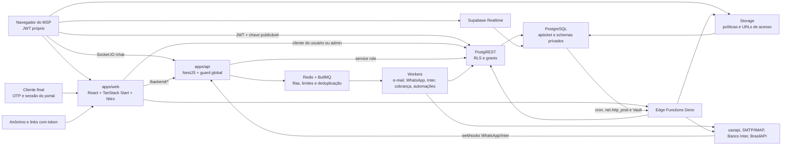

# APTicket — auditoria AppSec em andamento

Data: 19/10/2026, America/Sao_Paulo. Base analisada: `0241b4bd9673320f16c4a48520f9765f02aafc7e`.

Atualização em 20/10/2026: [validação, migration e publicação dos lotes seguintes](./validacao-20261020.md). Os estados abaixo registram o fechamento do lote inicial; consulte a continuação para o estado atual de SEC-07/08, CI e produção.

Estado atual em 22/10/2026: [controles publicados, cobertura SQL, antivírus e janela de manutenção](./validacao-20261022.md). As tabelas de estado do lote de 19/10 abaixo são históricas.

## 1. Resumo executivo e limites

**Estado: Fase 1 concluída; achados iniciais da Fase 2 registrados antes das alterações; primeiro lote de correções validado localmente.** A investigação e a validação complementar continuam. Não constitui atestado de segurança. O risco residual é **alto**: os seis avisos críticos de dependências foram eliminados do lockfile local, mas permanecem avisos altos de SMTP e lacunas de autenticação, isolamento e integrações. Severidades de avisos de dependências não equivalem automaticamente a exploração comprovada neste aplicativo.

O checkout contém três caminhos de execução com acesso a dados: navegador/PostgREST, servidor TanStack Start/Nitro e API NestJS com workers. Há também Edge Functions Deno, Storage, Realtime e funções PostgreSQL. A autenticação principal usa emissão própria de JWT compatível com PostgREST; o portal usa outro formato de sessão. Uma auditoria limitada a React e Edge Functions deixaria caminhos importantes sem análise.

Limites desta execução:

- Leitura estática de arquivos locais rastreados pelo Git e documentação pública de referência.
- Na Fase 1 não houve conexão com serviços de produção. Na Fase 2, após autorização expressa do responsável para utilizar o servidor, houve leitura de metadados, esquema e catálogos estruturais e criação de um banco descartável no mesmo host. Não foram consultadas/copidas linhas de clientes, contatos, tickets ou documentos reais.
- Nenhum acesso a registros de negócio reais, envio de mensagens, migration no banco original, push ou deploy. O banco de testes está em container separado, sem rede, sem portas publicadas, com limite de CPU/memória e dados de negócio sintéticos.
- Este relatório inicial foi atualizado antes de qualquer correção em código executável, dependências ou migrations. Correções posteriores serão registradas individualmente.
- Valores de `.env`, credenciais e tokens reais não foram coletados nem incluídos neste relatório.
- A revisão histórica em `docs/security-review-2026-09-15.md` é contexto; suas conclusões não foram revalidadas nesta fase.

O [inventário JSON](./inventario-20261019.json) registra arquivos, linhas de chamadas TypeScript, nomes de objetos SQL e migrations de origem. A extração é estática, por padrões: chamadas dinâmicas, SQL gerado por loops e nomes calculados exigem inspeção adicional. Contagens SQL representam declarações históricas, não objetos efetivos de uma instância.

## 2. Lista de tarefas

- [x] Fase 1: identificar componentes, entradas e fluxos de dados.
- [x] Fase 1: inventariar rotas, server functions, controllers, Edge Functions e acesso a dados.
- [x] Fase 1: mapear migrations, declarações de RLS, funções, views, triggers, Storage, Realtime e agendamentos.
- [x] Fase 1: descrever atores, fronteiras de confiança e ameaças STRIDE.
- [x] Fase 1: registrar limites, lacunas de escopo e bases de teste.
- [x] Fase 2: inspecionar metadados de RLS, grants, views e funções privilegiadas e reproduzir casos de autorização do portal.
- [ ] Fase 2: completar matriz CRUD/tenant/empresa para todas as tabelas e fluxos.
- [ ] Fase 2: auditar autenticação, sessão, autorização, APIs e integrações.
- [ ] Fase 2: auditar XSS/injeção/uploads, segredos/histórico, dependências, configuração, abuso e dados pessoais.
- [x] Fase 2: produzir achados iniciais reproduzíveis, classificação e recomendações antes das correções.
- [x] Preparar banco descartável isolado e handlers HTTP locais com integrações fictícias.
- [ ] Corrigir por severidade, com testes de regressão e commits locais separados por tema.
- [ ] Submeter decisões de negócio e mudanças com risco de regressão ao responsável antes de implementá-las.
- [x] Executar verificação deste lote: build, lint, typecheck e testes disponíveis, registrando falhas e cobertura incompleta.
- [x] Registrar pendências externas, riscos residuais e checklist trimestral.

## 3. Mapa da arquitetura

As setas representam caminhos identificados no código e na configuração versionada. Não afirmam que as regras de proxy, serviços ou jobs estejam ativos em qualquer implantação.

| Componente | Responsabilidade e evidência local |
|---|---|
| `apps/web` | React/TypeScript/Tailwind/shadcn, TanStack Router/Start, Vite/Nitro. UI, server functions, portal e proxy REST. Entradas: `src/server.ts`, `src/routes/`, `src/lib/*.functions.ts`. |
| `apps/api` | NestJS, REST, Socket.IO e workers. `src/app.module.ts` importa Auth, Queue, Email, WhatsApp, Chat, Inter, Finance e Automations. |
| `packages/shared-types` | DTOs e tipos `Database` compartilhados; não substituem validação de entrada em execução. |
| Supabase/PostgreSQL | Clientes usam schema `apticket`. Migrations também contêm objetos históricos em `public` e os schemas `apticket_finance_private`, `apticket_hr_private` e `apticket_contact_private`. |
| Redis/BullMQ | Transporte de filas, limites compartilhados, deduplicação e adapter de chat. Rate limit do portal em `apps/web/src/lib/rate-limit.ts` é outro mecanismo, em memória. |
| Hospedagem declarada | Dockerfiles separados e `infra/docker-compose.yml`. README descreve Dokploy/Traefik, `/backend/*` para REST e `/socket.io/` direto à API. Configuração efetiva fora do checkout não foi consultada. |

### 3.1 Autenticação e autorização

1. `apps/web/src/lib/auth.functions.ts` contém login, cadastro de tenant, aceitação de convite, pedido de reset e troca de senha. O código usa bcrypt e tokens aleatórios armazenados por hash para convite/reset.
2. `jwt.server.ts` emite JWT HS256 com `sub`, `tenant_id`, `app`, `role` e `aud`. O prazo declarado é de sete dias. A sessão do navegador é armazenada em `localStorage` por `session.ts`.
3. `integrations/supabase/client.ts` anexa o token às chamadas de dados. A fronteira de autorização dessas chamadas diretas é PostgREST/RLS/grants.
4. `auth-middleware.ts` verifica a assinatura e consulta o perfil ativo antes de fornecer contexto às server functions que adotam o middleware.
5. A API registra `SupabaseAuthGuard` como `APP_GUARD`. O guard verifica JWT e perfil, resolve permissões e interpreta `@Public`/`@RequirePermission`. O cliente de dados da API usa service role; cada operação precisa manter seus próprios filtros de autorização.
6. `portal-session.ts` implementa sessão HMAC separada, com prazo padrão de 30 minutos. As rotas do portal verificam contato, tenant e contexto de empresa conforme a operação.
7. O catálogo de módulos/permissões está em `permission-catalog.ts`; a resolução usa RPCs como `get_effective_permissions` e `has_permission`. A UI apresenta permissões; a efetividade no servidor e banco será verificada na Fase 2.

## 4. Inventário da superfície

| Superfície encontrada | Quantidade | Interpretação |
|---|---:|---|
| Declarações `createFileRoute` | 55 | Inclui layouts, demonstrações, páginas e handlers; não são 55 APIs públicas. |
| Server functions exportadas | 55 | Em 13 arquivos; transporte `/_serverFn/*` gerado pelo framework. |
| Endpoints REST declarados no Nest | 30 | Não inclui endpoints gerados pelo Swagger/Socket.IO. |
| Eventos recebidos pelo gateway de chat | 3 | `ticket:join`, `message:send`, `typing`. |
| Edge Functions com `index.ts` | 11 | Existem nove entradas explícitas no `supabase/config.toml`. |
| Chamadas `.from()` com nome literal no web/API/shared | 531 | Inclui acessos a tabelas e buckets; não conta nomes calculados. |
| Chamadas `.rpc()` com nome literal no web/API/shared | 105 | Ocorrências, não RPCs distintas. |
| Arquivos web com `useQuery`/`useMutation`/`useInfiniteQuery` | 73 | Acesso a dados está distribuído por hooks, componentes e páginas. |
| Arquivos em `apps/web/src/hooks` | 5 | Entre eles `use-tickets-inbox` e `use-financial-document-types`. |
| Arquivos com uso de `.storage` no web/API/shared | 18 | Há também chamadas REST ao Storage nas Edge Functions. |
| Migrations SQL | 156 | Necessário reconstruir seu estado final em ambiente local. |
| Nomes de tabelas em declarações CREATE | 119 | Pode haver objetos históricos/removidos, SQL dinâmico e diferença entre schemas. |
| Nomes de funções em declarações CREATE | 272 | 354 declarações/redefinições; sobrecargas não são separadas por assinatura nesta contagem. |
| Nomes de views declaradas | 7 | Detalhadas abaixo. |
| Nomes de triggers em declarações CREATE | 185 | Inclui histórico; não equivale a 185 triggers ativos. |
| Declarações estáticas de políticas | 346 | Não representa o conjunto efetivo após DROP/ALTER e loops. |

### 4.1 Frontend, server functions e entradas públicas

- Operação autenticada: tickets/detalhe, clientes, fornecedores, contatos, funcionários, equipamentos, contratos, SLAs, configurações, perfil, relatórios, filas e módulos financeiros.
- Autenticação pública: `/auth` e server functions `login`, `signUpTenant`, `acceptInvite`, `requestPasswordReset`, `resetPassword`.
- Portal: `/portal`; handlers `/api/public/portal/{request-otp,verify-otp,session,chat-start,contacts,documents,document-download,tickets,ticket-detail,ticket-reply}`. O prefixo público não implica acesso anônimo a todos esses handlers: vários exigem sessão do contato.
- Links com token: `/csat/$token`, `/report/$token`, `/measurement-report/$token`.
- Conteúdo público/demonstração: `/`, `/kb`, `/kb/$slug`, `/demo/*`.
- Proxy genérico: `/backend/$`, que encaminha métodos HTTP para a URL interna configurada da API.
- Server functions adicionais: permissões, papéis, permissões individuais, usuários/convites, perfil/avatar, ações de medições/ciclos, réguas de cobrança, Inter e WhatsApp. Nomes e arquivos estão no inventário.

### 4.2 API NestJS e processamento assíncrono

- REST de canais: contas de e-mail, instâncias WhatsApp, canais de saída WhatsApp e envio de mensagens de chat. Há operações de cadastro, alteração, exclusão de conta, teste, sincronização, envio e estado/QR code.
- Entradas com `@Public` encontradas: `GET /health`, templates de convite/recuperação e webhooks abaixo. A autenticação alternativa dos webhooks será auditada separadamente.
- Webhook WhatsApp: `POST /webhooks/whatsapp/:tenantId`, acessível via proxy `/backend`. Recebe evento, identifica contexto, verifica segredo e usa fila/Redis conforme o código.
- Webhook Inter: `POST /webhooks/inter/:environment`, com token de integração, normalização e RPC de aceitação antes da fila.
- E-mail recebido: polling IMAP por worker. Não foi localizado o antigo endpoint HTTP de ingestão citado em descrições históricas; o README informa sua remoção na migração para NestJS.
- Chat: namespace `/chat` sobre Socket.IO, com handshake autenticado, salas de ticket, mensagens e digitação. Complementa, e não substitui, o Realtime do Supabase.
- Filas declaradas: `email-polling`, `email-send`, `whatsapp-inbound`, `whatsapp-outbound`, `notification-fanout`, `inter-webhook`, `collection`, `automations`. A declaração de uma constante não comprova que haja consumidor ativo para cada fila.

### 4.3 Edge Functions

| Função | Papel | Declaração de gateway no arquivo local |
|---|---|---|
| `gerar-medicoes-contrato` | Motor de medições | `verify_jwt=true` |
| `fechar-ciclos-financeiros` | Fechamento de ciclos | `verify_jwt=true` |
| `emitir-cobranca-inter` | Emissão bancária | `verify_jwt=true` |
| `consultar-cobranca-inter` | Consulta/reconciliação bancária | `verify_jwt=true` |
| `configurar-webhook-inter` | Registro de callback | `verify_jwt=true` |
| `buscar-cep` | Proxy de consulta de CEP | `verify_jwt=true` |
| `criar-lancamento-financeiro-funcionario` | Integração de evento de funcionário | `verify_jwt=true` |
| `client-documents-upload` | Upload de documento do cliente | `verify_jwt=true` |
| `client-document-download` | Download de documento do cliente | `verify_jwt=true` |
| `preparar-cobranca-inter` | Preparação de emissão | Sem entrada explícita neste arquivo |
| `testar-conexao-inter` | Teste da integração | Sem entrada explícita neste arquivo |

Ausência de entrada não significa `verify_jwt=false` nem prova exposição. As condições de implantação e as validações dos handlers ainda precisam ser verificadas em configuração local/staging. Vários handlers usam `fetch` diretamente em `/rest/v1` e `/rpc`; buscar apenas `supabase.from/rpc` não cobre essa superfície.

### 4.4 PostgreSQL, RLS, Storage e Realtime

Os domínios identificados incluem identidade/tenant/permissões, atendimento e SLA, contatos e vínculos de empresas, contratos/equipamentos/medições, funcionários/documentos/benefícios, fornecedores/contas/pagamentos, bancos/Inter, classificação/rateios, orçamento/resultados e automações.

Funções centrais de confiança incluem `current_tenant_id`, `get_effective_permissions` e `has_permission`; há funções privilegiadas financeiras, de RH e de contatos. O inventário separa declarações com `SECURITY DEFINER`, `SECURITY INVOKER` explícito e cabeçalhos sem classificação. Ainda será necessário confirmar owner, grants, `search_path`, RLS/FORCE RLS e as assinaturas finais no banco isolado. Uma função sem `SECURITY` explícito não é automaticamente uma falha.

Views declaradas: `apticket.contract_value_periods`, `cash_flow_entries`, `cash_flow_allocation_entries`, `financial_budget_variance`, `financial_management_statement`, `contract_profitability` e `contract_mrr_projection`.

Buckets nomeados nas migrations: `ticket-attachments`, `kb-attachments`, `client-documents`, `funcionario-documentos`, `funcionario-beneficios`, `supplier-payment-receipts`, `supplier-payable-attachments` e `apticket-profile-avatars`. Não foi verificado o estado final de publicidade, MIME, tamanho, políticas ou assinatura das URLs.

Declarações históricas de publicação Realtime referenciam tickets, mensagens, apontamentos de tempo, motivos de pausa e pausas. O consumidor `postgres_changes` localizado está em `routes/_authenticated/tickets.$id.tsx`. Tabelas efetivamente publicadas e comportamento entre tenants precisam de testes locais; o nome do canal no cliente não constitui isolamento.

Dependências de infraestrutura encontradas nas migrations: `pgcrypto` declarado por CREATE EXTENSION; referências a `cron.schedule`, `net.http_post`, `vault.secrets` e `vault.decrypted_secrets`. A presença de uma referência não comprova instalação/configuração da extensão correspondente.

### 4.5 Agendamentos

- SQL: `apticket-gerar-medicoes-contrato`, `apticket-fechar-ciclos-financeiros` e `apticket-fixed-payable-forecasts`. Há agendamento condicional dependente de configuração em Vault nas migrations.
- BullMQ: polling de e-mail por tenant/intervalo configurado; despacho de automações a cada 15 segundos; régua de cobrança a cada 15 minutos. Existem disparos no startup.
- Revisão posterior: concorrência entre cron/worker, repetição de eventos, retries, associação do job ao tenant e idempotência financeira.

## 5. Atores, ativos e fronteiras de confiança

| Ator | Contexto de confiança e limites a verificar |
|---|---|
| Anônimo | Login/cadastro/reset/OTP, KB pública, demonstração e links com token. Entradas não devem herdar privilégios por dados fornecidos pelo cliente. |
| Contato/cliente final | Sessão do portal e vínculos com empresas; flags de administrador/financeiro do portal. O limite inclui empresa e não somente tenant. |
| Técnico/usuário do MSP | JWT principal, módulos e ações efetivas. IDs e metadados recebidos do browser são entrada não confiável. |
| Administrador do tenant | Gestão delegada dentro do tenant; não equivale a administração da plataforma ou acesso a outro MSP. |
| Superadmin/backoffice | Papel descrito na solicitação, mas sua implementação não foi localizada neste checkout por busca de rotas e identificadores. Caminho de outro repositório foi solicitado ao responsável. |
| Integração externa | uazapi, servidor de e-mail, Inter, serviços de consulta e callbacks. Payloads e respostas são entrada externa mesmo quando há segredo compartilhado. |
| Worker/cron/Edge/server privilegiado | Executa com credenciais de serviço em diversos fluxos. Contexto de tenant deve ser autorizado antes de usar o privilégio; RLS não pode ser presumido como barreira nesses caminhos. |

Ativos principais: dados de clientes/contatos e funcionários, tickets e anexos, permissões, contratos/SLAs, medições e saldos financeiros, documentos, credenciais de integração/certificados bancários, tokens de sessão, trilhas de auditoria e disponibilidade de filas/banco.

Fronteiras a testar na Fase 2:

1. Navegador → PostgREST/Storage/Realtime: JWT, grants, RLS e isolamento de objetos.
2. Navegador → server function/API: assinatura, perfil ativo, tenant, módulo e ação.
3. Sessão do portal → service role/Edge: contato ativo, papel e vínculo com a empresa do recurso.
4. API/worker/Edge → banco privilegiado: filtros explícitos, RPCs, contexto e operações financeiras.
5. Webhook/resposta externa → fila → worker: autenticidade, replay, tamanho e associação do evento ao tenant.
6. Configuração de integração → rede de saída: destino autorizado, TLS, timeouts, SSRF e exposição de segredo.
7. Administração de tenant → possível backoffice: separação entre poderes locais e poderes globais.

## 6. Modelo de ameaças STRIDE

As linhas abaixo são **hipóteses e objetivos de teste**, não achados confirmados. A organização segue o [modelo STRIDE da Microsoft](https://learn.microsoft.com/en-us/azure/security/develop/threat-modeling-tool-threats).

| Categoria | Cenário no APTicket | Fronteira/ativo | Evidência a buscar na auditoria |
|---|---|---|---|
| S — falsificação de identidade | Reutilizar sessão revogada, forjar contexto de contato ou simular webhook de outro tenant. | JWT próprio, portal e integração. | Validação de assinatura/contexto, expiração/revogação, atividade do perfil e autenticidade do evento. |
| T — adulteração | Trocar `tenant_id`, `company_id`, IDs de ticket/documento ou valores financeiros; repetir callback/job para alterar saldo. | PostgREST, RPC, service role e filas. | Rejeição de acesso cruzado, WITH CHECK, FKs/escopo, transação e idempotência. |
| R — repúdio | Negar mudança de papel, arquivamento, acesso a documento ou operação bancária. | Administração, financeiro e trilhas. | Registro confiável de ator/tenant/ação, restrição de alteração da trilha e política de retenção. |
| I — divulgação | Ler dados de outro MSP, baixar arquivo por ID, receber evento de outra empresa ou expor credenciais no HTML/log. | RLS, Storage, Realtime, bundles e logs. | Testes negativos A→B, URLs/objetos privados, payloads mínimos e varredura com resultados redigidos. |
| D — indisponibilidade | Abusar login/OTP, uploads, buscas, filas, polling ou automação recursiva. | Entradas públicas, Redis, workers e banco. | Limites efetivos, paginação, orçamento de execução, dedupe, retry/backoff e detecção de loops. |
| E — elevação de privilégio | Técnico alterar papel, administrador de tenant acessar backoffice ou cliente disparar ação service role. | Papéis, RPCs e execução privilegiada. | Negação no servidor/banco e teste de alteração de campos protegidos; UI não basta como prova. |

Ordem proposta para investigação: isolamento tenant/empresa e uso de service role; identidade e privilégios; documentos/Storage/Realtime; integrações e execução assíncrona; XSS/injeção/uploads; abuso/dependências/configuração e dados pessoais. A ordem das **correções** dependerá da severidade dos achados confirmados.

## 7. Base de testes e critérios da Fase 2

Inventário: 33 arquivos de testes SQL, 11 arquivos `*.spec.ts` da API, seis arquivos de testes Deno e 23 scripts Node/UI. São contagens de arquivos, não testes aprovados nem evidência de cobertura de todas as tabelas.

Não foram executados build, lint, typecheck ou testes nesta etapa documental. Os resultados de tarefas anteriores não substituem uma baseline de auditoria. Antes de executar scripts ou subir processos, será necessário revisar sua configuração para impedir conexões reais e substituir integrações por fixtures locais.

A matriz de isolamento deverá cobrir operações SELECT/INSERT/UPDATE/DELETE, mudança de tenant/empresa e soft delete; roles `anon`/`authenticated`, usuários de dois tenants, empresas distintas do mesmo tenant e contato com vínculos diferentes. Tabelas internas devem ser testadas como negativas para clientes comuns. RPCs, views, Storage, Realtime, server functions, API e jobs exigem casos próprios além de CRUD de tabelas.

## 8. Registro histórico ao encerrar a Fase 1

**Nenhum achado foi classificado nesta fase.** Isso não significa ausência de vulnerabilidades.

| ID | Título | OWASP/CWE | Severidade | Arquivo | Descrição/PoC segura | Impacto | Correção | Status |
|---|---|---|---|---|---|---|---|---|
| — | A preencher após validação na Fase 2 | — | Não avaliada | — | Não executada | Não quantificado | Não definida | Reconhecimento concluído |

Pendências de escopo/ambiente:

- O responsável confirmou que o superadmin/backoffice ainda não foi criado. Sua implementação e MFA de backoffice ficam como requisito futuro; não há esse componente para auditar neste checkout.
- Definir/reconstruir ambiente **local ou staging isolado**, com dados sintéticos, configuração sanitizada e sem acesso às integrações reais. O `config.toml` disponível tem entradas de funções, mas não descreve sozinho toda a infraestrutura self-hosted.
- Reconstruir a sequência de migrations e os schemas históricos antes de afirmar o estado efetivo de RLS, grants, publicações e extensões.
- Não há arquivos de pipeline `.github` rastreados neste checkout. Verificar outros mecanismos de CI antes de definir onde integrar os controles solicitados.

Itens externos a verificar posteriormente, sem acesso à produção nesta execução: política de Auth/MFA, redirects/provedores, headers/proxy/TLS, logs e retenção, buckets, backups/restauração/PITR, criptografia em repouso e SPF/DKIM/DMARC. Nenhuma rotação de segredo está prescrita como achado confirmado: a varredura de código/histórico pertence à Fase 2 e deverá reportar somente localização e identificação redigida.

A auditoria utilizará [OWASP ASVS](https://owasp.org/projects/asvs) para organizar controles verificáveis e a [documentação de RLS do Supabase](https://supabase.com/docs/guides/database/postgres/row-level-security) para os testes dos acessos sujeitos a políticas. Alterações em banco serão incrementais, com reversão documentada, sem editar migrations aplicadas. Nenhum push/deploy será feito enquanto vigorar a restrição de produção.

## 9. Fase 2 — achados e provas iniciais

Esta seção foi escrita antes de alterar o aplicativo. Testes HTTP foram executados somente em `127.0.0.1`, com JWT/HMAC de fixture e um servidor falso de Supabase. Nenhum token real foi utilizado nesses testes. A avaliação de dependências consultou o registro npm; a varredura de Git foi local e não enviou blobs a serviços externos.

| ID | Achado e causa | Categoria | Severidade | Componente | PoC segura / impacto | Correção recomendada | Estado inicial |
|---|---|---|---|---|---|---|---|
| SEC-01 | TanStack Start instalado dentro da faixa afetada por XSS em respostas de server functions | CWE-79 / componentes vulneráveis | Crítica no aviso do fornecedor | `apps/web/package.json`, lockfile; runtime `@tanstack/react-start`/`start-server-core` | Audit identifica `react-start` 1.168.46 e `start-server-core` 1.169.28. O aviso descreve resposta HTML controlável sem autenticação. Não foi enviado exploit ao domínio real. | Atualizar versões compatíveis corrigidas e testar o transporte de funções GET/POST; mínimo publicado: 1.168.60 / 1.169.39. | Confirmada a versão afetada; exploração específica não executada |
| SEC-02 | Desativação do contato não é revalidada em leitura/resposta do portal | CWE-863 / autorização | Alta | `portal/session.ts`, `ticket-detail.ts`, `ticket-reply.ts` | Contato fictício com `is_active=false` e sessão ainda válida recebe HTTP 200 nas três rotas e consegue inserir resposta. O token continua válido por até 30 minutos. | Centralizar consulta de contato ativo por ID/tenant antes do acesso privilegiado, mantendo os filtros do recurso. | Reproduzida em HTTP local |
| SEC-03 | Assinatura privilegiada de anexos confia no caminho em metadados da mensagem | CWE-639, CWE-862 / BOLA | Alta | `portal/ticket-detail.ts:98` | Mensagem fictícia do ticket autorizado referencia `outro-tenant/outro-ticket/private.pdf`; o signer service role recebe esse caminho. A obtenção de um caminho real de objeto é pré-condição; nenhum objeto real foi acessado. | Validar namespace do tenant e segmentos do caminho antes de assinar; falhar fechado para URL externa, path traversal e caminho de outro tenant. | Reproduzido o desvio no limite do signer; Storage real não consultado |
| SEC-04 | OTP gera sessão mesmo quando falha a persistência do consumo; atualização não disputa uso único | CWE-252, CWE-362 | Alta | `portal/verify-otp.ts` | Backend falso devolve erro ao atualizar `consumed_at`; a rota ainda retorna token com HTTP 200. Duas leituras anteriores ao UPDATE também permitem disputa do mesmo código. | UPDATE condicional `consumed_at IS NULL`, validade e SELECT do registro efetivamente consumido; emitir token somente após sucesso. Incremento de tentativas também precisa revisão atômica. | Falha de persistência reproduzida; concorrência inferida do fluxo read/update |
| SEC-05 | Destinos de rede configuráveis e download de mídia sem política central de SSRF | CWE-918 | Alta | `uazapi.service.ts`, `email-account.service.ts`, `whatsapp-webhook.service.ts:313` | Código aceita destino configurado pelo tenant; mídia segue redirects e lê resposta inteira antes do limite real. Pode alcançar rede interna. Não foram feitas requisições a alvos internos para provar exploração. | Definir destinos privados legítimos; validar resolução DNS/redirects/porta e limitar streaming. | Evidência estática; aguardando hosts internos autorizados para evitar regressão |
| SEC-06 | Login/cadastro/reset próprios sem limite de tentativas no handler | CWE-307, CWE-770 | Alta | `auth.functions.ts` | Os cinco handlers públicos não usam o limiter existente. bcrypt e envio de recuperação podem ser repetidos; controles externos não foram verificados. | Limites compartilhados por identidade e origem confiável, mensagens genéricas e auditoria sem PII. | Confirmado no código; capacidade externa não testada |
| SEC-07 | Convite/reset consomem token fora da transação da senha; sessões antigas não são revogadas pelo reset | CWE-362, CWE-613 | Alta | `auth.functions.ts`, `jwt.server.ts` | Fluxo lê token livre, altera perfil e depois atualiza `accepted_at` sem condição e sem conferir erro. Sessão JWT não tem versão/JTI consultado. | Transação/RPC para consumo e alteração; definir política de revogação da sessão principal antes de mudar o contrato de autenticação. | Evidência estática; requer decisão de sessão e testes de banco dedicados |
| SEC-08 | Dependências adicionais com avisos de segurança | CWE-1104 | Alta a crítica segundo avisos; alcance varia | Lockfile e ambos os manifests | Audit completo retornou 6 críticas, 16 altas, 17 moderadas e 5 baixas. Há avisos em runtime (SMTP, HTTP, serialização, Socket.IO) e ferramentas de build/teste. | Atualizações por tema, distinguindo produção/dev; major do Nodemailer exige verificação específica de compatibilidade. | [Inventário dos avisos](./dependencias-20261019.json) |
| SEC-09 | Uploads de tickets/documentos sem validação uniforme dos bytes e limite antes do buffering | CWE-434, CWE-400 | Média | `portal/tickets.ts`, `ticket-reply.ts`, `client-documents-upload/index.ts` | Validações usam tamanho declarado, extensão e MIME fornecido; não há verificação central de conteúdo real para todos os fluxos. Nenhum arquivo malicioso foi enviado. | Política central por tipo de arquivo, leitura limitada, download seguro e decisão sobre scanner/formatos necessários. | Evidência estática; política de formatos a definir |
| SEC-10 | Suíte SQL e ambiente reproduzível não cobrem integralmente o estado atual | CWE-693 / garantia de segurança | Média | `supabase/tests`, configuração local | No clone, 33 arquivos foram tentados; sete terminaram sem falha, 458 asserções passaram, 42 falharam e outros arquivos interromperam no setup. Há assinaturas antigas, novos campos obrigatórios e dependências globais fora do dump. | Reconciliar fixtures/assinaturas, completar matriz CRUD por tabela e CI isolado. Não interpretar falha de setup como vulnerabilidade nem como teste aprovado. | [Resultados por arquivo](./testes-sql-20261019.json) |
| SEC-11 | Headers e limites no proxy não são verificáveis integralmente pelo checkout | Configuração / defesa em profundidade | Média, condicionada à implantação | `src/server.ts`, `main.ts`, infra | Não há política central completa de headers no código inspecionado; Traefik/Kong podem acrescentá-la. `clientIp` do web usa o primeiro X-Forwarded-For, dependendo da política do proxy. | Verificar cadeia de proxy e introduzir headers compatíveis com recursos necessários; CSP exige inventário de origens. | Configuração externa não auditada |
| SEC-12 | Colunas de credenciais cifradas podem ser lidas por `authenticated` | Exposição desnecessária de informação | Média | Grants de `tenants.whatsapp_uazapi_token` e `outbound_channels.access_token` | Consulta somente aos metadados de privilégios confirma SELECT. Não foram consultados os valores nem se há valores legados em claro. | Remover SELECT de colunas secretas quando nenhum fluxo legítimo depender dele; migrar legado cifrado com procedimento aprovado. | Privilégio confirmado; conteúdo não inspecionado |

### Evidências favoráveis e seus limites

- Catálogo consultado: todas as 118 tabelas de `apticket` têm RLS habilitado. Isso não prova correção de cada política nem protege operações service role.
- As sete views de `apticket` declararam `security_invoker=true` no catálogo consultado.
- Não foi encontrada função `SECURITY DEFINER` de `apticket*` sem configuração de `search_path` no catálogo. Quatro funções concedidas a `anon` tratam relatórios/CSAT por token; sua concessão, sozinha, não é achado.
- A API passou nos 52 testes atuais, distribuídos em 11 suites. Não equivale à cobertura de toda autorização.
- Busca local de 1.624 blobs de texto alcançáveis no Git, com padrões específicos de tokens/chaves privadas, retornou zero candidatos. Não substitui análise de entropia/gitleaks nem garante ausência de senhas. [Escopo e resultado redigido](./segredos-20261019.json).
- Os renderizadores HTML de KB/relatório/diagnóstico inspecionados usam DOMPurify. O CSS do componente de gráficos não foi classificado como XSS sem demonstrar origem controlável pelo usuário.
- Filtros de pesquisa de contatos inspecionados utilizam `escapePostgrestValue`; não foi classificada injeção apenas pela presença de `.or()`.

### Ambiente e limitações da prova SQL

Container descartável `apticket-appsec-20261019`, PostgreSQL 17.6, `--network none`, sem portas/volumes da aplicação, CPU e memória limitadas. Dump apenas de esquema/grants/políticas, mais os catálogos estruturais de permissões e dos oito buckets. As tabelas de negócio começaram vazias. Testes do repositório inserem fixtures e fazem rollback.

A restauração inicial teve 39 erros: referências globais de outros sistemas compartilhando Storage/Auth e duas FKs do Vault. A extensão Vault foi instalada no clone e as duas FKs foram restauradas. Objetos de outros aplicativos não foram copiados. Essas diferenças impedem afirmar equivalência integral do Storage/Auth compartilhado e aprovação global de RLS. Nenhum cron/job de produção foi copiado nem houve execução de integrações reais.

### Referências dos avisos principais

- [TanStack / GHSA-qx66-fv34-fjm8](https://github.com/advisories/GHSA-qx66-fv34-fjm8): faixas corrigidas do transporte de server functions.
- [Nodemailer / GHSA-prgh-xp8r-p3m5](https://github.com/advisories/GHSA-prgh-xp8r-p3m5): complexidade do parser alcançável via mailparser.
- [proxy-addr / GHSA-jqcg-44mw-7w3h](https://github.com/advisories/GHSA-jqcg-44mw-7w3h): política de confiança de IPs mapeados IPv6.

## 10. Plano de correções e decisões pendentes

1. SEC-01: atualizar TanStack para versões corrigidas compatíveis, com teste de fronteira de server function.
2. SEC-02/03/04: correções separadas de contato ativo, namespace de anexo e consumo de OTP, com testes antes/depois.
3. SEC-05: aguardar a lista de destinos privados legítimos antes de bloquear rede interna. A pergunta foi apresentada ao responsável conforme item 6 da solicitação.
4. SEC-06/07: definir política compartilhada de tentativas e revogação de sessões; preparar testes atômicos antes de migration incremental.
5. SEC-08/09/11/12: atualizações adicionais e hardening com análise de compatibilidade, tipos de arquivo e configuração de proxy; não bloquear integrações/formatos silenciosamente.
6. SEC-10: reconciliar a base SQL, adicionar CI e completar os testes negativos ainda ausentes.

Não há backoffice implementado, conforme confirmação do responsável. Não será criado um painel novo como parte de uma correção de auditoria. MFA e privilégios do futuro backoffice devem fazer parte dos seus critérios de aceite. Não foi realizada alteração de configuração, migration ou deploy no aplicativo em produção.

## 11. Correções incrementais e regressão

### SEC-01 — transporte TanStack

Antes: `react-start` 1.168.46 / `start-server-core` 1.169.28 constavam nas faixas vulneráveis publicadas. Depois: `react-start` 1.168.60 traz `start-server-core` 1.169.39; `react-router` 1.170.41 acompanha a versão requerida pelo pacote. Atualização restrita ao conjunto de patches compatível, com scripts de instalação desativados.

Teste: `node scripts/security/test-server-functions.mjs`, sobre build Node local, envia `result` controlado pelo cliente em GET/POST, tanto navegação quanto RPC. Os quatro casos recusam transformar o erro de autorização/validação em HTML ou devolver o marcador injetado. O teste não envia requisições ao ambiente real. Baseline de versão vulnerável comprovada pelo lockfile/audit; não foi demonstrada execução de JavaScript no build anterior. Reversão: reverter o commit e reinstalar pelo lockfile, reconhecendo a reabertura do aviso.

Compatibilidade: o patch do Router passou a tipar `errorComponent.error` como `unknown`. Cinco incompatibilidades foram identificadas pelo typecheck e corrigidas com narrowing/assinatura apropriada; mensagens `Error` continuam disponíveis e outros valores recebem texto genérico.

### SEC-02 — contato ativo no portal

Antes: o token HMAC era aceito por sessão/detalhe/resposta mesmo após desativar o contato. Depois: `portal-auth.server.ts` verifica a assinatura e consulta contato ativo por ID e tenant, com empresa vinculada; erro de consulta nega acesso. As três rotas usam esse helper antes de ler tickets/anexos ou inserir mensagens. Os filtros de ticket por tenant e contato continuam obrigatórios. As outras rotas já consultam atividade/papel ou delegam ao Edge que faz essa validação.

Teste: `node scripts/security/test-portal.mjs SEC-02`. Baseline: falha (`200` em sessão de contato inativo). Após a mudança: HTTP 401 para inativo/erro de consulta nas três rotas, sem leitura de negócio nem escrita; contato ativo mantém sessão, detalhe e resposta; falta de token é negada. Reversão por revert do commit; não há migration.

### SEC-03 — limite do signer por tenant (mitigação parcial)

Antes: qualquer caminho indicado no JSON da mensagem era encaminhado ao signer com service role. Depois: helper `isTenantStoragePath` exige chave canônica dentro do tenant da sessão, recusando segmentos vazios, `.`/`..`, escapes `%`, barras invertidas, controle, query/fragmento e destinos externos. A rota mantém autorização de contato e propriedade do ticket. Caminhos atuais `tenant/ticket/...`, `tenant/whatsapp-inbound/...` e `tenant/pending/...` continuam compatíveis.

Teste: `node scripts/security/test-portal.mjs SEC-03`. Falha antes: signer recebia outro tenant e variantes de traversal. Após: só recebe dois caminhos canônicos do tenant, e anexos recusados recebem `url:null`. Reversão por revert do commit, sem migration.

Risco residual: o prefixo de tenant não estabelece a propriedade do objeto entre empresas/tickets do mesmo tenant. Anexos WhatsApp e pendências legadas não contêm o ticket no caminho. É necessário adicionar vínculo imutável objeto–ticket/contato no banco e validar no signer, com migração compatível do legado; não declarar BOLA de arquivos integralmente resolvido por esta mitigação.

### SEC-04 — disputa de uso único do OTP (mitigação parcial)

Antes: a rota emitia sessão mesmo se o UPDATE de consumo falhasse, e atualizava incondicionalmente após ler o código. Depois: UPDATE condicionado a ID/hash, `consumed_at IS NULL`, validade e menos de cinco tentativas; exige retorno do registro consumido e ausência de erro antes de assinar o token. PostgreSQL reavalia a condição após concorrência no UPDATE, permitindo somente um consumo.

Teste: `node scripts/security/test-portal.mjs SEC-04`. Baseline falhou pois emitia token após erro simulado de gravação. Após: erro de gravação nega sessão; duas requisições liberadas simultaneamente após ler o mesmo código resultam em um HTTP 200 e um 401, com exatamente um token. O teste HTTP usa backend falso com comportamento de UPDATE condicional, não comprova por si só concorrência no PostgreSQL real. Reversão por revert do commit, sem migration.

Risco residual: incremento de `attempts` em códigos incorretos ainda é read/modify/write e pode perder incrementos concorrentes. O limiter por e-mail/processo continua como mitigação parcial; exige operação atômica e limite compartilhado para cobertura completa.

### SEC-08 — dependências de runtime e ferramentas

Antes: seis avisos críticos, 16 altos, 17 moderados e cinco baixos na baseline. Depois: patches fixados no workspace para `proxy-addr`, `shell-quote`, `handlebars`, `undici`, `seroval`, `engine.io`, `dompurify`, `fast-uri`, `source-map-js`, `ip-address` e as três linhas de `brace-expansion`, além do TanStack tratado em SEC-01. `seroval` 1.6.11 foi mantido compatível com os plugins 1.6.11; fixar apenas o mínimo 1.6.3 causava erro de export no build e foi descartado antes de commit. Instalação com scripts desativados, preservando o allowlist existente.

Teste: `node scripts/security/test-dependency-audit.mjs <json-do-pnpm-audit>`. Falha na baseline (seis críticos); passa após patches, exigindo zero críticos e ausência de avisos nos componentes corrigidos. O audit final ainda retorna código 1: **zero críticos, dois altos e três moderados**, todos do Nodemailer 9.1.1. Atualização principal para 10 foi apresentada ao responsável; a faixa corrigida dos avisos restantes chega a 10.0.9. [Inventário após patches](./dependencias-apos-20261019.json). Reversão: revert do commit e instalação pelo lockfile; isso reabre os avisos eliminados.

### Validação complementar da API

O typecheck completo da API, incluindo specs, identificou um matcher de erro parcial tipado como erro completo; corrigido para `Partial<CollectionDispatchError>`, preservando a asserção existente. Quatro erros de lint no worker Inter tratavam resposta de Edge como `any`; agora o retorno entra como `unknown` e seus campos são verificados antes de aceitar a sincronização. Não foi classificada vulnerabilidade nova com base apenas nesses erros estáticos.

Regressão: sete casos adicionais do worker verificam respostas nulas/incompletas, estado negativo, erro de transporte e sincronização válida. As 12 suites da API passaram com 59 testes; build, typecheck incluindo specs e lint da API também passaram. Nenhuma chamada bancária ou mensagem real foi executada.

### CI e varredura de segredos

Workflow `.github/workflows/security.yml` preparado para PR, push em main e execução manual, com permissões somente de leitura e Actions fixadas por SHA verificado. Inclui build/typecheck, testes da API, HTTP local do portal/server functions, seis arquivos de teste Edge sem rede/ambiente, audit pnpm e lint de segurança. O projeto usa pnpm: não foi criado um lockfile npm concorrente.

Gitleaks CLI 8.30.1 foi baixado da release oficial e conferido por SHA-256; scan de todo histórico local alcançável, com saída redigida. O único candidato era o parâmetro de exemplo do badge CircleCI no README do starter NestJS, confirmado por comparação em memória com o template público oficial. Exceção em `.gitleaksignore` limitada ao fingerprint histórico exato; arquivo, regra ou diretório não foram ignorados. Nova execução passou com zero candidatos não resolvidos. [Resultado sanitizado](./gitleaks-20261019.json). Isso não prova ausência de todo segredo e não exige rotação daquele exemplo público.

`eslint-plugin-security` utiliza regras de bloqueio para eval dinâmico, Buffer inseguro, pseudoRandomBytes, escape desativado e caracteres bidirecionais. Heurísticas restantes geram avisos para triagem; não são classificadas automaticamente como vulnerabilidade. Inline disables não podem desativar esse perfil. Teste de configuração demonstra recusa dos exemplos inseguros, aceitação do uso seguro e resistência a desativação inline. Execução atual: zero erros, 119 avisos a revisar.

**Limites:** o YAML e os comandos foram validados localmente; o workflow ainda não rodou no GitHub. O audit alto continuará falhando por Nodemailer e o lint geral do frontend continuará falhando pelo legado. A matriz SQL completa e seu bootstrap reproduzível ainda não foram incorporados ao CI; testes HTTP de caminhos entre tenants não substituem essa matriz. Configurar checks obrigatórios no GitHub e impedir deploy independente no Dokploy também exige configuração da implantação.

## 12. Estado de cada achado após este lote

Esta tabela registra o lote inicial. Para a implantação atual, inclusive a revogação de sessão, Nodemailer, SSRF e o CI integralmente aprovado, consultar [20/10](./validacao-20261020.md) e [21/10](./validacao-20261021.md). Itens de anexos, uploads e matriz SQL seguem em execução conforme o checklist atual.

| ID | Estado local | Pendência / risco residual |
|---|---|---|
| SEC-01 | Corrigido e validado localmente | Publicação ainda não realizada. |
| SEC-02 | Corrigido e validado localmente | Publicação ainda não realizada; desativação do contato é revalidada em cada chamada. |
| SEC-03 | Mitigado parcialmente | Vínculo imutável objeto–ticket/contato e migração dos caminhos legados ainda necessários dentro do tenant. |
| SEC-04 | Mitigado parcialmente | Consumo condicional corrigido; contador de tentativas incorretas e limite distribuído ainda não atômicos/compartilhados. |
| SEC-05 | Corrigido e implantado no lote de 20/10 | Responsável confirmou apenas Supabase/API internos. Política de DNS/IP/redirects e streaming adicionada; ver escopo, testes, deploy e limitações na [validação atual](./validacao-20261020.md). |
| SEC-06 | Não corrigido | Política de tentativas, identidade de origem confiável e armazenamento compartilhado precisam ser implementados. |
| SEC-07 | Não corrigido; decisão solicitada | Definir revogação de sessões após reset; implementar consumo transacional de convite/reset e testes dedicados. |
| SEC-08 | Mitigado parcialmente | Zero críticos; dois avisos altos e três moderados do Nodemailer; atualização major solicitada ao responsável. |
| SEC-09 | Não corrigido | Definir formatos e política de uploads/antivírus; adicionar validação real e leitura limitada. |
| SEC-10 | Parcial: CI preparado; cobertura SQL incompleta | Fixtures antigas e bootstrap ainda bloqueiam vários testes; matriz de todas as tabelas/CRUD não concluída. Lint legado do frontend também permanece. |
| SEC-11 | Não concluído | Conferir proxy/TLS/headers e origens de CSP; não impor política que bloqueie recursos legítimos sem inventário. |
| SEC-12 | Não corrigido | Mapear consumidores das colunas cifradas antes de reduzir grants e tratar possível legado. Valores reais não consultados. |

### Verificações e cobertura

- Build web (preset Node) e API: aprovados. Typecheck web e API, incluindo specs: aprovados.
- API: 59 testes aprovados em 12 suites. Edge: 54 testes aprovados em seis arquivos, executados por Deno 2.9.6 sem permissão de rede/ambiente.
- HTTP local: quatro variantes de transporte GET/POST; contato inativo/erro/ativo; recusa de assinatura fora do tenant/traversal; persistência e concorrência de OTP: aprovados.
- UI dos seletores: scroll, A–Z, Concluir por mouse/teclado/busca, categoria com código, opções desabilitadas, Escape e múltipla seleção, em 1440/768/390px: aprovados em ambos os scripts. O teste passou a aguardar a animação de fechamento antes de abrir outro seletor, evitando ambiguidade entre duas caixas de busca transitórias.
- Lint API e lint dos seis arquivos web de segurança: aprovados. Lint de segurança: zero erros e 119 avisos heurísticos. Lint geral do web: 603 erros e 11 avisos legados; comparação dos 11 arquivos alterados com a base Git, normalizando EOL, não introduziu erros (quatro existentes no root, zero nos demais). Parte do total global depende da mistura de EOL do checkout Windows; não confundir uma comparação de conteúdo normalizado com o total bruto de formatação.
- SQL: mantém a baseline documentada de 33 arquivos tentados, sete arquivos aprovados, 458 asserções aprovadas e 42 falhas, além de interrupções de setup. Nenhuma alegação de aprovação global de RLS, Realtime, RPCs, contract-gating ou de todas as tabelas.
- Não foram executados todos os scripts UI históricos de módulos não alterados; não apresentar os testes executados como toda a suíte do monorepo.

### Decisões e ações externas

1. Responder às perguntas já apresentadas: destinos internos legítimos; atualização do Nodemailer para versão principal corrigida; revogação de sessões no reset.
2. Especificar política de arquivos, origem de IP confiável, limites de tentativas e retenção/auditoria/LGPD com os responsáveis. Requerimentos de MFA para futuro backoffice continuam em aberto porque o componente não existe.
3. Verificar Auth/provedores/redirects de apps compartilhados, backups/PITR e restauração, criptografia em repouso, headers/TLS no proxy e SPF/DKIM/DMARC. Esses controles não foram atestados por leitura de código.
4. Completar matriz SQL e reconciliação das fixtures, revisão dos avisos heurísticos, cobertura de Realtime/jobs/idempotência/exportações e scanner de uploads. Wrapper central de Edge, auditoria imutável e MFA global não foram implementados neste lote; mudanças de contrato exigem desenho e compatibilidade.
5. Confirmar o escopo de publicação: a solicitação de auditoria restringe produção; a autorização posterior liberou o uso do servidor para testes. O procedimento geral GitHub → Dokploy foi identificado e os dois aplicativos existem, mas não houve push/deploy nem migration de produção neste lote. Não há migration nova necessária para as correções atuais.

Encerramento do ambiente descartável: container de auditoria parado/removido após conferir nome, labels, rede `none` e ausência de volumes. Dump de esquema e arquivos SQL/logs temporários nomeados desta auditoria também removidos do servidor. Containers frontend/backend existentes permaneceram ativos. Relatórios sanitizados e fontes dos testes permanecem no repositório para reprodução.

### Checklist recorrente trimestral

- Reexecutar audit, Gitleaks e lint de segurança; revisar exceções por fingerprint e dependências abandonadas/postinstall.
- Executar matriz tenant/empresa/contato para CRUD, RPCs, views, Storage, Realtime e rotas privilegiadas, incluindo soft delete.
- Revisar papéis/grants, contatos/perfis inativos, credenciais de integrações e contas de serviço; validar revogação/reset/MFA.
- Testar restore em ambiente isolado e registrar tempo/recuperação; conferir backups, PITR e retenção sem copiar dados para serviços externos.
- Verificar TLS/headers/CORS/CSP, limites públicos, filas, replay, idempotência financeira e loop de automações.
- Exercitar uploads, exportações e sanitização com fixtures; revisar logs/auditoria e política de anonimização/LGPD.
- Exigir checks antes da publicação e reavaliar o modelo de ameaças quando entrar módulo, integração, papel ou backoffice novo.
