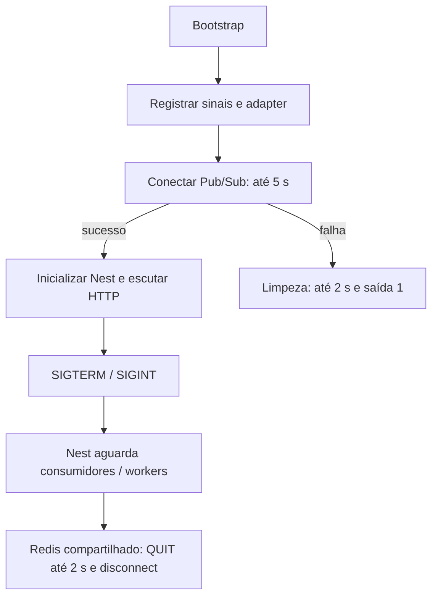

# Ciclo de vida da API e das conexões Redis

Data: 17/11/2026. Base: `0f8a496`, branch local `codex/priority-session-whatsapp`.

## 1. Stack Tecnológica & Ecossistema

Mantidos NestJS 11, ioredis 6, Socket.IO e BullMQ existentes. Nenhuma dependência do produto adicionada. A implementação instalada do BullMQ aceita `connection.url`; essa configuração foi preservada.

Arquivos centrais: `channels/chat/redis-io.adapter.ts`, `queue/redis-lifecycle.ts`, `queue/redis.service.ts`, `runtime/application-lifecycle.ts` e `main.ts`, em `apps/api/src`.

## 2. Infraestrutura & Deploy

O bootstrap registra SIGTERM/SIGINT. A conexão inicial Pub/Sub tem orçamento conjunto de 5 s; falha desencadeia limpeza limitada a mais 2 s e saída com código 1. Mensagens desse caminho são genéricas e não incluem URL ou credenciais.

O compose versionado define `stop_grace_period: 60s` para a API. No shutdown normal, o Nest aguarda os workers; somente depois encerra o Redis compartilhado. O QUIT deste cliente tem limite de 2 s, seguido de desconexão imediata. Esse limite não é um prazo global para todos os jobs ou hooks.

Não há migration ou variável nova. `REDIS_URL`, autenticação, database, TLS e reconexão de runtime permanecem configurados pelo cliente existente. O ensaio TCP local comprovou autenticação e seleção de database; não exercitou handshake TLS.

Publicação pendente: conferir os testes remotos, publicar a imagem e validar SIGTERM com um job sintético em homologação. Conferir a graça efetiva no Dokploy/orquestrador: configurações externas podem substituir o compose. Jobs que excedam essa graça ainda podem ser interrompidos à força e reprocessados. Reversão pela imagem/compose anteriores, sem apagar filas ou chaves de negócio.

Nenhum push, deploy, acesso à produção ou alteração de dados ocorreu nesta entrega.

## 3. Arquitetura & Conceitos de Domínio



O adapter possui os dois clientes Pub/Sub. Chamadas concorrentes compartilham a mesma tentativa; erro, prazo ou dispose liberam inclusive conexões parcialmente abertas. Dispose cancela tentativas pendentes, não permite reativação e pode ser repetido. Erros de runtime têm aviso genérico limitado por episódio de indisponibilidade em cada cliente.

O `RedisService` global mudou de `onModuleDestroy` para `onApplicationShutdown`. A ordem dos módulos globais na versão instalada do Nest/BullMQ coloca o encerramento do BullExplorer antes desse provider, permitindo aos jobs usar Redis durante sua conclusão. O fechamento é idempotente e não enfileira QUIT se o cliente estiver offline.

## 4. Inventário de Funcionalidades (Features)

| Módulo | Correção |
|---|---|
| Chat / Socket.IO | Prazo de conexão, cancelamento, tentativa compartilhada e liberação de Pub/Sub |
| Redis compartilhado | Fase final de shutdown, QUIT limitado e desconexão imediata |
| API | Sinais de desligamento e saída não zero após falha de startup |
| Hospedagem | Graça de 60 s no compose da API |
| CI | Ensaio TCP/Nest e integração Redis 7/BullMQ com job ativo e SIGTERM |

Não foram alteradas rotas, UI, permissões ou regras de negócio.

## 5. Code Quality & Technical Debt (Bônus Técnico)

Evidências locais:

- Regressões RED reproduziram clientes órfãos, tentativas duplicadas, startup pendurado, QUIT pendurado e Redis fechado antes dos consumidores. Os dez testes novos passaram após as correções.
- **172 testes em 26 suítes API aprovados**; typecheck, build e lint API aprovados. Lint de segurança sem erros, com warnings existentes.
- `test-api-lifecycle.mjs`: ioredis real contra TCP loopback, credenciais sintéticas/database 4, startup sem resposta, liberação de sockets, QUIT sem resposta, ordem dos hooks Nest e falha do entrypoint compilado em subprocesso. No Windows, o teste dispara o evento de sinal; no Linux, envia SIGTERM ao processo.
- Regressões anteriores de prontidão, SDK Supabase/HTTP e Lua executadas novamente e aprovadas.
- Revisão independente sem achados críticos ou importantes no código de produção.

O CI inclui `test-bullmq-shutdown.mjs` com Redis 7 descartável: inicia worker real, mantém um job ativo, dispara SIGTERM e libera o job durante o shutdown; o job precisa usar o Redis compartilhado e concluir. Apenas fila/chave sintéticas com UUID são criadas; a limpeza é restrita ao namespace do ensaio. **O caminho positivo desse teste e o workflow remoto ainda não foram executados localmente**, por ausência de Redis/Docker/WSL. O caminho sem Redis foi exercitado e termina com falha limitada, sem processo pendurado. Nenhuma imagem Docker foi construída localmente.

Reprodução, após build da API:

```powershell
pnpm --filter api exec jest --runInBand
pnpm --filter api exec tsc --noEmit
pnpm --filter api exec eslint 'src/**/*.ts' 'test/**/*.ts'
pnpm --filter api build
node scripts/security/test-api-lifecycle.mjs
node scripts/security/test-api-readiness.mjs
# Requer Redis descartável em loopback; não apontar para serviço compartilhado.
node scripts/security/test-bullmq-shutdown.mjs
```

Continuam necessários: validação no orquestrador efetivo, acompanhamento de jobs longos/reprocessamento, métricas de fila e recuperação operacional. Shutdown ordenado não oferece garantia de exactly-once.
