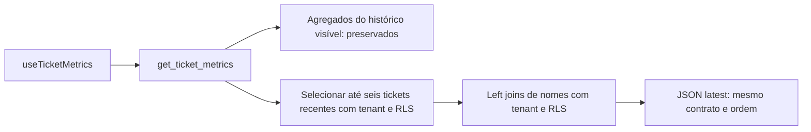

# Consulta limitada de tickets recentes do dashboard

Data: 17/11/2026. Base: `8118406`, branch local `codex/priority-session-whatsapp`.

## 1. Stack Tecnológica & Ecossistema

Mantidos PostgreSQL, Supabase/PostgREST e o contrato consumido pelo hook `useTicketMetrics`. Nenhuma dependência nova do produto ou alteração de UI/API TypeScript.

Arquivos centrais: migration/rollback `20261117180000_dashboard_latest_query.sql`, teste `supabase/tests/ticket_pagination_metrics_test.sql` e runner `scripts/security/test-atomic-workflows-postgres.mjs`.

## 2. Infraestrutura & Deploy

A migration substitui somente `apticket.get_ticket_metrics(integer)`, preservando assinatura, grants e modo `SECURITY INVOKER`. Aplicar depois das migrations `20261117120000_atomic_onboarding_portal_chat.sql` e `20261117140000_ticket_pagination_metrics.sql`. Não há índice, tabela, dado ou variável adicional. O schema PostgREST recebe notificação de recarga.

O rollback restaura a implementação anterior da função, inclusive a chamada da listagem. Não apaga tickets. Reverter este ajuste antes de remover as funções da migration anterior.

Nenhuma migration, publicação, push ou conexão em produção foi executada. A suíte Supabase completa em Docker continua dependente do CI; a validação local usa PostgreSQL 17.6 descartável em loopback, com fixtures sintéticas e políticas selecionadas do schema versionado.

## 3. Arquitetura & Conceitos de Domínio

Antes, para retornar seis tickets recentes, a função de métricas chamava `list_ticket_inbox` com página de dez itens. Isso reutilizava o pipeline de busca, filtros, joins, contagem exata e ordenação configurável de toda a listagem; os quatro itens restantes eram descartados.

Agora, a consulta seleciona até seis tickets por `created_at DESC NULLS LAST, id ASC` e então resolve os nomes relacionados e serializa os campos públicos. O JSON `latest` permanece igual aos seis primeiros itens da listagem sob a mesma sessão/snapshot e configuração de acesso.



O tenant continua derivado da sessão, `tickets.view` é exigido e as leituras permanecem sob RLS. Não é necessário conceder acesso a empresas/contatos para enxergar tickets; quando essas tabelas ocultam os nomes, os respectivos objetos continuam `null`.

## 4. Inventário de Funcionalidades (Features)

| Área | Resultado |
|---|---|
| Dashboard e visão geral | Mesmo contrato de indicadores e seis tickets recentes, sem executar a RPC completa da caixa de entrada |
| Indicadores | Períodos, calendário, SLA, durações e contagens históricas preservados |
| Listagem | Sem alteração em paginação, busca, filtros ou ordenação |
| Segurança | Tenant, permissão e RLS preservados para tickets e nomes relacionados |
| Testes SQL | Empates, nomes autorizados/ocultos, outros tenants, poucos/zero itens e independência da listagem |

## 5. Code Quality & Technical Debt (Bônus Técnico)

Evidências locais:

- RED na implementação anterior: revogar temporariamente o EXECUTE da listagem impedia a função de métricas de responder, com `permission denied for function list_ticket_inbox`.
- GREEN no PostgreSQL 17.6 real: mais de 1.200 registros, igualdade de todo o JSON dos seis recentes com a listagem, desempate por ID, nomes de empresa/contato/responsável, RLS de nomes, outro tenant, poucos/zero itens, acesso sem permissão/anônimo e demais regressões históricas de paginação/métricas.
- Migration, rollback e reaplicação executados; o runner compara `pg_get_functiondef` antes e depois do rollback e exige igualdade exata.
- Suíte local também aprovou os fluxos transacionais anteriores, cadastro concorrente e locks de contato/contrato.
- Contratos web de query/URL aprovados; typecheck web aprovado; lint de segurança sem erros, com 140 warnings existentes.
- Revisão independente sem achados críticos, importantes ou menores; confirmou preservação dos agregados e rollback exato. Sintaxe do runner e diff verificados.

Reprodução local com as ferramentas opcionais PostgreSQL já descritas na entrega de paginação:

```powershell
node scripts/security/test-atomic-workflows-postgres.mjs --tickets
node scripts/security/test-ticket-query.mjs
pnpm --filter web exec tsc --noEmit
pnpm lint:security
```

O ganho comprovado é estrutural: deixa de executar o pipeline completo da listagem para montar seis itens. `LIMIT 6` limita o resultado e o conjunto passado aos joins de nomes; não garante que o banco leia somente seis linhas. Sem um plano adequado, a seleção ainda pode percorrer/ordenar tickets visíveis. Os agregados continuam lendo o histórico completo e fazendo suas passagens existentes; a consulta SQL dos recentes continua separada dos agregados dentro da mesma RPC. Não foi medido ganho percentual ou latência em produção. Avaliação de índices, planos com distribuição real e redução das passagens de agregação continuam pendentes.
