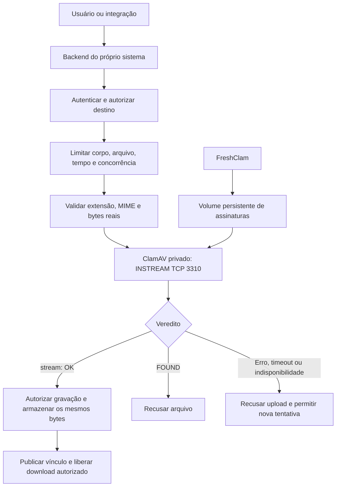

# Guia de implementação do ClamAV em aplicações hospedadas no Dokploy

**Referência:** implementação do APTicket publicada em 22/10/2026.  
**Público:** desenvolvimento, infraestrutura e responsáveis pela operação dos sistemas.  
**Ambiente:** servidor Linux com Docker/Dokploy; aplicações com backend e armazenamento de anexos.

Este guia explica a instalação existente, sua integração com o APTicket e o
procedimento para proteger outros sistemas no mesmo servidor. As configurações
reproduzem o código publicado no commit `7e762ca750a1c689d996d8b812be7adf43dd3bb1`.
O [relatório de validação](./validacao-20261022.md) registra a publicação e os testes.

Os comandos de terminal deste documento usam **Bash no servidor Linux**, salvo
indicação diferente. Execute-os com uma conta autorizada a administrar Docker.
Não é necessário colocar senhas, JWTs ou chaves de armazenamento neste documento
ou no Git. A aplicação de exemplo deve usar seus próprios segredos no Dokploy.

## Índice

1. [O que foi implementado](#1-o-que-foi-implementado)
2. [Arquitetura e fluxo do arquivo](#2-arquitetura-e-fluxo-do-arquivo)
3. [Arquivos de referência](#3-arquivos-de-referência)
4. [Escolher entre reutilizar e criar outro scanner](#4-escolher-entre-reutilizar-e-criar-outro-scanner)
5. [Instalação e configuração no Dokploy](#5-instalação-e-configuração-no-dokploy)
6. [Conectar outro sistema ao scanner existente](#6-conectar-outro-sistema-ao-scanner-existente)
7. [Implementação no backend](#7-implementação-no-backend)
8. [Política de arquivos e limites](#8-política-de-arquivos-e-limites)
9. [Integração com o Supabase Storage](#9-integração-com-o-supabase-storage)
10. [Navegador, portal, Edge, e-mail e WhatsApp](#10-navegador-portal-edge-e-mail-e-whatsapp)
11. [Sequência de implantação em outro sistema](#11-sequência-de-implantação-em-outro-sistema)
12. [Testes de aceitação](#12-testes-de-aceitação)
13. [Operação, assinaturas e monitoramento](#13-operação-assinaturas-e-monitoramento)
14. [Diagnóstico de problemas](#14-diagnóstico-de-problemas)
15. [Atualização, reversão e recuperação](#15-atualização-reversão-e-recuperação)
16. [Checklist de entrega](#16-checklist-de-entrega)
17. [Referências oficiais](#17-referências-oficiais)

## 1. O que foi implementado

O ClamAV foi instalado como um **serviço auxiliar Docker Compose**, administrado
pelo Dokploy. Não foi instalado como antivírus de desktop ou agente de proteção
geral do sistema operacional.

O serviço mantém o daemon `clamd`, que verifica os arquivos, e o `freshclam`, que
atualiza a base de assinaturas. Os backends enviam o conteúdo pelo protocolo
**INSTREAM**, em uma conexão TCP privada. O arquivo só é armazenado e publicado
pela aplicação depois de receber um resultado limpo.

No APTicket, a proteção inclui uploads do navegador, portal de clientes, avatar,
documentos de funcionários, documentos financeiros, base de conhecimento,
anexos de e-mail e mídias recebidas pelo WhatsApp. Áudios e vídeos foram
preservados na política aprovada.

### 1.1 Inventário da instalação existente

| Item | Valor de referência em 22/10/2026 |
| --- | --- |
| Origem | Repositório GitHub do APTicket → Dokploy |
| Tipo no Dokploy | Docker Compose; serviço `antivirus` |
| Diretório versionado | `infra/antivirus/` |
| Compose | `./infra/antivirus/compose.yml` |
| Imagem base | `clamav/clamav:1.5.4-debian`, fixada por digest no Dockerfile |
| Nome DNS interno | `apticket-antivirus` |
| Porta interna | TCP `3310` |
| Rede | `dokploy-network`, overlay Swarm com `attachable=true` |
| Portas publicadas no host | Nenhuma |
| Domínio público | Nenhum |
| Volume de assinaturas | Montado em `/var/lib/clamav` |
| Memória máxima | 4 GiB por container |
| CPU máxima | 1,5 CPU por container |
| Healthcheck | `clamdscan --ping 1` |
| Resultado aceito pela API | Exatamente `stream: OK` |

O nome real do container e o prefixo do volume são gerados pelo projeto Compose
do Dokploy. Na inspeção desta instalação eram, respectivamente,
`apticket-antivirus-efiegg-antivirus-1` e
`apticket-antivirus-efiegg_signatures`. Descubra os nomes atuais antes de operar;
não use esses nomes gerados como configuração permanente das aplicações.

### 1.2 Alcance e limitações

- Protege os **novos arquivos que passam pelos fluxos integrados**. Estar no
  mesmo servidor não torna outro sistema protegido automaticamente.
- Não houve varredura geral dos discos nem reprocessamento do acervo histórico.
- A API recusa arquivos quando o scanner está indisponível ou responde de forma
  inconclusiva. Não existe fallback que armazene o arquivo sem verificação.
- Um resultado limpo representa a análise disponível naquele momento; não é
  garantia absoluta de ausência de malware. Mantenha atualização, autorização,
  isolamento, controle de downloads e proteção do sistema operacional.
- A identificação de formato e o antivírus não substituem sanitização de HTML,
  validação de XML, remoção de macros ou reconstrução segura de documentos.

## 2. Arquitetura e fluxo do arquivo



A conexão ao scanner parte do **backend**, nunca do navegador. A API não envia
uma URL para o ClamAV baixar nem um caminho do disco da aplicação: envia os
bytes. Os buckets e diretórios dos sistemas não são montados no container do
scanner. Isso reduz o acesso do scanner ao armazenamento dos demais serviços.

**ClamD não implementa autenticação nem TLS nativos nesse protocolo.** A rede é
uma fronteira de confiança. Sem `ports:` a porta não fica publicada no host,
mas outros containers conectados à mesma rede podem alcançá-la. Use a rede
somente entre serviços confiáveis; a documentação oficial também alerta sobre
o uso do socket TCP. [Referência: operação do ClamD](https://docs.clamav.net/manual/Usage/Scanning.html).

## 3. Arquivos de referência

| Arquivo | Responsabilidade |
| --- | --- |
| [Dockerfile](../../infra/antivirus/Dockerfile) | Fixa imagem/digest e incorpora `clamd.conf` |
| [compose.yml](../../infra/antivirus/compose.yml) | Serviço, recursos, volume, rede e healthcheck |
| [clamd.conf](../../infra/antivirus/clamd.conf) | Política do daemon e limites de varredura |
| [FileSecurityService](../../apps/api/src/files/file-security.service.ts) | Limites por destino, worker e cliente INSTREAM |
| [Worker de tipos](../../apps/api/src/files/file-type.worker.mjs) | Verificação de formato, extensão, MIME e texto |
| [FileUploadService](../../apps/api/src/files/file-upload.service.ts) | Autorização, varredura, recibo e gravação no Storage |
| [FilesController](../../apps/api/src/files/files.controller.ts) | Rotas, autenticação interna, multipart e capacidade |
| [FilesModule](../../apps/api/src/files/files.module.ts) | Registro dos providers e controller no NestJS |
| [Validação de ambiente](../../apps/api/src/config/env.validation.ts) | `CLAMAV_HOST` e `CLAMAV_PORT` |
| [Upload do navegador](../../apps/web/src/lib/secure-upload.ts) | FormData com JWT para a API |
| [Upload do servidor web](../../apps/web/src/lib/secure-upload.server.ts) | Transporte privado para produtores confiáveis |
| [Limite de corpo web](../../apps/web/src/lib/bounded-body.server.ts) | Limites antes do parsing completo |
| [Upload de documentos Edge](../../supabase/functions/client-documents-upload/handler.ts) | Autoriza o usuário e delega a varredura à API |
| [Limite de corpo Edge](../../supabase/functions/_shared/bounded-body.ts) | Contagem efetiva de bytes no multipart |
| [Contrato de uploads verificados](../../supabase/migrations/20261022162436_scanned_upload_boundary.sql) | RPCs de autorização e recibos privados |
| [Fechamento de gravações diretas](../../supabase/migrations/20261022163913_enforce_scanned_storage_writes.sql) | Policies restritivas e trigger no Storage |
| [Testes de banco](../../supabase/tests/scanned_uploads_test.sql) | Autorização e exigência/consumo de recibos |

Para consultar esses arquivos fora deste checkout, use o
[repositório na revisão de referência](https://github.com/APTechSolucoesTI/ticket/tree/7e762ca750a1c689d996d8b812be7adf43dd3bb1).
Copie os componentes necessários para o repositório do outro sistema e adapte
suas dependências. Os nomes de schema, permissões, buckets e rotas do APTicket
não são uma configuração universal.

## 4. Escolher entre reutilizar e criar outro scanner

| Caminho | Quando usar | O que muda |
| --- | --- | --- |
| Reutilizar `apticket-antivirus:3310` | Sistemas confiáveis, política de até 25 MiB compatível e capacidade disponível | Integração e configuração no backend; não exige outro ClamAV |
| Criar instância separada | Isolamento necessário, política diferente ou contenção entre sistemas | Novo serviço Compose, alias DNS exclusivo, volume próprio e recursos adicionais |

Para os sistemas atuais no mesmo servidor, comece avaliando a **reutilização do
scanner existente**. Cada aplicação deve manter sua própria autorização,
credencial de armazenamento e tratamento de falhas. Compartilha-se o scanner,
não a API nem os segredos do APTicket.

Quatro uploads permitidos em cada aplicação não significam quatro uploads
globais: com vários backends o total aumenta. O daemon atual tem quatro threads
e fila configurada para oito solicitações. Meça tempo de espera, erros e memória
antes de ampliar o número de consumidores. Para cargas maiores, implemente
coordenação entre consumidores ou instâncias separadas, mantendo os arquivos
pendentes inacessíveis até a aprovação.

O limite de 4 GiB é um teto, não uma reserva garantida de RAM. O servidor também
executa Supabase, Dokploy e outros sistemas. Multiplicar instâncias de ClamAV
sem dimensionar o conjunto pode causar falta de memória. A documentação do
ClamAV descreve o consumo adicional durante a recarga das assinaturas.
[Referência: memória no Docker](https://docs.clamav.net/manual/Installing/Docker.html).

## 5. Instalação e configuração no Dokploy

**Se o objetivo for reutilizar o serviço existente, avance para a seção 6.**
Esta seção serve para reproduzir a instalação ou criar uma instância separada.

### 5.1 Preparar o repositório

Crie os três arquivos abaixo no repositório do sistema ou em um repositório
central de infraestrutura. Versione-os e publique no GitHub antes de configurar
o deploy. O fluxo de produção permanece **GitHub → Dokploy**.

```text
infra/
  antivirus/
    Dockerfile
    compose.yml
    clamd.conf
```

Dockerfile usado no APTicket:

<!-- BEGIN REFERENCE DOCKERFILE -->
```dockerfile
FROM clamav/clamav:1.5.4-debian@sha256:d7ede3cefeaf3b8a72ebcdee849d13f504bbca3f3b3cfade5bc7b6ee06a4f62c
COPY clamd.conf /etc/clamav/clamd.conf
```
<!-- END REFERENCE DOCKERFILE -->

O digest identifica a imagem exata validada, não uma promessa de que continuará
sendo a versão adequada no futuro. Em uma nova implantação, confira os avisos e
a versão suportada, selecione a imagem oficial e teste a atualização antes de
alterar tag/digest. Não substitua por `latest` sem controle de mudança.

Compose usado no APTicket:

<!-- BEGIN REFERENCE COMPOSE -->
```yaml
services:
  antivirus:
    build:
      context: .
      dockerfile: Dockerfile
    restart: unless-stopped
    mem_limit: 4g
    cpus: 1.5
    volumes:
      - signatures:/var/lib/clamav
    networks:
      dokploy-network:
        aliases:
          - apticket-antivirus
    healthcheck:
      test: ["CMD", "clamdscan", "--ping", "1"]
      interval: 30s
      timeout: 10s
      retries: 5
      start_period: 180s

volumes:
  signatures:

networks:
  dokploy-network:
    external: true
```
<!-- END REFERENCE COMPOSE -->

O contexto `.` é relativo ao diretório do arquivo Compose. Os três arquivos
precisam estar juntos. Não adicione `ports: ["3310:3310"]`, domínio Traefik,
volume de uploads dos clientes ou socket Docker ao serviço.

Para uma instância separada, substitua o alias `apticket-antivirus` por um nome
exclusivo, por exemplo `sistema-b-antivirus`. Dois scanners com o mesmo alias na
mesma rede tornam o destino ambíguo. Preserve um projeto/volume próprio e
dimensione a memória adicional.

### 5.2 Política do daemon

Configuração efetivamente usada:

<!-- BEGIN REFERENCE CLAMD -->
```text
Foreground yes
User clamav
DatabaseDirectory /var/lib/clamav
LocalSocket /tmp/clamd.sock
LocalSocketMode 660
FixStaleSocket yes
TCPSocket 3310
TCPAddr 0.0.0.0
LogFile /tmp/clamd.log
LogFileMaxSize 2M
LogRotate yes
LogTime yes
LogClean no
LogVerbose no
MaxThreads 4
MaxQueue 8
MaxConnectionQueueLength 16
CommandReadTimeout 5
ReadTimeout 30
StreamMaxLength 25M
MaxFileSize 25M
MaxScanSize 100M
MaxScanTime 30000
MaxRecursion 16
MaxFiles 10000
AlertExceedsMax yes
AlertEncryptedArchive yes
AlertEncryptedDoc yes
FailIfCvdOlderThan 7
ConcurrentDatabaseReload no
ScanPDF yes
ScanOLE2 yes
ScanHTML yes
ScanArchive yes
```
<!-- END REFERENCE CLAMD -->

| Grupo | Efeito na implementação |
| --- | --- |
| `TCPSocket` / `TCPAddr` | Escuta dentro do container; a ausência de publicação de porta é definida no Compose |
| `LocalSocket` | Comunicação local do healthcheck e notificação do FreshClam |
| `StreamMaxLength 25M` | Limita os bytes aceitos em INSTREAM a 25 MiB |
| `MaxFileSize 25M` / `MaxScanSize 100M` | Limitam arquivo individual e volume processado, inclusive expansão de conteúdo |
| `MaxRecursion 16` / `MaxFiles 10000` | Contêm o processamento de contêineres/arquivos compactados |
| `MaxScanTime 30000` | Limite interno configurado em milissegundos; mantenha também o timeout da aplicação |
| `MaxThreads 4` / `MaxQueue 8` | Limitam capacidade e fila do daemon; precisam ser considerados por todos os consumidores |
| `AlertExceedsMax yes` | Faz determinados limites de análise gerarem detecção heurística em vez de liberação silenciosa |
| `AlertEncryptedArchive` / `AlertEncryptedDoc` | Recusa arquivos protegidos por senha que não possam ser inspecionados segundo esta política |
| `FailIfCvdOlderThan 7` | Verificação de idade da base ao carregar/iniciar; não substitui um alerta contínuo de atualização |
| `ConcurrentDatabaseReload no` | Evita manter dois motores simultaneamente; pode suspender novas análises durante a recarga |
| `LogClean no` / `LogVerbose no` | Reduz registros desnecessários; não registra o conteúdo dos arquivos |

Não trate todos os limites como mecanismos equivalentes. Na amostra oficial da
versão 1.5.4, `MaxScanTime` tem uma ressalva de alcance para ZIP; a API mantém
seu próprio prazo total de 30 segundos. `AlertExceedsMax` documenta alertas para
limites específicos. O cliente deve recusar **qualquer resposta que não seja o
resultado limpo exato**, inclusive erro de tamanho ou timeout.
[Referência: configuração da versão utilizada](https://raw.githubusercontent.com/Cisco-Talos/clamav/clamav-1.5.4/etc/clamd.conf.sample).

### 5.3 Criar o serviço no Dokploy

1. Abra o projeto e o ambiente corretos no Dokploy.
2. Crie um serviço do tipo **Docker Compose**, no modo Compose. Este exemplo
   possui `build:`; não o publique diretamente como Docker Stack, que exige
   outra estratégia de imagem previamente construída.
3. Selecione o repositório GitHub e a branch de publicação, normalmente `main`.
4. Configure o caminho `./infra/antivirus/compose.yml`.
5. Mantenha domínio e portas públicas sem configuração para o scanner.
6. Confira a existência de `dokploy-network` e sua associação ao backend.
7. Faça o deploy e aguarde o healthcheck saudável, não apenas o fim do build.
8. Confira a persistência de `/var/lib/clamav`, os limites e os processos
   `clamd` e `freshclam`.
9. Se habilitar auto deploy, limite os caminhos observados a
   `infra/antivirus/**` e a outras dependências reais de build. Isso evita
   reiniciar o scanner a cada alteração sem relação com ele.

No serviço instalado, o healthcheck roda a cada 30 segundos, tem timeout de dez
segundos, cinco tentativas e carência inicial de 180 segundos. Download e carga
iniciais podem demorar; acompanhe os logs antes de concluir que há falha.
Considere ajustar essa carência se a capacidade do ambiente exigir.

No Dokploy, variáveis cadastradas para um Compose precisam ser referenciadas
em `environment:` ou `env_file:` quando devam entrar no container. Não basta
criá-las na interface. [Referência: Docker Compose no Dokploy](https://docs.dokploy.com/docs/core/docker-compose).

## 6. Conectar outro sistema ao scanner existente

### 6.1 Configurar o backend

No serviço **backend** do novo sistema, configure:

```dotenv
CLAMAV_HOST=apticket-antivirus
CLAMAV_PORT=3310
```

Esses valores não são segredos. São parâmetros operacionais fixos: não permita
que um usuário, tenant ou campo do formulário escolha o host/porta do scanner.
Não use `192.168.3.106:3310`: essa porta não está publicada no host. `localhost`
dentro do backend aponta para o próprio container, não para o scanner.

Se o backend usa Compose, acrescente a rede externa à configuração existente:

```yaml
services:
  backend:
    # Preserve image/build, secrets e as demais opções do sistema.
    environment:
      CLAMAV_HOST: apticket-antivirus
      CLAMAV_PORT: "3310"
    networks:
      - dokploy-network
      # Preserve também as outras redes necessárias a este backend.

networks:
  dokploy-network:
    external: true
```

Esse trecho deve ser **mesclado** ao Compose; não é um arquivo completo para
substituir a aplicação. Se o backend é uma Application do Dokploy em Swarm,
configure a rede na definição persistente do serviço pelo mecanismo disponível
na instalação e publique novamente. Um `docker network connect` manual em um
container não garante que a conexão sobreviva ao próximo deploy.

Não use `depends_on` para tentar controlar um scanner de outro projeto Compose.
Faça readiness e tratamento de indisponibilidade no próprio sistema.

### 6.2 Validar a rede

Comandos de inspeção, sem alterar a instalação:

```bash
docker network inspect dokploy-network \
  --format 'driver={{.Driver}} scope={{.Scope}} attachable={{.Attachable}}'

docker ps --filter name=antivirus \
  --format 'table {{.Names}}\t{{.Status}}\t{{.Ports}}'

docker ps --format 'table {{.Names}}\t{{.Status}}'
```

Identifique o container correto; se houver mais de um scanner, confira projeto,
rede e alias. O teste INSTREAM da seção 12 deve rodar **de dentro do backend**.
Um teste no host, que não participa necessariamente do DNS overlay, não prova
que a aplicação consegue conectar.

### 6.3 Quando a rede compartilhada não for apropriada

A configuração existente usa `dokploy-network`. Para aplicações com fronteiras
de confiança diferentes, planeje uma rede específica entre scanner e produtores
autorizados, ou uma instância separada. Preserve as redes necessárias ao proxy
e aos bancos de cada aplicação. Essa segmentação adicional é uma recomendação
para a expansão; não foi aplicada aos demais sistemas por este guia.

Em múltiplos hosts, não transporte o protocolo TCP aberto pela Internet. Use
rede privada protegida ou um gateway autenticado com TLS. Nunca publique o
socket ClamD diretamente para clientes externos.

## 7. Implementação no backend

### 7.1 Responsabilidades e ordem das verificações

O backend do novo sistema deve implementar o fluxo abaixo:

1. Autenticar antes de aceitar processamento pesado e limitar a concorrência
   antes de consumir o multipart inteiro.
2. Limitar bytes efetivamente recebidos, quantidade de arquivos/campos e tempo
   do corpo. `Content-Length` é uma verificação adicional, não a única.
3. Autorizar o usuário no tenant, recurso e destino informados. Um prefixo com
   UUID ou o nome de um bucket não concede autorização.
4. Validar bytes reais, extensão e MIME segundo a política do sistema.
5. Enviar os mesmos bytes ao ClamAV e aceitar somente `stream: OK`.
6. Armazenar esses bytes no destino autorizado, sem sobrescrever arbitrariamente
   objetos anteriores. Vincular/publicar o anexo depois da gravação bem-sucedida.
7. Remover apenas os objetos novos desse processamento se a publicação falhar.

No APTicket, os guards de autenticação/capacidade antecedem o Multer. A
autorização específica do recurso ocorre depois do parsing limitado e antes da
análise/gravação. Os produtores internos executam suas regras de domínio antes
de chamar o serviço de upload.

Pseudocódigo independente de linguagem:

```text
identidade = autenticar(requisicao)
arquivo = receber_com_limites(requisicao)
destino = autorizar_recurso_e_caminho(identidade, requisicao)
mime = validar_conteudo(arquivo.bytes, arquivo.nome, arquivo.mime)
veredito = scanner.instream(arquivo.bytes, timeout=30s)
se veredito != "stream: OK": recusar_sem_publicar()
objeto = gravar_bytes_verificados(destino, arquivo.bytes, mime)
publicar_vinculo_autorizado(objeto)
```

Não verifique uma cópia e depois permita que outra origem substitua o conteúdo
antes da gravação. Para arquivos temporários, mantenha-os inacessíveis aos
usuários e impeça alteração entre análise e publicação.

### 7.2 Reutilizar a implementação Node.js/NestJS

O APTicket usa Node.js 22 em produção e `file-type` **22.2.0** na revisão de
referência. Para um sistema NestJS compatível:

- Adapte `FileSecurityService` e `file-type.worker.mjs` para sua configuração de
  ambiente, destinos e política. O serviço de varredura não exige Supabase.
- Registre o provider no módulo e injete-o no fluxo de armazenamento existente.
- Adicione validação de `CLAMAV_HOST` e `CLAMAV_PORT` no ambiente. No APTicket,
  o host padrão é `apticket-antivirus` e a porta padrão é `3310`.
- Preserve o worker no build. O [nest-cli.json](../../apps/api/nest-cli.json)
  inclui `"assets": ["**/*.mjs"]`; sem isso, o código compilado pode funcionar
  localmente e falhar no container por falta do worker.
- Fixe a dependência compatível no manifest/lockfile e valide o build da versão
  Node escolhida. Não copie o lockfile inteiro do APTicket para outro projeto.
- Adapte o controller e o serviço de armazenamento ao modelo do novo sistema;
  não copie os nomes de permissões ou o contrato interno do APTicket sem revisão.

Exemplo do ponto de integração com o serviço adaptado:

```typescript
// Autenticação, limites e autorização do destino já executados.
const mime = await fileSecurity.validate(
  destinoPermitido,
  file.buffer,
  file.originalname,
  file.mimetype,
);

// Esta função só é alcançada após a aprovação da análise.
// No APTicket com Supabase, use FileUploadService para incluir o recibo.
await armazenamento.gravarSemSobrescrever(caminhoAutorizado, file.buffer, mime);
```

Os nomes `destinoPermitido` e `armazenamento` são pontos de adaptação, não APIs
existentes no APTicket. Para PHP, Python, Java ou outra stack, use um cliente
ClamD confiável que implemente INSTREAM, timeout total e limite de resposta,
preservando as mesmas decisões de segurança.

### 7.3 Como o protocolo foi implementado

O cliente do APTicket abre uma conexão para o host/porta fixos, envia
`zINSTREAM` terminado por byte nulo e transmite os bytes em blocos de até
65.536 bytes. Cada bloco é precedido pelo comprimento de quatro bytes em
big-endian. Um bloco de comprimento zero encerra o arquivo. O cliente respeita
o backpressure do socket, limita a resposta a 4.096 caracteres e mantém um
prazo total de 30 segundos.

| Resposta/situação | Decisão do backend |
| --- | --- |
| `stream: OK` | Prosseguir com a gravação autorizada |
| Resposta terminada em ` FOUND` | Recusar arquivo; no APTicket, HTTP 400 |
| Erro do scanner, resposta desconhecida ou incompleta | Não gravar; HTTP 503 |
| Falha de DNS/conexão ou timeout | Não gravar; HTTP 503 |
| Capacidade do backend esgotada | Não iniciar mais processamento; HTTP 503 |

Não use apenas `resposta.includes("OK")` nem considere um socket fechado como
aprovação. ClamD não é um servidor HTTP; `fetch("http://...:3310")` não é um
cliente de varredura válido. [Referência do protocolo INSTREAM](https://raw.githubusercontent.com/Cisco-Talos/clamav/clamav-1.5.4/docs/man/clamd.8.in).

### 7.4 Rotas e credenciais

No APTicket existem dois caminhos:

| Caminho | Consumidor e controle |
| --- | --- |
| `POST /files/upload` na API; `/backend/files/upload` no proxy web | Usuário com JWT; a API verifica a permissão no recurso |
| `POST /files/internal-upload` | Produtores de servidor confiáveis; guard com comparação de segredo em tempo constante antes do multipart |

Ambos recebem `multipart/form-data` com os campos `bucket`, `path` e `file`.
O caminho interno usa `X-APTicket-Internal-Key`. Na implementação existente o
segredo comparado é `SUPABASE_SERVICE_ROLE_KEY`; ele fica exclusivamente nos
servidores. `@Public()` nessa rota desativa o guard JWT global, mas **não** o
guard da credencial interna.

**Outros sistemas não devem receber essa chave nem usar essa rota como gateway
genérico.** Reutilize a conexão ao scanner e implemente o armazenamento no
backend de cada sistema. Se um novo sistema precisar de transporte interno,
prefira uma credencial específica desse serviço e autenticação com o menor
privilégio necessário. Isso é uma orientação para a nova implementação, não
uma descrição de uma troca já feita no contrato do APTicket.

O navegador não define manualmente o `Content-Type` do FormData: a biblioteca
HTTP deve gerar o boundary. Não envie segredo de servidor em variável pública,
JavaScript de navegador, URL, log ou exemplo de documentação.

### 7.5 Download e publicação do arquivo aprovado

Preserve os buckets privados e as regras de autorização de leitura. Emita URL
assinada somente depois da aprovação e para o recurso autorizado, com validade
limitada. Uma URL assinada já emitida pode continuar utilizável até expirar;
revogar a sessão do usuário não a transforma automaticamente em inválida.

Sirva o MIME validado pelo servidor. Nos endpoints de download administrados
pela aplicação, use `Content-Disposition: attachment` quando não houver uma
pré-visualização segura e `X-Content-Type-Options: nosniff`. Não execute nem
renderize anexos arbitrários no contexto autenticado do sistema. Essas são
orientações para cada sistema; não representam mudança global de headers nos
buckets dos demais aplicativos do servidor.

## 8. Política de arquivos e limites

### 8.1 Limites do APTicket

| Destino | Limite por arquivo |
| --- | --- |
| `ticket-attachments` | 25 MiB = 26.214.400 bytes |
| `kb-attachments`, `client-documents`, `funcionario-documentos`, `funcionario-beneficios`, `supplier-payment-receipts`, `supplier-payable-attachments` | 10 MiB = 10.485.760 bytes |
| `apticket-profile-avatars` | 2 MiB = 2.097.152 bytes |

Outras camadas podem impor um subconjunto de formatos, quantidades e limites
menores: o fato de a política central aceitar um formato não obriga o avatar ou
o módulo de documentos financeiros a aceitá-lo.

| Camada | Proteção existente |
| --- | --- |
| Multipart da API | Um arquivo, dois campos, três partes; arquivo até 25 MiB; campos até 2.048 bytes |
| Capacidade HTTP da API | Quatro uploads ativos por processo; prazo do corpo de 45 segundos |
| Validação de conteúdo | Até quatro validações ativas por instância do serviço; worker com prazo de três segundos |
| Worker Node | Limites de heap/stack configurados; heap antigo de 64 MiB e jovem de 16 MiB, sem equivaler a limite total de RSS do processo |
| ClamD | Quatro threads, fila oito e limites de expansão/recursão |
| Cliente ClamD | Prazo total de 30 segundos |
| Portal web | Contagem do corpo multipart, com teto agregado de 51 MiB |
| Server functions web | Limite de corpo JSON de 4 MiB antes da desserialização |
| Documentos Edge | Até vinte arquivos de 10 MiB; teto de transporte agregado de 201 MiB |

Os tetos de transporte não são promessa de capacidade concorrente ou de memória
disponível. O runtime Edge também tem limite de memória. O parser lê um stream
com contagem de bytes para evitar uma segunda cópia integral do corpo; não é
uma garantia de aceitar qualquer lote máximo em qualquer ambiente. Dimensione
e teste o volume real do outro sistema.

A API do APTicket ainda recebe o arquivo em `file.buffer` do Multer e o worker
recebe os bytes para análise: existe buffering limitado em memória. INSTREAM
envia blocos ao daemon, mas não torna todo o caminho um upload sem buffering.
Para arquivos maiores, será necessário outro desenho com temporários privados
ou quarentena, limites equivalentes e publicação somente após a aprovação.

### 8.2 Formatos na política central

| Grupo | Extensões tratadas na implementação de referência |
| --- | --- |
| Documento | PDF; DOC/XLS/PPT; DOCX/XLSX/PPTX; ODT/ODS/ODP; RTF |
| Imagem | JPG/JPEG, PNG, GIF, WebP, BMP, TIF/TIFF, ICO, AVIF |
| Texto | TXT, LOG, CSV, MD, JSON, XML |
| Compactado | ZIP |
| Áudio | OGG/OGA/Opus, MP3, M4A, AAC, AMR, WAV, FLAC; WebM quando declarado como áudio e compatível com o contêiner |
| Vídeo | MP4/M4V, MOV, WebM, MKV, AVI, 3GP, MPG/MPEG, OGV |

O worker compara a identificação dos bytes com a extensão e o MIME declarado,
com aliases explícitos para casos legítimos. `application/octet-stream` não
dispensa a validação dos bytes. Texto passa por decodificação estrita; conteúdo
binário e raízes de HTML/SVG ativo são recusados; JSON é analisado; XML com
declarações de entidade/DOCTYPE é recusado.

Executáveis, HTML e SVG não fazem parte da lista permitida. Renomear um
executável para `.pdf` não o torna aceitável. Arquivos criptografados ou
protegidos por senha são recusados conforme a configuração do scanner.

Essa validação identifica formatos/contêineres, sem provar a integridade
semântica de todo documento. Por exemplo, Office legado é reconhecido pelo
contêiner CFB e pela extensão, sem uma validação completa dos seus objetos
internos. Para outros sistemas, defina uma lista compatível com o negócio;
habilitar um formato novo exige teste de conteúdo real e teste de integração.

## 9. Integração com o Supabase Storage

### 9.1 Por que a integração da API precisa de controle no Storage

Trocar o botão de upload do frontend não basta se o usuário ainda puder gravar
diretamente pelo SDK ou pela API do armazenamento. No Supabase, policies de
`storage.objects` controlam o acesso dos papéis comuns. A service role pode
contornar RLS, por isso a implementação do APTicket acrescenta uma exigência
de recibo também para os produtores privilegiados.
[Referência: controle de acesso do Supabase Storage](https://supabase.com/docs/guides/storage/security/access-control).

Os arquivos continuam sendo enviados/removidos pelo SDK/API do Storage. Não
grave ou apague linhas de `storage.objects` manualmente para movimentar os
objetos: metadados e conteúdo precisam permanecer consistentes.

### 9.2 Como o recibo do APTicket funciona

1. A API valida o usuário e o recurso usando o JWT do chamador, não uma
   autorização de service role no lugar do usuário.
2. O `FileSecurityService` valida e obtém o resultado limpo do ClamAV.
3. A API calcula SHA-256 e cria um recibo privado de curta duração, associado
   ao bucket, caminho, tamanho e hash. A validade é de dois minutos.
4. A gravação usa `upsert: false`, MIME validado e
   `metadata: { scan_id: idDoRecibo }` no SDK do Storage.
5. O trigger exige recibo válido e compatibilidade de destino/tamanho e o
   consome na gravação final. Reuso de recibo não é aceito.
6. Se o SDK falhar, a API revoga o recibo. A criação de novos recibos também
   faz limpeza limitada de registros expirados.

A tabela `apticket_security_private.scanned_upload_permits` fica em schema
privado, com RLS e sem acesso dos usuários. As RPCs de criação/revogação são
exclusivas de service role. A autorização do recurso usa a RPC invoker
`can_upload_apticket_object`, com o contexto do usuário.

O recibo é um **contrato interno de confiança**: não é uma assinatura emitida
pelo ClamAV. O banco armazena o SHA-256 informado pela API, mas o trigger não
lê os bytes do objeto para recalcular esse hash. Um backend comprometido com
permissão de emitir recibos continua fora dessa garantia. Proteja as credenciais
e a cadeia que conserva os mesmos bytes entre análise e gravação.

### 9.3 Particularidade importante do Storage utilizado

A versão validada foi `supabase/storage-api:v1.60.4`. Ela faz uma tentativa
transacional de permissão antes da gravação final. Nessa etapa, os metadados
podem estar ausentes; a transação é revertida.

O trigger distingue essa sondagem da gravação final: exige recibo existente na
sondagem e consome o recibo na operação com metadados finais. Apagar o recibo
de forma irreversível na sondagem quebraria uploads legítimos. A exceção de
administração direta no SQL também é restrita ao contexto de DBA previsto na
migration; ela não representa uma liberação para requisições do Storage.

Isso exige teste de integração com a **versão real** do Storage. Não copie o
trigger para outra instalação presumindo que SDK, metadados e sondagem sejam
iguais. Este mecanismo é uma adaptação do APTicket, não um recurso nativo de
antivírus habilitado no Supabase.

### 9.4 Adaptar para outro sistema

- Crie migrations novas no repositório do sistema. Não reaplique as migrations
  já executadas do APTicket nem altere seu histórico.
- Use os schemas, buckets e funções próprios. As listas restritivas devem
  alcançar somente os buckets do sistema que está sendo integrado.
- Preserve autorização por tenant/recurso e acesso de leitura/download.
- Implemente primeiro o contrato de recibo; migre todos os produtores; somente
  então impeça as gravações antigas.
- Teste também tentativas com service role, não apenas anon/authenticated.
- Para armazenamento local/S3 de outro fornecedor, aplique a mesma fronteira:
  somente o backend verificado pode publicar/gravar; não distribua uma
  credencial de upload que contorne a análise.

Se usar upload direto para quarentena, o desenho é outro: o objeto deve ficar
inacessível até a análise e promoção explícitas, sem reutilizar uma URL pública
ou assinada emitida antes da aprovação. Esse fluxo não foi implementado no
APTicket por este lote.

## 10. Navegador, portal, Edge, e-mail e WhatsApp

| Origem | Comportamento adotado no APTicket |
| --- | --- |
| Navegador autenticado | `secureUpload` envia FormData com JWT à API; não chama mais upload direto do SDK |
| Portal e avatar no servidor web | Regra de domínio executada antes de `secureServerUpload`; destino interno fixo e segredo apenas no servidor |
| Documentos financeiros Edge | Valida identidade/permissão e corpo; encaminha cada arquivo à rota autenticada da API com JWT do usuário |
| E-mail recebido | Anexos passam por `FileUploadService`; conteúdo recusado não vira anexo publicado; indisponibilidade do scanner permite nova tentativa |
| WhatsApp recebido | Mídias passam por `FileUploadService`; inclui áudio/vídeo; não publica URL externa como fallback para arquivo recusado |

No frontend de servidor, a configuração de referência usa
`INTERNAL_BACKEND_URL=http://apticket-backend-o1zrvz:3001`. A função Edge usa
`APTICKET_API_URL=https://apticket.aptechinfo.com.br:75/backend`. Esses destinos
são do APTicket; o outro sistema deve usar sua própria API.

Na instalação self-hosted do Supabase, cadastrar uma variável no `.env` não
basta se ela não for passada ao serviço `functions`. A publicação do APTicket
incluiu a variável no ambiente do runtime, os arquivos da função/helper e a
recriação **somente** do serviço de funções. Não foi necessário reiniciar o
PostgreSQL para ativar o antivírus.

Nos consumidores assíncronos, diferencie arquivo recusado de falha temporária.
No APTicket, falha temporária mantém a possibilidade de repetir o e-mail e
libera a reserva de deduplicação da mídia WhatsApp antes do retry da fila.
Arquivos novos são removidos quando o processamento falha; arquivos anteriores
do usuário não são apagados como compensação.

Para outros sistemas, inventarie também importações em lote, tarefas agendadas,
webhooks, editores ricos, galerias, anexos financeiros e rotas administrativas.
Um único produtor antigo com acesso direto pode manter a lacuna.

## 11. Sequência de implantação em outro sistema

### 11.1 Preparar e validar

1. Liste todas as entradas de arquivo e destinos de armazenamento.
2. Defina formatos, tamanhos, política de arquivos protegidos e comportamento
   de retry. Verifique funcionalidades como gravação de voz e vídeo.
3. Escolha scanner compartilhado ou separado, rede e capacidade.
4. Implemente a análise, limites, autorização e limpeza dos objetos novos.
5. Prepare o controle que impedirá contornar a análise no armazenamento.
6. Execute os testes em ambiente isolado, com dados e credenciais fictícios.
7. Prepare migrations reversíveis e uma versão anterior recuperável.

### 11.2 Publicar sem interromper os produtores antigos

1. Publique e valide o scanner, se ainda não existir.
2. Aplique a migration que adiciona o contrato novo, sem bloquear uploads antigos.
3. Publique a API pelo GitHub → Dokploy e aguarde o serviço novo saudável.
4. Faça um upload sintético pelo caminho novo, leia e remova o arquivo.
5. Publique frontend, funções Edge, workers e integrações que enviam arquivos.
6. Confirme que todos usam a análise e que as instâncias antigas terminaram
   sua substituição. Build concluído não prova que o Swarm já trocou a tarefa.
7. Aplique a migration/política que exige a análise no armazenamento.
8. Repita os testes de upload limpo, detecção, download e tentativa de bypass.
9. Confira monitoramento, retorno do auto deploy à política normal e relatório.

No APTicket a ordem foi:

```text
20261022162436_scanned_upload_boundary.sql
→ API
→ frontend e Edge
→ 20261022163913_enforce_scanned_storage_writes.sql
→ verificação real e remoção dos arquivos de teste
```

Se houver bloqueio antecipado do Storage, frontends e workers ainda antigos
passarão a falhar. Coordene deployments e migrations; use exclusão mútua de
deploys quando necessário. Não desative controles globais do Supabase
compartilhado para resolver uma incompatibilidade de um único sistema.

## 12. Testes de aceitação

### 12.1 Confirmar o scanner e a configuração

Identifique e selecione o container correto:

```bash
docker ps --filter name=antivirus --format '{{.Names}}'
export SCANNER_CONTAINER='NOME_ATUAL_DO_CONTAINER_DO_SCANNER'

docker inspect "$SCANNER_CONTAINER" \
  --format 'estado={{.State.Status}} saude={{.State.Health.Status}} memoria={{.HostConfig.Memory}} cpu={{.HostConfig.NanoCpus}} portas={{json .HostConfig.PortBindings}}'

docker inspect "$SCANNER_CONTAINER" \
  --format '{{range .Mounts}}{{.Type}} {{.Destination}} {{.Name}}{{println}}{{end}}'

docker exec "$SCANNER_CONTAINER" clamdscan --ping 1
docker top "$SCANNER_CONTAINER" -eo pid,comm
```

Na referência, o resultado esperado inclui `healthy`, `PONG`, limite de memória
`4294967296`, CPU `1500000000`, nenhuma porta publicada e volume no caminho
`/var/lib/clamav`. Os processos incluem `clamd` e `freshclam`.

### 12.2 Testar INSTREAM a partir do backend

O exemplo abaixo usa Node.js no container do backend. Verifica um conteúdo
limpo e o padrão EICAR, **somente em memória**, sem gravar no Storage ou enviar
mensagens. Não varre discos. Ele é uma sonda de diagnóstico com payloads
pequenos, não um substituto do cliente de produção com controle de blocos,
concorrência e política de arquivo.

O EICAR é um padrão de teste reconhecido por antivírus; não use malware real.
Sua detecção confirma esse caminho de análise, não a eficácia contra todo
malware. [Referência do arquivo de teste](https://www.eicar.org/download-anti-malware-testfile/).

```bash
export API_CONTAINER='NOME_ATUAL_DO_CONTAINER_DO_BACKEND'

docker exec -i "$API_CONTAINER" node <<'NODE'
const assert = require('node:assert/strict');
const net = require('node:net');

function scanProbe(bytes) {
  return new Promise((resolve, reject) => {
    const socket = net.createConnection({
      host: process.env.CLAMAV_HOST || 'apticket-antivirus',
      port: Number(process.env.CLAMAV_PORT || 3310),
    });
    let response = '';
    let settled = false;
    let timer;
    const finish = (error, verdict) => {
      if (settled) return;
      settled = true;
      clearTimeout(timer);
      socket.destroy();
      if (error) reject(error);
      else resolve(verdict);
    };
    timer = setTimeout(() => finish(new Error('scanner_timeout')), 30000);
    socket.once('error', () => finish(new Error('scanner_connection_error')));
    socket.once('close', () => finish(new Error('scanner_incomplete_response')));
    socket.once('connect', () => {
      const length = Buffer.alloc(4);
      length.writeUInt32BE(bytes.length);
      socket.write(Buffer.concat([
        Buffer.from('zINSTREAM\0'), length, bytes, Buffer.alloc(4),
      ]));
    });
    socket.on('data', (chunk) => {
      response += chunk.toString('utf8');
      if (response.length > 4096) return finish(new Error('invalid_response'));
      if (response.includes('\0') || response.includes('\n')) {
        finish(null, response.replace(/[\0\r\n]+$/, ''));
      }
    });
  });
}

(async () => {
  assert.equal(await scanProbe(Buffer.from('Arquivo sintetico limpo')), 'stream: OK');
  console.log('OK: conteudo limpo');
  const eicar = 'X5O!P%@AP[4' + String.fromCharCode(92)
    + 'PZX54(P^)7CC)7}$' + 'EICAR-STANDARD-ANTIVIRUS-TEST-FILE!$H+H*';
  assert.equal(Buffer.byteLength(eicar), 68);
  assert.match(await scanProbe(Buffer.from(eicar)), / FOUND$/);
  console.log('OK: EICAR detectado');
})().catch((error) => {
  console.error('FALHA:', error.message);
  process.exitCode = 1;
});
NODE
```

### 12.3 Testar a aplicação completa

| Caso | Resultado necessário |
| --- | --- |
| Arquivo limpo e autorizado | Upload aceito; download com os mesmos bytes; objeto de teste removido |
| EICAR enviado como texto permitido | Recusa pelo antivírus; nenhum anexo publicado |
| Scanner inacessível | Falha temporária; nenhum arquivo liberado sem análise |
| Extensão/MIME incompatível | Recusa antes da publicação |
| Executável renomeado, HTML/SVG ativo | Recusa |
| Arquivo acima do limite, inclusive envio chunked | Recusa pelo limite efetivo; HTTP 400/413 conforme a camada |
| Arquivo protegido por senha/limite de expansão | Recusa segundo a política; sem liberação silenciosa |
| Usuário sem sessão ou de outro tenant | Recusa; nenhum acesso ao destino estrangeiro |
| Upload direto no armazenamento | Recusa nos destinos protegidos, inclusive via credencial privilegiada quando o desenho usa recibos |
| Recibo expirado, usado ou para outro caminho | Recusa |
| Falha depois do upload, antes da publicação | Limpeza dos objetos novos, preservando os anteriores |
| Áudio/voz/vídeo legítimos | Mantêm funcionamento dentro da política |
| Vários produtores concorrentes | Capacidade e tempos limitados, sem aceitar arquivos não analisados |

Teste indisponibilidade em staging ou por injeção de dependência. **Não pare o
scanner compartilhado em produção para testar um único sistema:** isso afeta
os demais consumidores. O cenário deve ser simulado em um backend isolado ou
coordenado em janela própria.

### 12.4 Evidências obtidas no APTicket

- CI da revisão `7e762ca` aprovado nos cinco jobs; 132 testes da API, 58 testes
  Edge e 41 arquivos/1.574 asserções SQL, além das verificações de backfill.
- Em produção, após exigir os recibos: upload limpo pela API **201**;
  download assinado **200**, com bytes conferidos; upload direto com service
  role sem recibo **403**; EICAR pela API **400**.
- Objetos sintéticos removidos e contagem residual zero. Nenhum arquivo de
  cliente, e-mail ou mensagem real foi usado nesse teste.

O [relatório de publicação](./validacao-20261022.md) e o
[CI correspondente](https://github.com/APTechSolucoesTI/ticket/actions/runs/39833221291)
registram o escopo. Esses resultados não substituem os testes do outro sistema.

## 13. Operação, assinaturas e monitoramento

### 13.1 Assinaturas e versão do motor são atualizações diferentes

O FreshClam atualiza as assinaturas no volume e notifica o daemon. Isso não
atualiza a versão do executável ClamAV nem a distribuição base da imagem;
essas atualizações exigem alterar tag/digest e publicar uma imagem nova.

Na inspeção de 22/10/2026, ambos os processos estavam ativos e o log registrava
download da base `daily.cld`. O healthcheck confirma que o daemon responde,
mas **não comprova que a versão mais recente foi carregada em memória**.
Compare o log/arquivo de assinaturas, o comando `VERSION` do daemon e a
conclusão da recarga. Um aviso de que o socket local ainda não existia pode
ocorrer durante a primeira inicialização; ele exige conferência posterior.

**Observação da inspeção para este guia:** o log do FreshClam registrava a base
`daily.cld` na versão `28161`, enquanto a consulta `VERSION` ao daemon retornava
`28158`, com data de 19/10/2026. Portanto, a sincronização entre o download e o
motor em memória não foi atestada nessa consulta. Essa divergência requer
verificação operacional da recarga antes de ampliar o uso compartilhado; a
elaboração deste documento não reiniciou nem recarregou o serviço de produção.
O teste EICAR verifica a detecção desse padrão, não resolve essa conferência.

Comandos de leitura, usando o container selecionado na seção 12:

```bash
docker exec "$SCANNER_CONTAINER" sh -c \
  'tail -n 60 /var/log/clamav/freshclam.log'

docker exec "$SCANNER_CONTAINER" sh -c \
  'tail -n 60 /tmp/clamd.log'

docker exec "$SCANNER_CONTAINER" sh -c \
  'for f in /var/lib/clamav/daily.cld /var/lib/clamav/daily.cvd; do if [ -f "$f" ]; then sigtool --info "$f"; fi; done'

docker stats --no-stream "$SCANNER_CONTAINER"
```

Esses logs devem permanecer restritos à operação. Não compartilhe conteúdo
integral, nomes de arquivos de clientes ou dumps de `docker inspect` com
variáveis de ambiente. Não execute outro FreshClam concorrente no mesmo volume
apenas para forçar atualização; primeiro confira o daemon e seus logs.

Para consultar o motor carregado a partir do backend Node, envie `zVERSION`
com o terminador nulo, da mesma forma que a sonda INSTREAM abre o socket.
`clamdscan --version` isoladamente não deve ser a única prova de sincronização
entre a base em disco e a análise em memória.

Consulta pronta para o backend selecionado na seção 12:

```bash
docker exec -i "$API_CONTAINER" node <<'NODE'
const net = require('node:net');
let response = '';
const socket = net.createConnection({
  host: process.env.CLAMAV_HOST || 'apticket-antivirus',
  port: Number(process.env.CLAMAV_PORT || 3310),
}, () => socket.write('zVERSION\0'));
const timer = setTimeout(() => {
  socket.destroy();
  process.exitCode = 1;
}, 5000);
socket.on('error', () => {
  clearTimeout(timer);
  process.exitCode = 1;
});
socket.on('data', (chunk) => {
  response += chunk.toString('utf8');
  if (response.length > 4096) {
    clearTimeout(timer);
    socket.destroy();
    process.exitCode = 1;
  } else if (response.includes('\0') || response.includes('\n')) {
    console.log(response.replace(/[\0\r\n]+$/, ''));
    clearTimeout(timer);
    socket.destroy();
  }
});
socket.once('close', () => {
  clearTimeout(timer);
  if (!response.includes('\0') && !response.includes('\n')) process.exitCode = 1;
});
NODE
```

Se o download estiver concluído e a investigação indicar recarga pendente,
coordene a intervenção entre os consumidores. O comando abaixo **solicita uma
recarga**, podendo suspender temporariamente a análise com a configuração
atual; não é uma verificação somente de leitura:

```bash
docker exec "$SCANNER_CONTAINER" clamdscan --reload
```

O retorno desse comando não prova conclusão. Aguarde o registro de carga no
log, repita `VERSION`, `PONG` e os testes de análise. Uma falha persistente exige
diagnóstico do volume/configuração/daemon; não habilite uploads sem scanner
para contorná-la. Essa solicitação de recarga não foi executada na elaboração
do guia.

### 13.2 O que acompanhar

| Sinal | Ação esperada |
| --- | --- |
| Container unhealthy, reinício ou OOM | Investigar memória, configuração, base e logs; manter uploads fechados |
| Falha repetida de FreshClam ou base envelhecendo | Verificar DNS, saída HTTPS, certificado, permissões e eventual bloqueio do fornecedor |
| Base nova em disco sem confirmação de carga | Investigar notificação/socket e recarga; conferir o motor antes de considerar resolvido |
| Aumento de HTTP 503 ou latência | Distinguir scanner offline, recarga, fila e capacidade dos produtores |
| Uso de memória/CPU próximo do teto | Dimensionar o conjunto de aplicações antes de ampliar limites |
| Espaço baixo no volume/disco | Corrigir capacidade e retenção sem apagar a base de assinaturas em uso |
| Detecções | Registrar código/resultado com identificação técnica mínima; não registrar bytes ou segredos |

Como ponto de partida para a expansão, configure alertas de falha de atualização
e idade de base antes do limite de sete dias, além de saúde e saturação. Esses
alertas centralizados são uma recomendação: este lote não implantou um painel
de métricas ou uma rotina geral de auditoria dos demais sistemas.

Durante recarga com `ConcurrentDatabaseReload no`, novas análises podem esperar
ou falhar pelo prazo da API. O sistema deve mostrar falha temporária e permitir
nova tentativa; não deve alterar a política para aceitar sem scanner.

Para falhas de atualização, use o
[diagnóstico oficial do FreshClam](https://docs.clamav.net/faq/faq-freshclam.html).
Não desative a validação TLS para contornar erro de certificado.

## 14. Diagnóstico de problemas

| Sintoma | Causas a conferir | Correção orientada |
| --- | --- | --- |
| `ENOTFOUND` no host do scanner | Backend fora da rede ou alias incorreto | Corrigir a rede na definição persistente; publicar o backend novamente |
| `ECONNREFUSED` / timeout | Scanner iniciando, indisponível, fila ou host/porta errados | Verificar `PONG`, saúde, recursos e logs; conferir DNS interno |
| ClamAV healthy, mas upload dá 503 | Falha do worker, RPC/recibo, Storage ou capacidade, além do scanner | Examinar o ponto de falha; saudável não significa fluxo completo aprovado |
| Worker não encontrado após build | `.mjs` não incluído nos assets | Corrigir o empacotamento e validar a imagem final |
| `FOUND` em arquivo legítimo | Detecção, limite heurístico ou arquivo protegido por senha | Identificar o tipo de resultado; revisar com segurança, sem liberar automaticamente |
| Erro de tamanho do INSTREAM | Limite da aplicação acima de `StreamMaxLength` | Alinhar aplicação, scanner e armazenamento; não remover os tetos |
| Falha periódica de memória | Recarga de base e soma das cargas | Conferir OOM/RAM; preservar limite e dimensionar antes de novas instâncias |
| FreshClam sem permissão | Volume com owner inadequado ou diretório não gravável | Corrigir somente o volume do scanner, conforme imagem/UID; evitar chmod amplo |
| FreshClam 429/cooldown | Frequência excessiva ou bloqueio temporário | Respeitar o intervalo informado; não criar loop de download |
| Base atualizada em disco, motor antigo | Notificação inicial perdida ou recarga não concluída | Conferir `NotifyClamd`, socket, logs e VERSION; coordenar recarga controlada |
| Storage 403 mesmo com arquivo limpo | Recibo ausente, expirado, consumido ou incompatível; produtor antigo | Conferir contrato de upload/metadata e ordem de publicação; não abrir a policy global |
| Áudio/vídeo recusado | MIME/extensão/contêiner incompatível ou tamanho acima do destino | Conferir o arquivo real e aliases aprovados; acrescentar teste antes de mudar a lista |
| FormData não chega corretamente | Boundary manual, proxy bufferizando ou corpo truncado | Deixar o cliente gerar o boundary e verificar limites do proxy/backend |

Não envie detalhes internos de detecção, caminho de disco, stack trace ou
credenciais ao usuário final. Mostre recusa de arquivo ou indisponibilidade
temporária, mantendo o diagnóstico técnico nos registros restritos.

## 15. Atualização, reversão e recuperação

### 15.1 Atualizar ClamAV ou a política

1. Consulte versão suportada, avisos e compatibilidade das opções do daemon.
2. Valide a nova imagem/configuração fora de produção, usando base e volume
   próprios. Não rode dois atualizadores sobre o mesmo volume por improviso.
3. Faça os testes limpo, EICAR, offline, limites e formatos usados no negócio.
4. Registre o novo digest, configuração, evidências e versão anterior.
5. Publique a alteração pelo GitHub → Dokploy em janela compatível com os
   consumidores. Um único scanner é ponto compartilhado de disponibilidade.
6. Aguarde saúde e análise real após a recarga. Monitore falhas temporárias.

Se o problema estiver apenas no scanner/configuração, reverta a imagem/config
pelo repositório e Dokploy, preservando a fronteira que exige análise. Enquanto
ele não estiver operacional, mantenha a recusa de novos uploads.

### 15.2 Reverter a integração de armazenamento

As reversões de referência estão em
[contrato de recibos](../../supabase/rollbacks/20261022162436_scanned_upload_boundary.sql)
e [fechamento de Storage](../../supabase/rollbacks/20261022163913_enforce_scanned_storage_writes.sql).
Elas pertencem ao APTicket, não devem ser executadas em outro sistema sem
adaptação e não são um botão genérico para desligar a proteção.

Se for indispensável voltar a produtores antigos, coordene a retirada da
exigência incompatível no armazenamento antes da reversão desses produtores;
depois remova o contrato, somente quando não houver consumidores. Essa retirada
reduz a proteção: suspenda uploads ou mantenha um gateway de verificação até
restabelecer a fronteira. Não apresente esse intervalo como operação protegida.
Em banco compartilhado, limite cada alteração aos objetos do sistema afetado.

### 15.3 Persistência e recuperação

Preserve o volume de assinaturas nos redeploys. Não use `docker compose down -v`
ou remova volumes para resolver uma falha de inicialização. As assinaturas
podem ser baixadas novamente em uma recuperação planejada, mas haverá tempo
de carga/download e os uploads continuarão indisponíveis até a prontidão.

Mantenha no Git a configuração, o digest e as adaptações de cada aplicação.
Credenciais ficam no mecanismo de segredos do ambiente. Backup dos anexos e do
banco é responsabilidade separada: o volume do ClamAV contém assinaturas, não
é cópia dos arquivos dos clientes.

## 16. Checklist de entrega

Use este checklist para **cada sistema** integrado:

- [ ] Entradas de arquivo inventariadas, incluindo integrações e tarefas de fundo.
- [ ] Política de formatos/tamanhos aprovada e compatível com áudio/vídeo necessários.
- [ ] Scanner compartilhado ou separado escolhido com capacidade disponível.
- [ ] Host/porta fixos no backend e conectividade privada testada.
- [ ] Nenhuma porta ClamD publicada no host e nenhum segredo enviado ao navegador.
- [ ] Autenticação, autorização por recurso e limites antes do processamento pesado.
- [ ] Validação dos bytes reais e cliente INSTREAM com timeout e resposta estrita.
- [ ] Nenhum fallback armazena/publica arquivo sem análise.
- [ ] Todos os produtores atualizados; arquivos pendentes inacessíveis.
- [ ] Armazenamento recusa caminhos que contornem a análise.
- [ ] No Supabase, migrations próprias revisadas, RLS/grants/triggers verificados.
- [ ] Testes limpo/EICAR/offline/limites/tenant e bypass aprovados.
- [ ] Download confere os mesmos bytes e arquivos de teste foram removidos.
- [ ] Deploys concluídos no serviço real; configuração de auto deploy conferida.
- [ ] FreshClam, carga de assinaturas, recursos e falhas temporárias acompanhados.
- [ ] Reversão e recuperação documentadas; responsável pela operação definido.

## 17. Referências oficiais

- [ClamAV: instalação com Docker e memória](https://docs.clamav.net/manual/Installing/Docker.html).
- [ClamAV: uso do daemon e scanners](https://docs.clamav.net/manual/Usage/Scanning.html).
- [ClamAV: configuração e FreshClam](https://docs.clamav.net/manual/Usage/Configuration.html).
- [ClamAV 1.5.4: amostra das opções de clamd.conf](https://raw.githubusercontent.com/Cisco-Talos/clamav/clamav-1.5.4/etc/clamd.conf.sample).
- [ClamAV 1.5.4: comandos do daemon e INSTREAM](https://raw.githubusercontent.com/Cisco-Talos/clamav/clamav-1.5.4/docs/man/clamd.8.in).
- [ClamAV: diagnóstico do FreshClam](https://docs.clamav.net/faq/faq-freshclam.html).
- [Dokploy: Docker Compose](https://docs.dokploy.com/docs/core/docker-compose).
- [Supabase: controle de acesso do Storage](https://supabase.com/docs/guides/storage/security/access-control).
- [EICAR: arquivo padrão de teste](https://www.eicar.org/download-anti-malware-testfile/).

As referências externas foram consultadas para este guia. A configuração do
repositório e as evidências de publicação definem o que foi efetivamente
implantado no APTicket; recomendações de expansão não significam alterações já
executadas nos outros sistemas.
