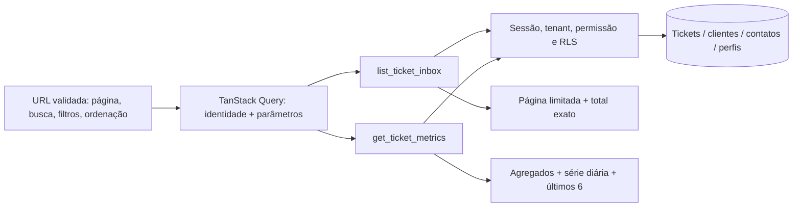

# Paginação de tickets e indicadores completos

Data: 17/11/2026. Base: `3bedd3b`, branch local `codex/priority-session-whatsapp`.

## 1. Stack Tecnológica & Ecossistema

Mantida a stack existente: React, TypeScript, TanStack Router/Query, Supabase/PostgreSQL, Zod e componentes locais. Nenhuma dependência do produto adicionada.

- `ticket-query.ts`: valida query string, filtros, whitelist de ordenação e respostas das RPCs.
- `use-tickets-inbox.ts`: consultas com chave incluindo usuário, tenant, página, tamanho, busca, filtros e ordenação; cancelamento pelo `AbortSignal`.
- `ConfigurableTable`: contrato remoto opcional, preservando paginação e ordenação locais das demais telas.
- Ferramentas opcionais de ensaio: PostgreSQL 17.6 portátil e Playwright/Chrome, instalados somente no diretório ignorado `node_modules/.cache/atomic-flow-tools`.

## 2. Infraestrutura & Deploy

Migration incremental: `supabase/migrations/20261117140000_ticket_pagination_metrics.sql`. Requer PostgreSQL com suporte ICU para a collation natural `pt-BR-u-kn-true`. O ensaio local confirmou criação, uso, rollback e reaplicação no PostgreSQL 17.6.

As RPCs executam como `SECURITY INVOKER`, derivam tenant da sessão, exigem `tickets.view` e preservam as políticas RLS existentes. `anon` e `public` não recebem execução. O browser continua usando somente a chave publicável; nenhuma variável nova é necessária.

Publicação, ainda não executada:

1. Aplicar as migrations anteriores pendentes, incluindo `20261117120000_atomic_onboarding_portal_chat.sql`, e depois a nova migration de paginação.
2. Confirmar RPCs, grants, collation e recarga do schema PostgREST em homologação.
3. Publicar o web e validar listagem, filtros, Kanban e dashboard com sessão autorizada e sessão sem permissão.

Para reverter, restaurar primeiro o web anterior e depois executar `supabase/rollbacks/20261117140000_ticket_pagination_metrics.sql`. O rollback remove funções/collation e não exclui chamados. Publicar o web novo antes das RPCs deixa os respectivos fluxos indisponíveis.

## 3. Arquitetura & Conceitos de Domínio



`list_ticket_inbox` retorna uma página de 10/20/30/50/100 registros, total exato e página corrigida para a última válida. O retorno JSON evita que o teto de linhas do PostgREST trunque o total. A busca é literal, case/accent-insensitive; nomes relacionados continuam sujeitos às respectivas políticas. Ordenação tem whitelist, comparação textual natural em português e desempate por ID.

`get_ticket_metrics` agrega todos os chamados visíveis, eliminando o antigo corte de 500 registros do dashboard. A série de 7/14/30 dias usa datas de `America/Sao_Paulo`; os totais do período excluem datas futuras. A visão geral mantém a janela móvel dos últimos sete dias. A média de resolução considera chamados concluídos com duração não negativa, usando `resolved_at` ou, na ausência, `closed_at`. Contagens por estado e média de resolução abrangem todo o histórico visível; o seletor de período afeta volume e comparação de criação. SLA vencido exclui concluídos, avulsos e pausados e utiliza o mesmo fallback de quatro horas da lista para contratos legados sem prazo.

## 4. Inventário de Funcionalidades (Features)

| Módulo | Correção | Arquivos principais |
|---|---|---|
| Tickets | Paginação, busca com debounce de 350 ms, filtros e ordenação no servidor; estado na URL | `routes/_authenticated/tickets.tsx`, `hooks/use-tickets-inbox.ts` |
| Tabela | Usa a página recebida sem repaginar/reordenar no browser; total e controles remotos | `components/configurable-table.tsx` |
| Concorrência de interface | Controles bloqueados durante consulta ou placeholder, inclusive offline; snapshot conserva página e tamanho coerentes | Rota de tickets e contrato `RemoteTableState` |
| Kanban | Pagina com a mesma consulta; informa que cards/contadores representam a página atual; mutação invalida o cache paginado | `TicketInboxKanban.tsx` |
| Dashboard/visão geral | Indicadores completos, agregação SQL, atualização e erro visíveis | `dashboard.tsx`, `TicketOverview.tsx` |
| Mobile e teclado | Filtros sob demanda, áreas de toque ampliadas, número persistente na rolagem horizontal, limpar busca/`Escape`, `aria-sort` e foco | `TicketFilters.tsx`, `TicketInboxList.tsx`, tabela |

Listagem vazia e ausência de resultados têm mensagens distintas. Falha inicial oferece nova tentativa; falha ao atualizar dados existentes sinaliza o erro e mantém os dados. Detalhes internos do banco não aparecem na mensagem da listagem.

## 5. Code Quality & Technical Debt (Bônus Técnico)

Evidências da entrega:

- PostgreSQL descartável: mais de 1.200 chamados, total completo, páginas disjuntas/estáveis, última página ajustada, busca literal/com acentos, filtros combinados e entrada inválida; acesso de outro tenant, usuário sem permissão e anônimo; datas locais, durações históricas/inválidas, pausas e fallback de SLA; rollback/reaplicação.
- 144 testes da API em 21 suítes; oito regressões de isolamento de sessão e quatro testes reais de tabela (modo remoto, bloqueio em atualização e comportamento local).
- Fronteiras Zod e ensaio Chrome com build compilado: navegação, histórico, busca, ordenação por teclado, limpeza via `Escape`, lista/Kanban, troca de tamanho com resposta atrasada/offline e mensagem sem erro interno.
- Inspeção de screenshots em desktop 1440, tablet 768 e mobile 390, nos temas claro/escuro e com fontes externas bloqueadas para exercitar fallbacks.
- Typechecks e builds web/API, lint de segurança e lint web verificados. O lint web global no Windows exige a exceção local `endOfLine: auto` por CRLF do checkout; permanecem dez warnings preexistentes de Fast Refresh. A exceção não foi gravada na configuração do projeto.

O runner PostgreSQL local usa DDL/políticas reais selecionados do snapshot; não reproduz todo o Supabase. O teste SQL entra automaticamente no job completo do CI, que não foi executado localmente. O ensaio de navegador usa respostas HTTP sintéticas, complementando os testes reais de autorização no banco; não valida a configuração do servidor de produção.

Próximos pontos estruturais: avaliar índices e planos com a distribuição real de dados antes de grandes volumes; a contagem exata e filtros textuais ainda percorrem os registros visíveis, e o dashboard faz uma consulta adicional para os últimos chamados. Preferências globais de colunas ainda precisam impedir ocultação de todos os identificadores e persistir tamanho por usuário/listagem. Não são declaradas resolvidas nesta entrega.

Nenhuma conexão, migration ou publicação em produção foi realizada.

Reprodução local no Windows (Node 22 e Chrome instalado; ferramentas opcionais fora das dependências do produto):

```powershell
npm.cmd install --prefix node_modules/.cache/atomic-flow-tools --no-package-lock --ignore-scripts @embedded-postgres/windows-x64@17.6.0-beta.15 pg@8.23.1 playwright@1.65.1
node scripts/security/test-atomic-workflows-postgres.mjs --tickets
node scripts/security/test-ticket-query.mjs
node --test scripts/security/test-session-query-cache.mjs scripts/security/test-table-remote.mjs
$env:VITE_SUPABASE_URL = 'https://fixture-supabase.example.test'
$env:VITE_SUPABASE_PUBLISHABLE_KEY = 'fixture-public'
$env:NITRO_PRESET = 'node-server'
pnpm --filter web build
node scripts/security/test-ticket-ui.mjs
```

Os screenshots ficam no diretório ignorado `node_modules/.cache/ticket-ui-qa`. `CHROME_PATH` permite indicar outro executável do Chrome. Os processos de teste recebem somente URLs/credenciais sintéticas; o build de fixture acima não deve ser usado para publicação.
