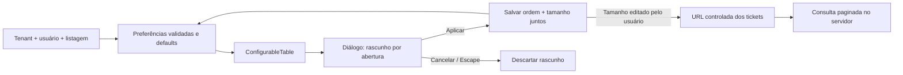

# Configuração consistente das listagens

Data: 17/11/2026. Base: `d99cfb3`, branch local `codex/priority-session-whatsapp`.

## 1. Stack Tecnológica & Ecossistema

Mantida a stack existente; nenhuma dependência adicionada. `lib/table-preferences.ts` reúne os tipos, validação Zod, política de colunas e armazenamento. `use-column-preferences.ts` aplica essa política ao contexto de autenticação. O fluxo usa os componentes React/Radix e o Router/Query existentes.

O metadado de coluna aceita `identifier` e `required`. Se nenhum identificador estiver declarado, a primeira coluna serve como identificação, preservando compatibilidade com as listagens existentes. A caixa de tickets declara explicitamente o número do chamado.

## 2. Infraestrutura & Deploy

Esta entrega altera somente o web e seus testes/documentação; não exige migration adicional. A versão acumulada continua dependendo das RPCs das migrations anteriores, descritas em [paginação e indicadores](./paginacao-indicadores-20261117.md). Aplicar essas migrations antes de publicar a versão acumulada.

As preferências ficam no navegador em um registro versionado, separado por tenant, usuário e `listKey`. Arrays legados `cols:<usuário>:<listKey>` são normalizados e importados para um único contexto, com vínculo de migração; o valor legado permanece disponível para reversão do web. O formato não contém linhas de negócio, credenciais nem tokens.

Storage bloqueado ou inválido usa defaults seguros. Quando a gravação não é permitida, alterações continuam utilizáveis em memória. Não há sincronização automática da configuração entre dispositivos ou abas já abertas. A importação legada não constitui uma transação entre abas concorrentes.

Para reverter, restaurar a versão web anterior. Registros do novo formato não são usados pelo código antigo; não é necessário apagar dados ou executar SQL. Nenhum push, deploy ou acesso à produção ocorreu nesta entrega.

## 3. Arquitetura & Conceitos de Domínio



Normalização remove colunas inexistentes e duplicadas, restaura obrigatórias e mantém ao menos um identificador. Tamanhos válidos: 10, 20, 30, 50 e 100; fallback 10.

Na caixa de tickets, uma URL com tamanho explícito prevalece sobre a preferência. Se estiver ausente, a validação SSR conserva a ausência; o navegador lê a preferência, materializa o tamanho na URL e só então habilita a consulta. Isso evita uma consulta provisória com tamanho diferente e mantém o histórico reproduzível.

O snapshot paginado conserva página/tamanho dos dados recebidos. O tamanho solicitado na URL é um campo separado. O diálogo acompanha alterações externas de tamanho enquanto o seletor não foi editado; editar somente colunas não dispara mudança de tamanho nem volta à página 1. Uma escolha explícita no seletor ou `Restaurar padrão` pode mudar o tamanho e reiniciar a página conforme o contrato.

## 4. Inventário de Funcionalidades (Features)

| Fluxo | Comportamento corrigido |
|---|---|
| Visibilidade | Último identificador e colunas obrigatórias não podem ser ocultados; storage antigo/inválido também passa pela política |
| Aplicar | Ordem, visibilidade e tamanho são gravados juntos; a tabela continua funcional com storage indisponível |
| Cancelar / Escape | Descartam alterações e devolvem foco ao botão `Colunas` |
| Restaurar padrão | Recupera os defaults reais da listagem, inclusive colunas ocultas originalmente e tamanho 10; persiste apenas após Aplicar |
| Atualização dos dados | Rascunho preservado entre renders e refetches; abertura bloqueada durante snapshot remoto pendente |
| Preferências | Configurações novas isoladas por tenant, usuário e listagem; tamanho restaurado nas listagens locais e remotas |
| Acessibilidade | Checkboxes e botões de ordenação nomeados, explicação da identificação obrigatória, foco restaurado e controles de 44 px no celular |

Arquivos centrais: `components/configurable-table.tsx`, `components/column-settings-dialog.tsx`, `hooks/use-column-preferences.ts`, `lib/table-preferences.ts`, `lib/ticket-query.ts`, rota/hook de tickets.

## 5. Code Quality & Technical Debt (Bônus Técnico)

Regressões reproduzidas antes das correções:

- Hook real permitia remover identificação/obrigatórias, preservava duplicatas e compartilhava configuração entre tenants do mesmo usuário.
- Diálogo real no Chrome perdia rascunho após atualização dos tickets.
- SSR respondia `307` inserindo `pageSize=10` antes de o navegador ler a preferência 100; reproduzido também por HTTP local sem navegador.
- Revisão independente reproduziu abertura sobre snapshot pendente e aplicação de tamanho antigo após uma mudança externa. Dois testes reais foram adicionados, falhando antes da correção.

Validação:

- **22 regressões** de sessão, hook, storage e tabela; fronteiras da query e SSR aprovadas.
- **144 testes da API**, 21 suítes, aprovados.
- Build e typecheck web/API e lint de segurança verificados. Lint web global sem erros com a exceção local `endOfLine: auto` para o CRLF do checkout Windows; dez warnings preexistentes de Fast Refresh. A configuração do projeto não foi alterada.
- Chrome sobre build compilado e backend sintético: rascunho durante atualização, identificação bloqueada, reordenação, aplicação apenas de colunas sem mudar página, Cancelar, Escape, defaults, tamanho 100 restaurado sem consulta provisória, URL explícita 20, nova restauração 100, paginação offline e erros humanos.
- Screenshots do diálogo e das telas em desktop 1440, tablet 768 e mobile 390, claro/escuro; fontes externas bloqueadas para conferir fallbacks. Revisão independente final sem outros achados críticos/importantes.

Reprodução:

```powershell
node --test scripts/security/test-table-remote.mjs scripts/security/test-session-query-cache.mjs
node scripts/security/test-ticket-query.mjs
# Usar o build de fixture e as ferramentas opcionais descritos no relatório anterior.
node scripts/security/test-ticket-ui.mjs
```

Os testes ampliados de tabela/query já participam do workflow existente. O ensaio Chrome é opcional local, com screenshots em `node_modules/.cache/ticket-ui-qa`. Não foi executado um pipeline remoto nesta entrega. Os testes usam identidades e respostas sintéticas; não atestam a configuração de produção.

A materialização do histórico do dashboard foi otimizada na [entrega posterior de agregações](./dashboard-agregacoes-20261118.md), com equivalência e EXPLAIN em fixture PostgreSQL. Observação de planos com distribuição real e os itens operacionais de observabilidade/bootstrap continuam no acompanhamento da publicação; a fixture não justificou um novo índice de tickets.
