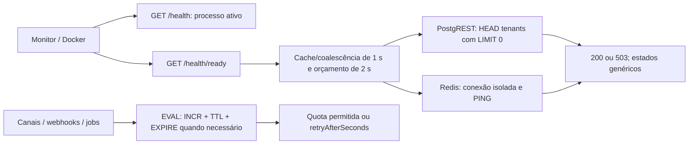

# Prontidão da API e expiração do limitador Redis

Data: 17/11/2026. Base: `86e7f50`, branch local `codex/priority-session-whatsapp`.

## 1. Stack Tecnológica & Ecossistema

Mantidos NestJS, ioredis 6, Supabase JS e BullMQ existentes. Nenhuma dependência do produto adicionada.

- `queue/redis-rate-limit.ts`: script Lua, validação de configuração e decodificação da resposta.
- `queue/redis.service.ts`: limitador compartilhado pelos canais, webhooks e consumidores da API.
- `health/readiness.service.ts`: probes limitados e coalescidos de PostgREST e Redis.
- Fengari 0.1.4 é ferramenta opcional de ensaio local, instalada somente no diretório ignorado `node_modules/.cache/atomic-flow-tools`.

O uso de Lua elimina o intervalo entre comandos do cliente e o interleaving com outros comandos Redis. A própria documentação descreve a condição de corrida entre `INCR` e `EXPIRE` e a correção com `EVAL`. [Referência oficial Redis](https://redis.io/docs/latest/commands/incr/).

## 2. Infraestrutura & Deploy

O Dockerfile da API e o compose versionado passam a usar `/health/ready`, com timeout do comando de 3,5 s e timeout externo de 5 s. O comando respeita `PORT`, com fallback 3001, e usa loopback. Configurações próprias do Dokploy ou do balanceador podem sobrescrever o healthcheck da imagem; devem ser conferidas na publicação.

Não há migration ou variável de ambiente adicional. Permanecem `REDIS_URL`, `SUPABASE_URL` e `SUPABASE_SERVICE_ROLE_KEY` da API. O probe usa as credenciais já configuradas, sem devolvê-las na resposta ou registrar os erros originais. O Redis deve permitir os comandos utilizados pelo aplicativo, incluindo `EVAL`, `INCR`, `TTL` e `EXPIRE`.

Publicação, ainda não executada:

1. Publicar a nova imagem da API e confirmar a configuração efetiva de healthcheck.
2. Conferir `/health` e `/health/ready` pela rede interna do container.
3. Em homologação isolada, interromper as dependências e conferir 503, recuperação e encerramento dos probes. Não provocar indisponibilidade no Redis ou Supabase compartilhado de produção como teste.
4. Conferir separadamente workers e entrega de jobs: prontidão de conexão não substitui esses sinais.

Reversão: restaurar a imagem anterior e, se usado, o compose anterior. Não excluir ou limpar chaves de negócio. As chaves do limitador mantêm o mesmo formato e namespace; as que estavam sem expiração recebem TTL na próxima utilização válida.

Nenhum push, deploy, migration ou acesso à produção ocorreu nesta entrega.

## 3. Arquitetura & Conceitos de Domínio



`/health` conserva `{ "ok": true }` e não consulta dependências. `/health/ready` é público e responde, por exemplo:

```json
{"ok":false,"checks":{"database":"up","redis":"down"}}
```

HTTP 200 exige ambos os probes positivos; falhas retornam 503. As duas rotas usam `Cache-Control: no-store`; o cache de 1 s é interno ao processo e inclui falhas. Chamadas simultâneas compartilham o mesmo ensaio.

O PostgREST recebe HEAD com limite zero: verifica o caminho de acesso ao schema `apticket` sem retornar linhas ou contagens de negócio. O Redis usa conexão separada, sem fila offline nem retry; o prazo cancela o HTTP e desconecta o probe. `disconnectTimeout: 0` impede que o ioredis mantenha o socket aberto por mais 2 s depois do timeout. A conexão principal do aplicativo não é encerrada pelo healthcheck.

O limitador valida limite/janela antes de Redis e rejeita respostas malformadas. O script incrementa o contador e atribui expiração quando o TTL está ausente, preservando janelas válidas, inclusive contador zero. TTL zero retorna espera mínima de um segundo. A semântica continua sendo janela fixa; não há promessa de exactly-once nem de rollback de erros internos do Redis. Uma resposta perdida pode consumir quota mesmo sem concluir a operação protegida.

## 4. Inventário de Funcionalidades (Features)

| Módulo | Alteração |
|---|---|
| Limites da API | Uma execução Lua para contador/expiração; recuperação de TTL legado e validação na fronteira |
| Processo ativo | `/health` continua leve e público |
| Prontidão | `/health/ready` diferencia indisponibilidade de Redis/PostgREST com estado genérico e deadline |
| Recursos dos probes | AbortSignal para HTTP; conexão Redis isolada, sem retry/offline queue, e encerramento imediato |
| Hospedagem | Dockerfile e compose passam a verificar prontidão |
| CI | Ensaios de SDK/sockets locais e serviço Redis descartável para o teste de concorrência/expiração |

Não há alteração visual ou de regras de domínio, permissões de negócio, pagamentos ou mensagens. Os probes não enviam e-mail, WhatsApp ou chamadas bancárias.

## 5. Code Quality & Technical Debt (Bônus Técnico)

Evidências locais:

- RED: falha entre incremento e expiração, contador legado sem TTL, espera incorreta no TTL zero e configurações/respostas inválidas. Os 13 cenários do limitador passaram após a correção.
- RED HTTP: a rota de prontidão não existia e respondia 404. Os testes novos conferem 200/503 com guard real, resposta sem segredos, ausência de consultas em liveness, cache/coalescência e deadline.
- **162 testes API, 23 suítes**, aprovados. Typecheck, build e lint API aprovados; lint de segurança sem erros, com warnings existentes.
- Script Lua executado de fato em Fengari, com comandos Redis simulados: rajada de 100 chamadas, manutenção da expiração, reparo de chave sem TTL, contador zero, TTL zero e nova janela. Isso não equivale a um Redis real.
- A revisão independente reproduziu socket Redis meio-aberto além do deadline. O novo ensaio com ioredis real e servidor TCP loopback reproduziu RED e passou após a correção.
- SDK Supabase real contra HTTP local: HEAD, schema `apticket`, limite zero e cancelamento comprovados. O comando Node extraído do Dockerfile foi executado contra respostas 200, 503 e endpoint sem resposta.
- Sintaxe dos dois YAMLs validada. Revisão independente final sem outros achados críticos/importantes.

O workflow inclui Redis 7 descartável e o teste `test-redis-rate-limit.mjs`, com 100 chamadas concorrentes, quota exata, recuperação de chave sem TTL, preservação da janela/contador zero e nova janela após expiração. Usa somente loopback, credenciais sintéticas e chaves próprias com UUID, removidas ao final. **Esse ensaio com Redis real e o workflow remoto não foram executados localmente:** não há Redis/Docker/WSL instalado. Também não foi construído um container Docker neste ambiente; o teste do comando não substitui o build da imagem.

Reprodução local, após `pnpm --filter api build`:

```powershell
pnpm --filter api exec jest --runInBand
node scripts/security/test-api-readiness.mjs
# Opcional: instala ferramenta somente no cache ignorado, fora do produto.
npm.cmd install --prefix node_modules/.cache/atomic-flow-tools --no-package-lock --ignore-scripts fengari@0.1.4
node scripts/security/test-redis-rate-lua.mjs
# Somente com Redis de testes descartável em loopback:
node scripts/security/test-redis-rate-limit.mjs
```

Permanecem fora do alcance desse sinal: progresso dos workers, idade das filas, entrega de mensagens, disponibilidade de Storage/antivírus/provedores externos, alertas centralizados e recuperação operacional. Um 200 de prontidão não certifica esses fluxos.
