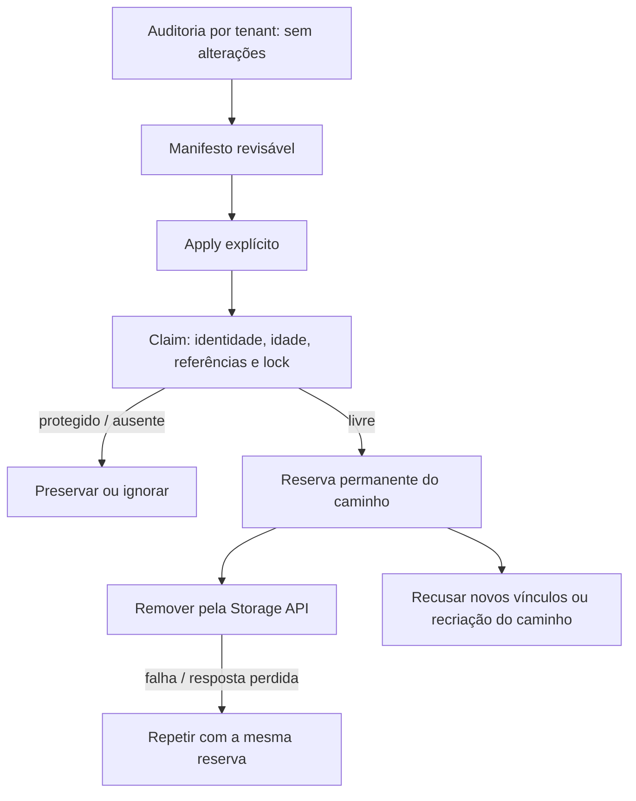

# Reconciliação de anexos órfãos

Data: 18/11/2026. Base: `aebaebe`; branch local `codex/priority-session-whatsapp`.

## 1. Stack Tecnológica & Ecossistema

PostgreSQL/Supabase Storage, cliente Supabase JS existente e CLI Node.js. Nenhuma dependência nova do produto. O escopo é `ticket-attachments`, bucket dos uploads de tickets, ingestões e stickers cobertos pelo achado de retry. A ferramenta rejeita outros buckets; não faz varredura geral de discos ou antivírus do acervo.

Arquivos: `scripts/storage/reconcile-ticket-storage.mjs`, módulo/testes adjacentes, migration/rollback `20261117190000_ticket_storage_reconciliation.sql`, teste SQL e ensaios HTTP/PostgreSQL em `scripts/security`.

## 2. Infraestrutura & Deploy

Aplicar a migration pelo procedimento habitual do ambiente antes de usar a CLI. As funções `audit_ticket_storage` e `claim_ticket_storage_orphan` são operacionais, `SECURITY DEFINER`, com `search_path=pg_catalog`, objetos qualificados e EXECUTE somente para service role, além do proprietário. Claims ficam em schema privado com RLS e sem acesso direto de browser/service role.

A CLI exige `APTICKET_STORAGE_URL` e `APTICKET_STORAGE_SERVICE_KEY` explícitas; não lê `.env`, não usa credenciais fornecidas no histórico da conversa e não envia chave ao browser. Não há endpoint UI novo. O cliente recusa redirects e limita cada requisição a 15 s. Logs são genéricos e relatórios não contêm a chave.

Modo padrão: auditoria, sem DELETE ou claim. Retenção padrão de 30 dias, mínimo sete dias; considera tanto criação quanto última atualização. Paginação por nome em ordenação C, padrão 100 e máximo 500 por página. O inventário para em 10.000 objetos por padrão (máximo 50.000) e marca `truncated` quando o limite é atingido. Não interpretar inventário parcial como contagem completa do bucket.

Operação, depois de revisar o inventário e configurar as duas variáveis em sessão privada:

```powershell
node scripts/storage/reconcile-ticket-storage.mjs --tenant <uuid-do-tenant> --report <diretorio-privado>/storage-audit.json
# Após revisão concreta dos candidatos; não há aplicação automática:
node scripts/storage/reconcile-ticket-storage.mjs --apply <diretorio-privado>/storage-audit.json --report <diretorio-privado>/storage-result.json
```

Guardar relatórios fora do repositório, em diretório privado com ACL apropriada: eles contêm caminhos e IDs. A CLI não sobrescreve relatórios existentes. O `--apply` herda tenant/retenção/destino do manifesto e exige que o destino corresponda à URL configurada; o manifesto completo é validado antes da primeira RPC. Se ocorrer falha no meio do processo, algumas operações podem ter terminado; não há transação global envolvendo Storage. Repetir o mesmo manifesto com novo caminho de relatório é seguro: reservas permanecem, remoções são idempotentes e cada item é revalidado pelo banco. O contador `deletedOrAbsent` significa sucesso da Storage API, incluindo objeto já ausente.

**Rollback:** antes do primeiro claim, remove as novas funções, triggers e tabela. Depois de qualquer claim, recusa remover guardas e exige análise operacional. O rollback trava a tabela antes de verificar claims; não pode ignorar uma reserva concorrente. Não apagar claims para forçar rollback: uma requisição antiga de exclusão ainda pode chegar ao Storage. Caminhos recolhidos são permanentemente aposentados; produtores devem continuar usando nomes novos, como já fazem os uploads cobertos.

Nenhuma exclusão, migration, push, publicação ou acesso a serviço real ocorreu neste lote.

## 3. Arquitetura & Conceitos de Domínio

A auditoria classifica objetos como `referenced`, `recent`, `invalid` ou `candidate`. Conserva vínculos de mensagens, pendências de e-mail/WhatsApp, stickers, bindings privados e permits de upload ainda válidos. Os extratores reconhecem `path` e o legado `storage_path`, inclusive em JSON aninhado. O teste de referências não se limita ao tenant da linha de negócio, preservando também vínculos históricos inconsistentes que reutilizem o caminho. Caminhos inválidos são reportados e nunca coletados.

O manifesto é um diagnóstico, não autorização suficiente para excluir. O claim reconsulta o objeto pelo ID, tenant, bucket, idade e referências. Referência criada depois da auditoria protege o objeto. O claim e as guardas de escrita em mensagens, pendências, stickers e metadados Storage adquirem o mesmo advisory lock exclusivo do caminho. Depois de adquirido o lock, o claim verifica novamente com snapshot novo. Por isso claim e guardas exigem `READ COMMITTED`; transações com outro isolamento que tentem esses vínculos são recusadas.



O ordenamento dos locks de paths dentro de cada array reduz deadlocks. Transações de múltiplas linhas e DDL ainda podem sofrer deadlock/timeout; o PostgreSQL aborta a operação e as proteções permanecem. A ferramenta não desabilita triggers ou RLS. A remoção de bytes usa exclusivamente a Storage API, sem DELETE SQL em `storage.objects`.

## 4. Inventário de Funcionalidades (Features)

| Módulo | Resultado |
|---|---|
| Inventário | Cursor, limite, escopo de tenant, retenção e relatório de candidatos/protegidos |
| Exclusão explícita | Manifesto validado, nova consulta transacional e DELETE somente após claim correspondente |
| Concorrência | Escritores tardios e recriação de caminhos bloqueados pelas guardas |
| Recuperação | Reserva permanente permite retry após falha de rede/Storage |
| Histórico | Mensagens, pendências, stickers e bindings preservados, inclusive `storage_path` legado |
| CI | Testes do módulo e CLI/SDK HTTP no job application; teste SQL autodescoberto no job full-sql |

## 5. Code Quality & Technical Debt (Bônus Técnico)

Evidências locais registradas no plano de conclusão das pendências médias:

- RED SQL por ausência das RPCs, seguido de GREEN no PostgreSQL 17.6 real com referências, idade, escopo, cursor, claims idempotentes, guardas e permissões.
- Concorrência real com conexões independentes: escritor antes do claim resulta em `protected`; claim antes do escritor faz o vínculo tardio falhar. Conferidas guarda de Storage, rejeição de isolamento incompatível e serialização do rollback.
- Testes do módulo cobrem manifesto inválido/obsoleto, duplicatas, destino, cursor, truncamento, erros, caminhos inválidos e comprimento Unicode.
- CLI real com SDK contra HTTP loopback: schema/tenant, auditoria sem DELETE, claim seguido de Storage DELETE, proteção tardia, destino incorreto, recusa de sobrescrita e ausência de credencial no output.
- A revisão independente identificou e acompanhou correções de cursor inválido, Unicode, isolamento e corrida do rollback. O CI completo e a operação contra Supabase real permanecem validações externas distintas.
- Conferência da branch: dez testes do módulo, 172 testes API/26 suítes, build API, typechecks API/web e lint de segurança aprovados; este último conserva 140 warnings existentes e nenhum erro. YAML do workflow e sintaxe/formatação dos scripts verificados.

Reprodução local:

```powershell
node --test scripts/storage/reconciliation.test.mjs
node scripts/security/test-storage-reconciliation-http.mjs
# Requer ferramentas PostgreSQL opcionais no cache ignorado, conforme entregas anteriores:
node scripts/security/test-storage-reconciliation-postgres.mjs
```

Limites: somente produtores e campos de referência inventariados do bucket de tickets; novos produtores devem integrar a guarda e o inventário antes de usar esse bucket. Referências externas em formatos não canônicos exigem revisão própria. A auditoria pode percorrer referências JSON em volumes grandes e falhar por prazo; isso não autoriza excluir. Não há limpeza agendada nem execução automática em produção. `candidate` não significa arquivo infectado; a ferramenta não altera o parecer do antivírus.
